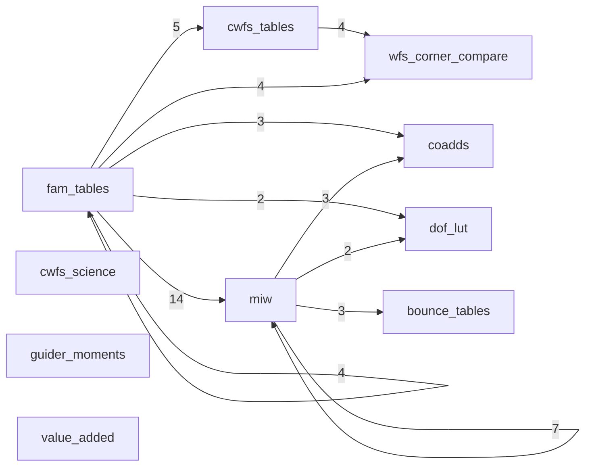

# Product map

> **Status:** generated · **Last updated:** 2026-10-26 · **Kind:** reference (index)

How the products feed each other, and which studies and code read each one. Generated by `python -m rubinwork.studies map` (and by `/review`); do not edit by hand. What each product is: [`rubinwork/products/README.md`](rubinwork/products/README.md). Builds: [`PRODUCTS.md`](PRODUCTS.md). Studies: [`STUDIES.md`](STUDIES.md).

Sources: **manifest** — a build's recorded inputs (exact); **declared** — a study's `uses:` (exact, but most studies leave it empty); **scanned** — tracked code that imports `rubinwork.products.<name>` or calls `catalog.path|load|manifest` with the product name as a literal (an inference).

## Product graph (manifest)

Arrows point from an input product to the product built from it; the number is the count of variants whose shown build (current, else latest) records that input.

## Variants and their inputs (manifest)

| product | variant | build shown | current | inputs |
|---|---|---|---|---|
| bounce_tables | `d12-A_50_34_i` | 20261025 | yes | miw: d12-A_50_34_i@20261025 |
| bounce_tables | `d12-A_50_34_i_5rot` | 20261025 | yes | miw: d12-A_50_34_i_5rot@20261025 |
| bounce_tables | `d12-A_50_34_i_5rot_july` | old-tree-20261001 | no | miw: d12-A_50_34_i_5rot@20261014 (fits_july.parquet, hand-made, old tree) |
| coadds | `d12-A_50_34_i_5rot` | 20261025 | yes | fam_tables: danish_1_2@20261025b; miw: d12-A_50_34_i_5rot@20261025 |
| coadds | `d12-A_50_34_i_5rot_v2` | old-tree-20260903 | no | fam_tables: danish_1_2@20261014; miw: d12-A_50_34_i_5rot@20261014 |
| coadds | `d13-A_50_34_i_5rot` | 20261025 | yes | fam_tables: danish_1_3@20261025b; miw: d13-A_50_34_i_5rot@20261025 |
| cwfs_science | `d13-blitz_rso1071` | 20261026 | yes |  |
| cwfs_tables | `d12-ai_donut` | 20261013 | yes | fam_tables: danish_1_2@20261013 |
| cwfs_tables | `d12-paired_3mm` | 20261013 | yes | fam_tables: danish_1_2@20261013 |
| cwfs_tables | `d12-refitWcs` | 20261013 | yes | fam_tables: danish_1_2@20261013 |
| cwfs_tables | `d12-tarts` | 20261013 | yes | fam_tables: danish_1_2@20261013 |
| cwfs_tables | `d13-blitz_unpaired` | 20261024 | yes | fam_tables: danish_1_3@20261024 |
| dof_lut | `d12-A_50_34_i` | 20261025 | yes | fam_tables: danish_1_2@20261025b; miw: d12-A_50_34_i@20261025 |
| dof_lut | `d12-A_50_34_i_5rot` | 20261025 | yes | fam_tables: danish_1_2@20261025b; miw: d12-A_50_34_i_5rot@20261025 |
| fam_tables | `danish_1_2` | 20261025b | yes | fam_tables: danish_1_2@20261025 |
| fam_tables | `danish_1_3` | 20261025b | yes | fam_tables: danish_1_3@20261025 |
| fam_tables | `danish_1_3_test` | 20261025b | yes | fam_tables: danish_1_3_test@20261025 |
| fam_tables | `danish_1_3_v1000` | 20261025b | yes | fam_tables: danish_1_3_v1000@20261025 |
| guider_moments | `v4` | nights/20260712 | no |  |
| miw | `d12-A_50_34_i` | 20261025 | yes | fam_tables: danish_1_2@20261025b |
| miw | `d12-A_50_34_i_5rot` | 20261025 | yes | fam_tables: danish_1_2@20261025b; miw: d12-A_50_34_i |
| miw | `d13-A_50_34_i` | 20261025 | yes | fam_tables: danish_1_3@20261025b |
| miw | `d13-A_50_34_i_5rot` | 20261025 | yes | fam_tables: danish_1_3@20261025b; miw: d13-A_50_34_i |
| miw | `d13t-A_50_34_i` | old-tree-20260928 | yes | fam_tables: danish_1_3_test@20261013 |
| miw | `d13t-A_50_34_i_5rot` | old-tree-20260928 | yes | fam_tables: danish_1_3_test@20261013; miw: d13t-A_50_34_i |
| miw | `d13v1000-A_22_12_i` | old-tree-20261007 | yes | fam_tables: danish_1_3_v1000@20261013 |
| miw | `d13v1000-A_22_12_i_5rot` | old-tree-20261007 | yes | fam_tables: danish_1_3_v1000@20261013; miw: d13v1000-A_22_12_i |
| miw | `d13v1000-A_50_34_i` | old-tree-20261006 | yes | fam_tables: danish_1_3_v1000@20261013 |
| miw | `d13v1000-A_50_34_i_5rot` | old-tree-20261006 | yes | fam_tables: danish_1_3_v1000@20261013; miw: d13v1000-A_50_34_i |
| miw | `d13v1000-A_50_34_i_rbr` | old-tree-20261006 | yes | fam_tables: danish_1_3_v1000@20261013 |
| miw | `d13v1000-A_50_34_i_rbr_5rot` | old-tree-20261006 | yes | fam_tables: danish_1_3_v1000@20261013; miw: d13v1000-A_50_34_i_rbr |
| miw | `d13v1000-A_50_50_i_rbr` | old-tree-20261007 | yes | fam_tables: danish_1_3_v1000@20261013 |
| miw | `d13v1000-A_50_50_i_rbr_5rot` | old-tree-20261007 | yes | fam_tables: danish_1_3_v1000@20261013; miw: d13v1000-A_50_50_i_rbr |
| miw | `official-20260528a` | external | no |  |
| miw | `official-gmegias-v3` | external | no |  |
| miw | `staged-v1` | external | no |  |
| value_added | `v1` | snapshots/20261025b | yes |  |
| wfs_corner_compare | `d12-ai_donut` | 20261024 | no | cwfs_tables: d12-ai_donut@20261013; fam_tables: danish_1_2@20261013 |
| wfs_corner_compare | `d12-paired_3mm` | 20260707 | no |  |
| wfs_corner_compare | `d12-refitWcs` | 20261024 | yes | cwfs_tables: d12-refitWcs@20261013; fam_tables: danish_1_2@20261013 |
| wfs_corner_compare | `d12-tarts` | 20261024 | no | cwfs_tables: d12-tarts@20261013; fam_tables: danish_1_2@20261013 |
| wfs_corner_compare | `d13-blitz_unpaired` | 20261024 | yes | cwfs_tables: d13-blitz_unpaired@20261024; fam_tables: danish_1_3@20261024 |

## Readers by product

### bounce_tables

Declared by studies (`uses:`): [aos/cwfs_lut](aos/cwfs_lut/study.md) d12-A_50_34_i_5rot_july@old-tree-20261001; [smatrix/regularized_inversion](smatrix/regularized_inversion/study.md) d12-A_50_34_i_5rot@current.

| reader | kind | files (scanned) | literal variants |
|---|---|---|---|
| [aos/cwfs_lut](aos/cwfs_lut/study.md) | study | 1: `aos/cwfs_lut/code/bounce_compare.py` |  |
| [smatrix/regularized_inversion](smatrix/regularized_inversion/study.md) | study | 1: `smatrix/regularized_inversion/code/run_penalty_matrix_compare.py` |  |

### coadds

| reader | kind | files (scanned) | literal variants |
|---|---|---|---|
| [aos/miw_origin](aos/miw_origin/study.md) | study | 3: `aos/miw_origin/code/analyze_dz_goodness_of_fit.py`, `aos/miw_origin/code/analyze_umode_null_coupling.py`, `aos/miw_origin/code/recompute_coadd_metrics.py` | `d12-A_50_34_i_5rot` |

### cwfs_science

Declared by studies (`uses:`): [aos/cwfs_blur_intra_extra](aos/cwfs_blur_intra_extra/study.md) d13-blitz_rso1071@20261026.

### cwfs_tables

Built into (manifest): `wfs_corner_compare`.

Declared by studies (`uses:`): [aos/cwfs](aos/cwfs/study.md) d12-refitWcs@20261013; [aos/cwfs](aos/cwfs/study.md) d13-blitz_unpaired@20261024.

| reader | kind | files (scanned) | literal variants |
|---|---|---|---|
| [aos/cwfs](aos/cwfs/study.md) | study | 3: `aos/cwfs/code/run_wfs_corner_compare.py`, `aos/cwfs/code/run_wfs_dof_compare.py`, `aos/cwfs/code/run_wfs_fam_compare.py` |  |
| [aos/processing_compare](aos/processing_compare/study.md) | study | 1: `aos/processing_compare/notebooks/aos_danish_tarts_compare_20260713.ipynb` |  |
| `fam_tables` | product | 1: `rubinwork/products/fam_tables/gen_param_sets.py` |  |
| `miw` | product | 1: `rubinwork/products/miw/Snakefile` |  |
| `wfs_corner_compare` | product | 1: `rubinwork/products/wfs_corner_compare/builders/build_wfs_corner_compare.py` |  |
| `rubinwork.products` | library | 1: `rubinwork/products/stage_scratch_product.py` |  |

### dof_lut

| reader | kind | files (scanned) | literal variants |
|---|---|---|---|
| [aos/processing_compare](aos/processing_compare/study.md) | study | 1: `aos/processing_compare/code/compare_fam_processings.py` |  |

### fam_tables

Built into (manifest): `coadds`, `cwfs_tables`, `dof_lut`, `fam_tables`, `miw`, `wfs_corner_compare`.

Declared by studies (`uses:`): [aos/cwfs](aos/cwfs/study.md) danish_1_2@20261013; [aos/cwfs](aos/cwfs/study.md) danish_1_3@20261024; [aos/miw_hull](aos/miw_hull/study.md) danish_1_2@20261014; [aos/unpaired_intra_vs_extra](aos/unpaired_intra_vs_extra/study.md) danish_1_3_test@20261013; [aos/unpaired_intra_vs_extra](aos/unpaired_intra_vs_extra/study.md) danish_1_3_v1000@20261013.

| reader | kind | files (scanned) | literal variants |
|---|---|---|---|
| [aos/closed_loop](aos/closed_loop/study.md) | study | 1: `aos/closed_loop/code/run_closed_loop.py` |  |
| [aos/correlations](aos/correlations/study.md) | study | 4: `aos/correlations/code/run_aberration_pairs.py`, `aos/correlations/code/run_dz_explained.py`, `aos/correlations/code/run_thermal_correlations.py`, `aos/correlations/code/run_vmode_correlations.py` |  |
| [aos/cwfs](aos/cwfs/study.md) | study | 3: `aos/cwfs/code/run_wfs_corner_compare.py`, `aos/cwfs/code/run_wfs_dof_compare.py`, `aos/cwfs/code/run_wfs_fam_compare.py` |  |
| [aos/dzfit](aos/dzfit/study.md) | study | 2: `aos/dzfit/code/run_dz_fit_check.py`, `aos/dzfit/code/run_dz_plots.py` |  |
| [aos/miw_origin](aos/miw_origin/study.md) | study | 2: `aos/miw_origin/code/recompute_coadd_metrics.py`, `aos/miw_origin/code/run_fam_coadd_miw.py` |  |
| [aos/psf_fp_maps](aos/psf_fp_maps/study.md) | study | 1: `aos/psf_fp_maps/code/run_psf_fp_maps.py` |  |
| [aos/unpaired_intra_vs_extra](aos/unpaired_intra_vs_extra/study.md) | study | 2: `aos/unpaired_intra_vs_extra/extract_visit_medians.py`, `aos/unpaired_intra_vs_extra/fetch_exposure_times.py` |  |
| [aos/wfs_mimic](aos/wfs_mimic/study.md) | study | 1: `aos/wfs_mimic/code/run_wfs_mimic.py` |  |
| [psf/wavefront_to_psf](psf/wavefront_to_psf/study.md) | study | 1: `psf/wavefront_to_psf/notebooks/wavefront_to_psf.ipynb` |  |
| `coadds` | product | 1: `rubinwork/products/coadds/Snakefile` |  |
| `cwfs_tables` | product | 2: `rubinwork/products/cwfs_tables/Snakefile`, `rubinwork/products/cwfs_tables/builders/run_wfs_mktable.py` |  |
| `dof_lut` | product | 1: `rubinwork/products/dof_lut/Snakefile` |  |
| `miw` | product | 1: `rubinwork/products/miw/Snakefile` |  |
| `value_added` | product | 1: `rubinwork/products/value_added/builders/build_fam_dz.py` |  |
| `wfs_corner_compare` | product | 1: `rubinwork/products/wfs_corner_compare/builders/build_wfs_corner_compare.py` |  |
| `rubinwork.products` | library | 1: `rubinwork/products/stage_scratch_product.py` |  |
| `notes` | topic code, no study | 1: `notes/status/phase6_ccd_height_sign/ccd_height_sign_v1.ipynb` |  |
| `optatmo` | topic code, no study | 2: `optatmo/code/campaign.py`, `optatmo/code/data_fit.py` |  |

### guider_moments

Declared by studies (`uses:`): [guider/guider_atmo_sim](guider/guider_atmo_sim/study.md) v4@current; [guider/guider_ellipticity_ensemble](guider/guider_ellipticity_ensemble/study.md) v4@current.

| reader | kind | files (scanned) | literal variants |
|---|---|---|---|
| [guider/guider_atmo_sim](guider/guider_atmo_sim/study.md) | study | 1: `guider/guider_atmo_sim/code/guider_atmo_compare.py` |  |
| [guider/guider_ellipticity_ensemble](guider/guider_ellipticity_ensemble/study.md) | study | 2: `guider/guider_ellipticity_ensemble/notebooks/guider_moments_ensemble.ipynb`, `guider/guider_ellipticity_ensemble/notebooks/guider_star_ellipticity.ipynb` |  |

### miw

Built into (manifest): `bounce_tables`, `coadds`, `dof_lut`, `miw`.

Declared by studies (`uses:`): [aos/cwfs](aos/cwfs/study.md) d12-A_50_34_i@current; [aos/cwfs](aos/cwfs/study.md) d12-A_50_34_i_5rot@current; [aos/miw_hull](aos/miw_hull/study.md) d12-A_50_34_i@20261014; [aos/miw_hull](aos/miw_hull/study.md) d12-A_50_34_i_5rot@20261014; [aos/miw_recovery_constraint](aos/miw_recovery_constraint/study.md) d13t-A_50_34_i@old-tree-20260928; [aos/miw_recovery_constraint](aos/miw_recovery_constraint/study.md) d13v1000-A_22_12_i@old-tree-20261007; [aos/miw_recovery_constraint](aos/miw_recovery_constraint/study.md) d13v1000-A_50_34_i@old-tree-20261006; [aos/miw_recovery_constraint](aos/miw_recovery_constraint/study.md) d13v1000-A_50_34_i_rbr@old-tree-20261006; [aos/miw_recovery_constraint](aos/miw_recovery_constraint/study.md) d13v1000-A_50_50_i_rbr@old-tree-20261007; [aos/miw_version_comparisons](aos/miw_version_comparisons/study.md) d13t-A_50_34_i_5rot@old-tree-20260928.

| reader | kind | files (scanned) | literal variants |
|---|---|---|---|
| [aos/bounce](aos/bounce/study.md) | study | 2: `aos/bounce/code/bounce_lib.py`, `aos/bounce/code/run_bounce.py` |  |
| [aos/closed_loop](aos/closed_loop/study.md) | study | 1: `aos/closed_loop/code/run_closed_loop.py` |  |
| [aos/correlations](aos/correlations/study.md) | study | 4: `aos/correlations/code/run_dz_correlations.py`, `aos/correlations/code/run_dz_explained.py`, `aos/correlations/code/run_thermal_correlations.py`, `aos/correlations/code/run_vmode_correlations.py` |  |
| [aos/cwfs](aos/cwfs/study.md) | study | 1: `aos/cwfs/code/run_wfs_dof_compare.py` |  |
| [aos/miw_hull](aos/miw_hull/study.md) | study | 3: `aos/miw_hull/code/azimuth_probe.py`, `aos/miw_hull/code/continued_rings.py`, `aos/miw_hull/code/ring_coverage.py` |  |
| [aos/miw_origin](aos/miw_origin/study.md) | study | 9: `aos/miw_origin/code/analyze_dz_goodness_of_fit.py`, `aos/miw_origin/code/analyze_miw_dz_full_k.py`, `aos/miw_origin/code/analyze_umode_null_coupling.py`, `aos/miw_origin/code/camera_gravity_maps.py`, `aos/miw_origin/code/recompute_coadd_metrics.py`, `aos/miw_origin/code/run_fam_coadd_miw.py`, `aos/miw_origin/code/run_m3_backprojection_miw.py`, `aos/miw_origin/code/run_miw_backprojection_surfaces.py`, `aos/miw_origin/code/run_miw_joint_fit.py` | `d12-A_50_34_i_5rot` |
| [aos/miw_recovery_constraint](aos/miw_recovery_constraint/study.md) | study | 3: `aos/miw_recovery_constraint/code/check_dof_ranges.py`, `aos/miw_recovery_constraint/code/compare_rbr_arms.py`, `aos/miw_recovery_constraint/code/compare_schemes.py` |  |
| [aos/miw_version_comparisons](aos/miw_version_comparisons/study.md) | study | 2: `aos/miw_version_comparisons/code/compare_miw_versions.py`, `aos/miw_version_comparisons/code/compare_pupil_models.py` |  |
| [aos/psf_fp_maps](aos/psf_fp_maps/study.md) | study | 1: `aos/psf_fp_maps/code/run_psf_fp_maps.py` |  |
| [aos/wfs_mimic](aos/wfs_mimic/study.md) | study | 1: `aos/wfs_mimic/code/run_wfs_mimic.py` |  |
| [optatmo/miw_radial_correlations](optatmo/miw_radial_correlations/study.md) | study | 1: `optatmo/miw_radial_correlations/code/plot_miw_radial_correlations.py` |  |
| `bounce_tables` | product | 1: `rubinwork/products/bounce_tables/Snakefile` |  |
| `coadds` | product | 2: `rubinwork/products/coadds/Snakefile`, `rubinwork/products/coadds/builders/run_coadd_blocks_miw.py` |  |
| `dof_lut` | product | 1: `rubinwork/products/dof_lut/Snakefile` |  |
| `value_added` | product | 2: `rubinwork/products/value_added/builders/build_fam_dz.py`, `rubinwork/products/value_added/builders/build_optical_state.py` |  |
| `rubinwork.products` | library | 1: `rubinwork/products/stage_scratch_product.py` |  |
| `aos` | topic code, no study | 1: `aos/code/dz_plotting.py` |  |

### value_added

Declared by studies (`uses:`): [aos/cwfs_blur_intra_extra](aos/cwfs_blur_intra_extra/study.md) v1@20261025b; [aos/cwfs_lut](aos/cwfs_lut/study.md) v1@current; [aos/intra_extra](aos/intra_extra/study.md) v1@current; [thermal_focus/thermal_focus](thermal_focus/thermal_focus/study.md) v1@current; [thermal_focus/trim_calculator](thermal_focus/trim_calculator/study.md) v1@current; [value_added/compare_trim_consdb](value_added/compare_trim_consdb/study.md) v1@snapshots/20261016.

| reader | kind | files (scanned) | literal variants |
|---|---|---|---|
| [aos/bending_mode_test](aos/bending_mode_test/study.md) | study | 1: `aos/bending_mode_test/notebooks/bending_mode_test_lut_trim.ipynb` |  |
| [aos/cwfs_lut](aos/cwfs_lut/study.md) | study | 1: `aos/cwfs_lut/code/run_cwfs_lut.py` |  |
| [aos/giant_donut_pupil](aos/giant_donut_pupil/study.md) | study | 4: `aos/giant_donut_pupil/code/find_giant_nights.py`, `aos/giant_donut_pupil/code/giant_state.py`, `aos/giant_donut_pupil/code/night2_pipeline.py`, `aos/giant_donut_pupil/code/night2_review.py` |  |
| [aos/intra_extra](aos/intra_extra/study.md) | study | 1: `aos/intra_extra/notebooks/blur_intra_extra_offset.ipynb` |  |
| [thermal_focus/thermal_focus](thermal_focus/thermal_focus/study.md) | study | 1: `thermal_focus/thermal_focus/code/run_thermal_focus.py` |  |
| [thermal_focus/thermal_vmodes](thermal_focus/thermal_vmodes/study.md) | study | 1: `thermal_focus/thermal_vmodes/code/run_thermal_vmodes.py` |  |
| [thermal_focus/trim_calculator](thermal_focus/trim_calculator/study.md) | study | 1: `thermal_focus/trim_calculator/code/check_against_fit.py` |  |
| [value_added/compare_trim_consdb](value_added/compare_trim_consdb/study.md) | study | 1: `value_added/compare_trim_consdb/code/fetch_inputs.py` | `v1` |
| `fam_tables` | product | 1: `rubinwork/products/fam_tables/builders/run_attach_telemetry.py` |  |

### wfs_corner_compare

Declared by studies (`uses:`): [aos/cwfs](aos/cwfs/study.md) d12-refitWcs@20261024; [aos/cwfs](aos/cwfs/study.md) d13-blitz_unpaired@20261024.

| reader | kind | files (scanned) | literal variants |
|---|---|---|---|
| [aos/cwfs](aos/cwfs/study.md) | study | 3: `aos/cwfs/code/run_wfs_corner_compare.py`, `aos/cwfs/notebooks/wfs_corner_compare_correlations-aidonut.ipynb`, `aos/cwfs/notebooks/wfs_corner_compare_correlations.ipynb` |  |
| `optatmo` | topic code, no study | 1: `optatmo/code/extract_cwfs_sigma.py` |  |

## Studies and the products they use

A study listed here reads at least one product. **undeclared** marks a product its code reaches that its `uses:` does not name.

| study | status | declared (`uses:`) | scanned | undeclared |
|---|---|---|---|---|
| [aos/bending_mode_test](aos/bending_mode_test/study.md) | parked |  | value_added | value_added |
| [aos/bounce](aos/bounce/study.md) | done |  | miw | miw |
| [aos/closed_loop](aos/closed_loop/study.md) | parked |  | fam_tables, miw | fam_tables, miw |
| [aos/correlations](aos/correlations/study.md) | parked |  | fam_tables, miw | fam_tables, miw |
| [aos/cwfs](aos/cwfs/study.md) | active | cwfs_tables, fam_tables, miw, wfs_corner_compare | cwfs_tables, fam_tables, miw, wfs_corner_compare |  |
| [aos/cwfs_blur_intra_extra](aos/cwfs_blur_intra_extra/study.md) | active | cwfs_science, value_added |  |  |
| [aos/cwfs_lut](aos/cwfs_lut/study.md) | active | bounce_tables, value_added | bounce_tables, value_added |  |
| [aos/dzfit](aos/dzfit/study.md) | done |  | fam_tables | fam_tables |
| [aos/giant_donut_pupil](aos/giant_donut_pupil/study.md) | parked |  | value_added | value_added |
| [aos/intra_extra](aos/intra_extra/study.md) | active | value_added | value_added |  |
| [aos/miw_hull](aos/miw_hull/study.md) | answered | fam_tables, miw | miw |  |
| [aos/miw_origin](aos/miw_origin/study.md) | parked |  | coadds, fam_tables, miw | coadds, fam_tables, miw |
| [aos/miw_recovery_constraint](aos/miw_recovery_constraint/study.md) | active | miw | miw |  |
| [aos/miw_version_comparisons](aos/miw_version_comparisons/study.md) | done | miw | miw |  |
| [aos/processing_compare](aos/processing_compare/study.md) | dropped |  | cwfs_tables, dof_lut | cwfs_tables, dof_lut |
| [aos/psf_fp_maps](aos/psf_fp_maps/study.md) | parked |  | fam_tables, miw | fam_tables, miw |
| [aos/unpaired_intra_vs_extra](aos/unpaired_intra_vs_extra/study.md) | active | fam_tables | fam_tables |  |
| [aos/wfs_mimic](aos/wfs_mimic/study.md) | parked |  | fam_tables, miw | fam_tables, miw |
| [guider/guider_atmo_sim](guider/guider_atmo_sim/study.md) | active | guider_moments | guider_moments |  |
| [guider/guider_ellipticity_ensemble](guider/guider_ellipticity_ensemble/study.md) | active | guider_moments | guider_moments |  |
| [optatmo/miw_radial_correlations](optatmo/miw_radial_correlations/study.md) | done |  | miw | miw |
| [psf/wavefront_to_psf](psf/wavefront_to_psf/study.md) | dropped |  | fam_tables | fam_tables |
| [smatrix/regularized_inversion](smatrix/regularized_inversion/study.md) | active | bounce_tables | bounce_tables |  |
| [thermal_focus/thermal_focus](thermal_focus/thermal_focus/study.md) | active | value_added | value_added |  |
| [thermal_focus/thermal_vmodes](thermal_focus/thermal_vmodes/study.md) | done |  | value_added | value_added |
| [thermal_focus/trim_calculator](thermal_focus/trim_calculator/study.md) | active | value_added | value_added |  |
| [value_added/compare_trim_consdb](value_added/compare_trim_consdb/study.md) | active | value_added | value_added |  |
