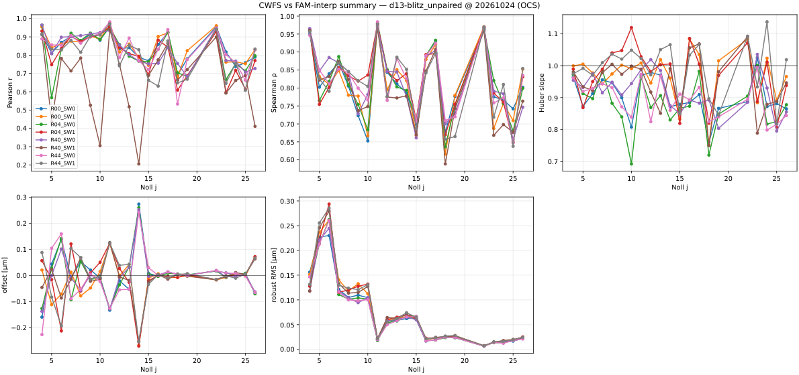

# `cwfs`

> **Code:** `code/` (corner and DOF comparisons, the parked refit ensemble) · **Notebooks:** `notebooks/` · **Write-up:** [`cwfs.md`](cwfs.md) · **Output:** `output/` (the study `output@`: `wfs_dof_compare/`, dated `wfs_corner_compare` runs); tables in the `wfs_corner_compare` and `cwfs_tables` products

## Question

Does the optical state recovered from the corner wavefront sensors agree with the FAM full-focal-plane measurement, Zernike by Zernike?

## Current answer

- Danish 1.3 blitz unpaired (v3.14 pupil) tracks the FAM far better than Danish 1.2: median Pearson r 0.69-0.86 per corner sensor against 0.26-0.42 (dimensionless), at 50-63 nm of wavefront robust scatter.
- Z11 and Z14 carry equal and opposite offsets on the intra (SW1) and extra (SW0) halves, about ±0.13 µm and ±0.26 µm of wavefront; the side mean is near zero.
- Under Danish 1.2, per-Zernike CWFS–FAM offsets (Z11 spherical, Z14 tetrafoil, Z7 coma) persist under a radius-matched comparison.
- The Z11/Z14 intra- against extra-focal split is unexplained; it belongs to [`../intra_extra`](../intra_extra/study.md).
- The refit-ensemble pair is parked pending Danish 1.2 FAM reprocessing.

## Log

### 2026-10-24 — wfs_corner_compare as a product; Danish 1.3 blitz unpaired

`wfs_corner_compare` is now a product (`rubinwork/products/wfs_corner_compare/`, the
computation in `rubinwork.corner_compare`); `code/run_wfs_corner_compare.py` plots a
build. GP interpolation, 10 seeded optimizer restarts (2 unseeded before, which moved
11 of 126 test fits, count, by up to 0.26 µm). Runs in
`output/20261024_wfs_corner_compare/`.

| variant (build 20261024) | triplets [count] | nights | median Pearson r | median nMAD [nm] |
|---|---|---|---|---|
| `d12-refitWcs` | 3290 | 20250415-20260513 | 0.26-0.42 | 48-57 |
| `d13-blitz_unpaired` (v3.14 pupil) | 1839 | 20250417-20260619 | 0.69-0.86 | 50-63 |

Ranges are over corner sensors (dimensionless r; nMAD in nm of wavefront, the robust
scatter of CWFS about the Huber line, median over Zj).

- **Danish 1.3 blitz agrees with FAM far better** than Danish 1.2 refitWcs: median r
  0.69-0.86 against 0.26-0.42, at similar scatter.
- **The intra/extra split is clear.** Huber offset, CWFS minus FAM, on all four corners
  (count): Z11 SW0 (extra) -0.126 to -0.133 µm, SW1 (intra) +0.122 to +0.126 µm; Z14 SW0
  +0.241 to +0.274 µm, SW1 -0.253 to -0.271 µm. Equal and opposite, so the side mean is
  near zero. Z4 and Z7 offsets differ by corner, not by side.
- `d12-refitWcs` 20261024 adds the 2025 nights to the July table (3290 against 1122
  triplets). On the shared rows `cwfs_median` is identical and `fam_interp` differs by
  more than 0.01 µm on 685 of 94,185 (count), max 0.19 µm (the GP restarts). The July
  table is kept as build `20260707`; optatmo's `extract_cwfs_sigma.py` stays pinned to it.

### 2026-10-08 — backfilled from docs and history

Moved from `aos/code/cwfs/` (less `run_wfs_mimic.py`, now its own study, and the `run_wfs_mktable.py` shim, which stays) and `aos/notebooks/cwfs/`. `robust_fit` moved to `rubinwork.common.utils`. Parked in the triage. Converted 2026-10-23 in phase 5.
