# `giant_donut_pupil`: giant-donut wavefront over the full focal plane, v1000 against v4.02

> **Code:** `code/isr_cache.py` (binned ISR cache), `code/fp_mosaic.py` (focal-plane
> mosaic), `code/candidates.py` and `code/select_candidates.py` (candidate selection).
> Imports `wfs/code/giant_donuts/` (shared in the section 2 step).

## Question

With a Danish model that includes the spider, what wavefront do giant donuts give across
the full focal plane, including the corner wavefront sensors (WFS)? What do coma (Z7,
Z8) and astigmatism (Z5, Z6) look like? Does the v4.02 CAD-matched pupil (spider at the
CAD location) fit better than v1000?

Data: day_obs 20251023, BLOCK-T626, r band, 60 s; exposure 2025102300337 (extra-focal)
and 2025102300340 (intra-focal). Both sit at ±4000 µm on the camera hexapod and ±4000 µm
on M2, a 4 + 4 mm split, about 7.6 mm effective defocus. Rotator angle 0.012 deg and
0.149 deg. Background: `notes/status/item7_giant_donuts_handoff.md`,
`wfs/docs/giant_donuts_pupil_findings.md`.

Optical models: `~/notebooks/rubin-optical-model` at commit `e2a1e54` (read only).

## Current answer

v4.02 fits the giant donuts better than v1000. With Z4 + Z11 + Z22, its residual RMS is
lower on 16 of 16 clean donut sides; with the blitz set, on 12 of 16. The median ratio,
v4.02 over v1000 residual RMS, is 0.94 (Z4 + Z11 + Z22) and 0.95 (blitz set), both
dimensionless. Most of the gain is the spider: the v1000 vanes sit 50 mm (one vane width)
off the CAD shadow. Inside 1.725 deg the fitted Z5–Z8 deviations stay within ±3 µm of
wavefront and show no trend with field radius. Beyond 1.9 deg the fits break down.

Fitted with Z4 only (other Zernikes fixed at the batoid intrinsic, blur fixed at 1.0
arcsec), v4.02 still wins: 35 of 38 donut sides, 15 of 16 clean, median ratio 0.944
(dimensionless). Inside 1.725 deg the v4.02 danish edges match a Batoid ray trace of the
full v4.02 model to 0.2–1.6 pixels RMS. The data do not match either: on clean donuts
the inner edge sits 3.5–5.7 pixels outside Batoid over OCS azimuth 0–135 deg and within
1 pixel over 225–315 deg, on both sides of focus.

Pupil pass 4 (2026-10-21; 180 sides at 0–0.8 and 1.4–1.75 deg):
- **The central edge mismatch is in the image frame, not the pupil.** Data − fit c
  agrees between extra and intra in OCS image azimuth: Pearson r +0.76 for the inner
  edge and +0.77 for the ratio. Turned into the pupil frame it is −0.95 and −0.91. It is
  an inner-edge shift of 1.7–2.0 pixels toward +y on both sides, so it is not an M1
  aperture effect.
- **Relative azimuth ψ stacks the outer band.** The outer-edge scatter between donuts is
  1.2–1.4 pixels in ψ, against 7.1–7.5 in OCS. The model misses most on the inner edge on
  the vignetted side (ψ 0 deg intra, 180 deg extra), by +3.5 to +5.5 pixels.
- **The large outer-band aberrations are pupil bias.** The central-band medians (Z5
  −0.22, Z6 −0.13, Z7 +0.22, Z9 −0.30 µm OCS) cost 6 % in chi2/dof against fit c's 1–3.9
  µm of Z5–Z7 on intra sides beyond 1.5 deg. Fit c's per-side Z11 and Z15 flip sign
  with focus and carry most of its edge gain.
- **The spider shadows are shifted, not misplaced per vane.**
  - Against fit c, the data shadows sit about 1.8 pixels toward −y OCS image on both
    sides of focus: an m = 1 term of 0.36–0.41 deg in azimuth at r_half.
  - A common rotation of −0.14 / −0.24 deg (extra / intra) sits inside the method's
    0.4 deg bias.
  - Per-vane residuals are 0.11 deg at most, with no field dependence.
  - The data shadows are 10–12 pixels wide against the model's 7.

Pupil pass 3 (2026-10-21; 30 donuts, 49 sides, intrinsicTA reference, v4.02g masks):
- With Z4 alone, the data's r_inner / r_outer is 0.0104 higher than the model on science
  donuts (median, nMAD 0.0048, dimensionless), with no trend in field radius (Pearson r
  −0.15, Spearman rho −0.21, n 34). The inner edge sits +2.1 pixels outside the model
  and the outer edge −1.25 pixels inside it.
- Freeing Z11 and Z22 removes most of that (excess 0.003) and cuts the inner-edge RMS
  from 3.3–3.6 to 2.2–2.3 pixels, but chi2/dof only by 6 %. Z11 comes out −0.15 µm
  extra and +0.15 µm intra: a sign that flips with focus is the pupil, not the wavefront.
- Fitting only the edges (fit d) gives Z7 +0.76 µm on both sides and at every field
  radius, the pass 2 edge coma. The whole-donut fits find Z7 +0.14 to +0.24 µm, and fit
  d's whole-donut chi2/dof is 1.36 times fit a's. So the coma fits the edges, not the
  donut.
- What most needs measuring: the M1 central-obscuration and outer clear-aperture radii.

Pupil pass 2 (2026-10-20) settles what that offset is not:
- **It has the signature of coma, but is not wavefront coma.** The inner-minus-outer
  edge-centre shift is +3.3 pixels along +y CCS on both sides of focus and at every
  field radius 0.17–1.70 deg. In Batoid, 1 µm of Z7 gives +4.45 pixels, so it reads as
  Z7 +0.71 µm (extra) and +0.81 µm (intra) of wavefront. But danish fits with Z7 and
  Z8 free find Z7 +0.02 and +0.19 µm, and the seq 324 state gives +0.02 µm.
- **The inner shadow is also larger.** r_inner / r_outer is 0.628 (extra) and 0.631
  (intra) in the data, and 0.616–0.618 in Batoid and danish, v4.02 and v1000 alike
  (dimensionless). Coma does not change the radii.
- **Not the telescope state.** The seq 324 optical state moves the sector offsets by
  under 1 pixel. Adding the 337/340 Trim tilts makes every fit worse (38 of 38 sides),
  so v4.02's as-built alignment already holds them.
- **Not one element shift.** A decentred pupil obscuration flips sign with focus.
  Only L3 and the filter give a same-sign shift, and they would need about 5 mm and
  100 mm moves.
- **danish v4.02g** (masks fitted at the giant configuration) fixes the outer edges
  that danish v4.02 missed at 1.73–1.75 deg (M3, filter). There Batoid itself clips at
  the filter 7–21 pixels inside the data edge. Dropping the in-camera openings costs
  nothing: they uniquely block no ray.

## Log

### 2026-10-21 — pupil pass 4: flip test, relative azimuth, central-Zernike fit, spiders

Code: `pupil_pass4.py` (fits), `pupil_pass4_report.py`, `spider_pass4.py` and
`spider_pass4_report.py` (step 6). Run `20261021_pupil4`: `sample`, `fits`,
`edges_bins`, `central_medians`, `central_stack`, `counts`, `flip_correlation`,
`psi_check`, `psi_scatter`, `psi_miss`, `c0_vs_c`, `c0_vs_c_sides`, `spiders`,
`spider_found`, `spider_by_vane`, `spider_vane_fits` (parquet and csv);
`pupil_pass4.pdf` (80 pages) and `pupil_pass4_spiders.pdf` (38 pages). Setup as pass 3
(`method.md`, "Pupil fit setup"), fit c only, plus fit c0.

Aaron's read of pass 3:
- Even with fit c, the data's inner/outer ratio is well off the model inside 0.8 deg.
- Fit c's aberrations vary widely beyond 1.5 deg but are stable below it. That points to
  pupil-model bias, not wavefront. The robust edges show clear pupil mismatches.

**0. Sample.** Every selected, not-bad side on 337 and 340, 180 sides, all fitted, none
failed to run. Five sides (three donuts) are left out of the summaries for a fitted flux
1.8–5.4 times the stamp sum (dimensionless).

| band | sensor | extra sides | intra sides |
|---|---|---|---|
| central, 0–0.8 deg | science | 26 | 27 |
| outer, 1.4–1.75 deg | science | 57 | 55 |
| outer | SW0 | 1 | 10 |
| outer | SW1 | 3 | 1 |

**1. Central band: the edge mismatch does not flip with focus.** Median over 27 donuts
per 2 deg bin, edges as fractions of each donut's median r_outer. Data − fit c is the
same in the OCS image frame on both sides of focus, and opposite in the pupil frame
(extra-focal turned 180 deg). Pearson r between extra and intra data − model (n 133–135
bins):

| quantity | image frame | pupil frame |
|---|---|---|
| inner edge | +0.76 | −0.95 |
| outer edge | +0.39 | −0.55 |
| ratio | +0.77 | −0.91 |

The pattern is an m = 1 term at OCS azimuth 88–94 deg on both sides: the inner edge sits
outside the model toward +y, amplitude 0.0050 (intra) and 0.0060 (extra) of r_out, about
1.7–2.0 pixels. A feature fixed in the pupil, such as an M1 aperture offset, would line
up in the pupil frame; this one lines up in the image. It is the pass 2 inner-shadow
shift (+3.3 pixels inner minus outer along +y CCS), seen again with free coma. The
constant part, the ratio excess, is +0.0036 (extra) and +0.0016 (intra), dimensionless.
With c0 (step 4) the correlations are +0.81 / −0.96 (inner) and +0.79 / −0.94 (ratio).

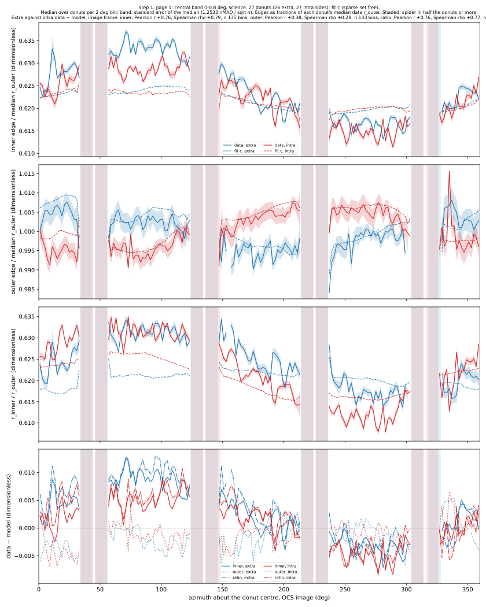

**2. Relative azimuth ψ lines up the outer band.** ψ = (OCS image azimuth − (φ + 180
deg)) mod 360. Check: the outer edge's vignetted minimum (m = 1, 2 Huber fit) sits at ψ
0–3 deg on 9 of 10 SW0 intra sides, whose φ spans 48–317 deg; in OCS those minima spread
over 44–229 deg. On extra-focal sides the minimum is at ψ 176–186 deg: the image of the
pupil turns over through focus. Scatter between donuts per bin (nMAD across donuts, each
donut's median edge removed, median over bins, pixels):

| group | inner, ψ | inner, OCS | outer, ψ | outer, OCS |
|---|---|---|---|---|
| science intra, 1.6–1.725 deg, 16 sides | 2.90 | 5.16 | 1.43 | 7.12 |
| science extra, 1.6–1.725 deg, 16 sides | 2.27 | 2.82 | 1.21 | 7.48 |
| SW0 intra, 9 sides | 1.71 | 1.69 | 1.33 | 3.15 |
| SW1 extra, 3 sides | 1.46 | 2.18 | 0.75 | 3.76 |

Where fit c misses most, median data − model in ψ (20 deg running median): the **inner
edge on the vignetted side**, where the field-dependent inner edge cuts into the ring. It
is +5.5 pixels at ψ 359 deg on science intra, +4.7 at ψ 9 deg on SW0 intra, and +3.8 at ψ
179 deg on science extra (+3.5 on SW1 extra). That is one place in the pupil on both
sides. The data's inner edge there sits outside the v4.02g model. The outer edge misses
by −1.3 pixels at most, at ψ 130–170 deg.

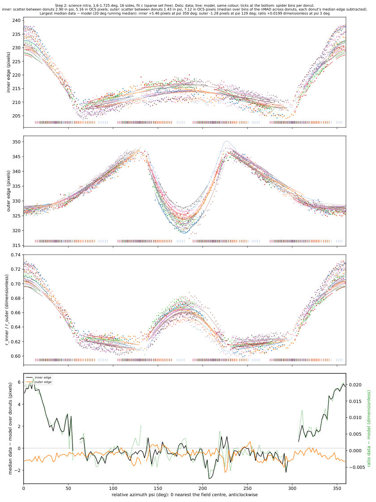

**3. Central-Zernike model, fit c0.** Median fit c deviations over the 53 central-band
science sides (OCS, µm of wavefront; median with nMAD in brackets):

| term | both sides | extra | intra |
|---|---|---|---|
| Z5 | −0.22 (0.17) | −0.28 (0.11) | −0.17 (0.17) |
| Z6 | −0.13 (0.22) | −0.26 (0.06) | +0.03 (0.07) |
| Z7 | +0.22 (0.11) | +0.14 (0.05) | +0.27 (0.10) |
| Z8 | +0.02 (0.07) | +0.00 (0.06) | +0.07 (0.08) |
| Z9 | −0.30 (0.10) | −0.36 (0.08) | −0.26 (0.06) |
| Z10 | −0.07 (0.04) | −0.08 (0.04) | −0.07 (0.06) |
| Z11 | +0.08 (0.13) | −0.18 (0.01) | +0.14 (0.01) |
| Z14 | +0.04 (0.04) | +0.06 (0.04) | +0.04 (0.04) |
| Z15 | −0.06 (0.28) | +0.18 (0.06) | −0.20 (0.06) |
| Z20 | +0.02 (0.04) | +0.03 (0.02) | −0.01 (0.02) |
| Z21 | −0.01 (0.05) | −0.05 (0.02) | +0.03 (0.02) |
| Z22 | +0.03 (0.03) | +0.06 (0.01) | +0.02 (0.01) |

Z11 and Z15 flip sign with focus, which wavefront cannot do: they are the pupil-size
mismatch again. Fit c0 fixes the both-sides medians and frees Z4, flux and centre.

Outer band, 122 sides, c0 against c (medians):
- chi2/dof c0 over c: 1.08 (all), 1.12 (science extra), 1.06 (science intra), dimensionless;
- inner edge RMS: 2.29 pixels (c), 3.43 pixels (c0); outer: 1.21 and 1.86 pixels;
- c0 within 0.3 pixels of c on both edges: 12 % of sides (0 % science extra, 19 % science
  intra, 44 % SW0 intra).

Fit c's Z5, Z6 or Z7 pass 1 µm on 18 sides, all intra-focal (40 % of intra sides beyond
1.5 deg), up to Z5 −3.9 µm on SW1 intra. On those 18, c0 costs 6 % in chi2/dof, 0.44
pixels inner and 0.21 pixels outer edge RMS (medians), and matches both edges on 33 %.
On extra-focal sides c0's loss is the Z11 and Z15 that c fits per side: c0's inner edge
sits +2.9 pixels out on science extra.

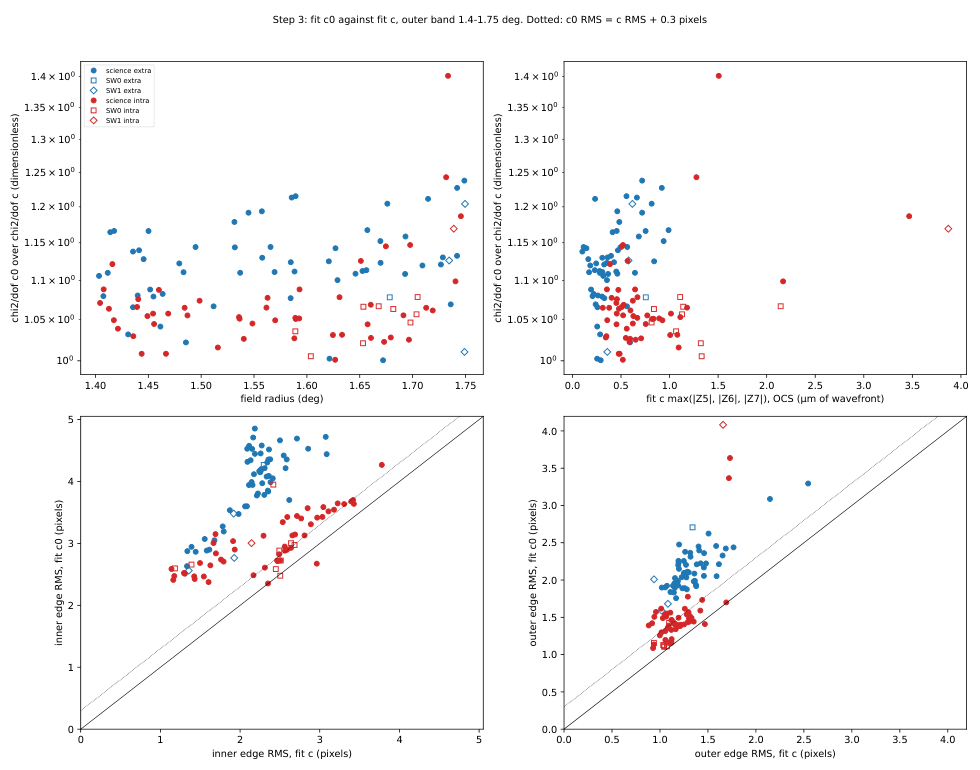

**6. Spider shadows, data against fit c.** Method: `spider_trajectory` (`wfs/code/giant_donuts`).
- Shadow centres are found at 7 radii, 0.68–0.92 of r_out, and fitted with a straight
  chord, φ(r) = φ_0 + arcsin(b / r).
- The flux profile is taken across each chord, and `vane_depth` gives the depth and FWHM.
- Data and model are traced about the same centre (fit a, as the edges) and at the
  same radii.
- The azimuth is read at r_half = (r_inner + r_outer) / 2 from the data's robust
  harmonic edges.
- The floor is 1.6 pixels in b, plus a common rotation bias of 0.2–0.4 deg that cancels
  in data − model.
- A chord with rms over 2 pixels drops its worst point, down to 4 points.

Numbering:
- **ψ number** 0–7: by ψ at r_half, counted anticlockwise from the shadow nearest ψ = 0.
- **vane id** 0–7, pupil frame: OCS azimuth (intra) or OCS azimuth + 180 deg (extra),
  counted anticlockwise from 0 deg. Shadows sit at pupil azimuth 39, 51, 129, 141, 219,
  231, 309 and 321 deg, ids 0–7, on both sides.
- Check against the v4.02 Spider_3D on G0005: the six pieces of the +x+y vane alone
  shadow OCS azimuth 50.9 deg intra (rtp −0.039 deg) and 230.9 deg extra (rtp −0.199
  deg). That is pupil azimuth 50.9 deg on both sides, vane id 1.

Found: 1189 of 1440 shadows on the 180 band sides; 275 of 392 on the 49 pass 3 sample
sides. Missing, by reason (band sides): no data shadow within 5 deg of the model, 210;
model shadow not traced, 36; data chord rms over 2 pixels, 5. Most are on the corner
sensors: SW0 intra 31 of 80 found, SW1 extra 7 of 24.

Data − model azimuth at r_half, per vane id (deg; median with nMAD in brackets; n 83–101
shadows each, all distinct sides):

| vane id | 0 | 1 | 2 | 3 | 4 | 5 | 6 | 7 |
|---|---|---|---|---|---|---|---|---|
| extra | +0.18 (0.14) | +0.07 (0.13) | −0.31 (0.12) | −0.47 (0.15) | −0.54 (0.09) | −0.24 (0.10) | +0.01 (0.10) | +0.19 (0.07) |
| intra | −0.58 (0.20) | −0.46 (0.21) | −0.06 (0.16) | +0.09 (0.19) | +0.16 (0.16) | −0.02 (0.15) | −0.50 (0.17) | −0.65 (0.13) |

Fitted as a common term plus m = 1 in OCS image azimuth (Huber):
- common: −0.14 deg (extra), −0.24 deg (intra);
- m = 1 amplitude: 0.36 deg (extra) and 0.41 deg (intra), at phase 184 and 183 deg OCS
  image azimuth on both sides;
- residual per vane: 0.11 deg at most; scatter nMAD 0.14 (extra) and 0.18 deg (intra).

So the data shadows sit shifted along −y OCS relative to the donut centre, in the image
frame on both sides: about 1.7 (extra) and 1.9 (intra) pixels at r_half (Huber fit of the
arc displacement), 2.3–2.6 pixels at 0.70 r_out and 1.2 pixels at 0.92 r_out. In the pupil
frame that is the opposite direction on the two sides, so it is not a spider misplaced
in the telescope.

Other differences, data − model (medians over vanes and sides):
- b: alternates ±2 to ±8 pixels between the two shadows of each vane pair, as a
  translation gives (nMAD 1.6–5.1 pixels per vane).
- Depth: +0.16 to +0.19 (extra), −0.12 to −0.16 (intra), dimensionless. The data are
  0.86–0.89 deep (extra) and 0.54–0.57 deep (intra), the model 0.67–0.73 on both.
- Width (FWHM): +4.0 to +5.4 pixels (extra), +3.1 to +3.6 pixels (intra). The data are
  10.8–12.3 and 9.9–10.5 pixels wide, the model 6.7–7.2 pixels.
- Field dependence: none. Slope 0.03 ± 0.02 (extra) and 0.04 ± 0.03 (intra) deg per deg
  of field radius. Against field radius, each side's median residual has Pearson r +0.19
  and +0.17, Spearman rho +0.15 and +0.27 (n 108 and 121 sides).

Pass 3 sample sides alone give the same: common −0.11 / −0.22 deg, per-vane spread
0.75 / 0.90 deg (extra / intra).

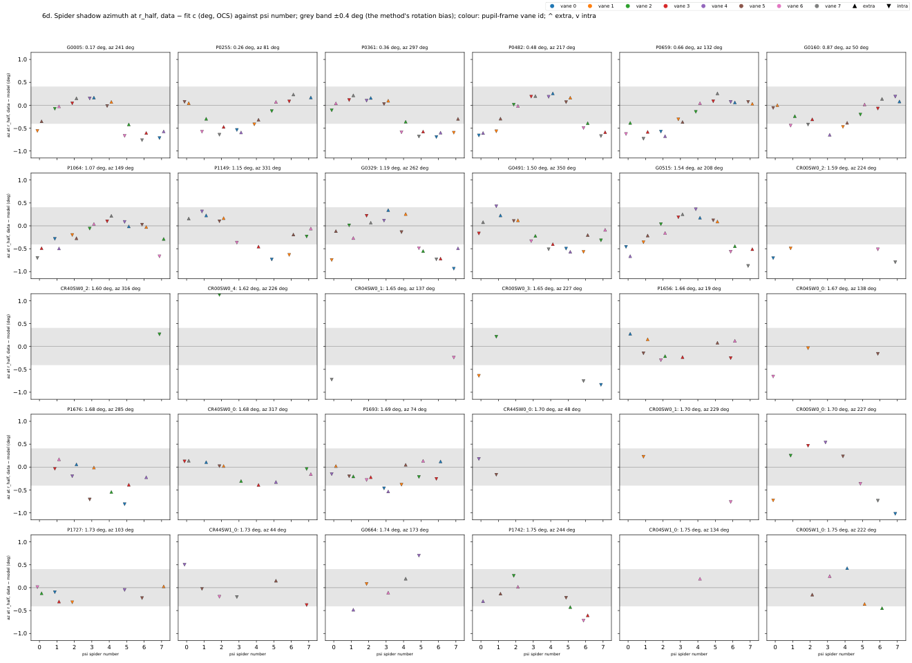
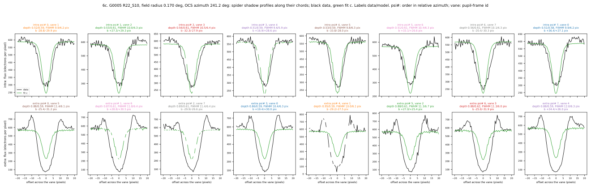

**Answers.**
- *(i) Does the central-band edge mismatch flip with focus?* No. It agrees in the OCS
  image frame: Pearson r +0.76 (inner edge) and +0.77 (ratio), extra against intra.
  In the pupil frame it is −0.95 and −0.91. It is an m = 1 inner-edge shift toward +y
  of 1.7–2.0 pixels on both sides, plus the 0.002–0.004 ratio excess. A pupil-fixed
  M1 aperture effect would flip; this does not.
- *(ii) Does ψ stacking line up the outer band, and where does the model miss?* Yes. The
  outer-edge scatter between donuts drops from 7.1–7.5 pixels in OCS to 1.2–1.4 pixels
  in ψ on science sides. The model misses most on the inner edge on the vignetted side
  (ψ ≈ 0 deg intra, ψ ≈ 180 deg extra), by +3.5 to +5.5 pixels, where the
  field-dependent inner edge enters the ring.
- *(iii) Are the outer-band aberrations pupil bias?* The large ones are. They are
  intra-only, beyond 1.5 deg. There the central wavefront costs 6 % in chi2/dof and
  0.2–0.4 pixels of edge RMS, against c's 1–3.9 µm of Z5–Z7. But c0 matches c's
  edges on only 12 % of outer sides. Most of c's edge gain is Z11 and Z15 fitted per
  side, and those flip sign with focus: pupil size again, not wavefront.
- *Spider placement:* a translation, plus a small common rotation. It is not per vane
  (residual ≤ 0.11 deg) and not field dependent.
  - The translation is about 1.8 pixels along −y OCS image, in the same image direction
    on both sides of focus.
  - The common rotation is −0.14 / −0.24 deg, below the 0.4 deg band.
  - The earlier check put the v4.02 danish vanes 0.0 mm off the batoid CAD shadow, so
    danish follows v4.02; the data differ from both.
  - The data shadows are 1.5–1.8 times wider than the model, and deeper extra and
    shallower intra.
  - An image-frame shift of the spiders and of the inner shadow, of opposite sign (+y
    inner edge, −y spiders), on both sides of focus is not a pupil element out of place.

Next:
- The common image-frame offsets (inner edge +y, spiders −y, relative to the donut
  centre): test whether the centre is what moves, by fitting the outer-edge centre
  separately from the fit-a centre.
- The shadow widths: fit the vane width and blur together on the bright central donuts.
- The field-dependent inner edge at ψ ≈ 0 / 180 deg in v4.02g: which element sets it.

### 2026-10-21 — pupil pass 3: four fits and robust edges, v4.02g, intrinsicTA

Code `a4530c0`: `pupil_sample.py`, `pupil_pass3.py` (fit and edge driver),
`pupil_pass3_report.py`. Run `20261020_pupil3`: `sample.parquet`, `fits.parquet` and
`.csv`, `edges_bins.parquet`, `summary_by_fit.csv`, `summary_ratio_correlation.csv`,
`timing.json`, and `pupil_pass3.pdf` (113 pages: map, 2 pages per side ordered by field
radius, then summaries 8a–8e). Setup: `method.md`, "Pupil fit setup". Pass 2 is not
built on; `robust_edges.py` is reused as it was.

**Sample** (4): 30 donuts, 49 sides, all within 1.75 deg. The 17 science donuts have
both sides; the 13 corner donuts have the sides that pass (SW0 extra-focal donuts are
404 pixels in radius, so mostly blended). Of the 12 earlier science donuts, 6 still pass
(G0005, G0160, G0329, G0491, G0515, G0664). G0249 was labelled bad on 337 and is
replaced by P1064. G0681, G0684, G0714, G0732 and G0737 lie beyond 1.75 deg and are
replaced by the nearest-radius passing donuts inside it. Five donuts were added, four
at 0–0.8 deg. Each band has donuts in all four OCS azimuth quadrants: 0–0.8 deg, 1/1/2/1;
0.8–1.3 deg, 1/1/1/1; 1.3–1.75 deg, 4/5/8/4 (donuts in quadrants 0/1/2/3).

| id | detector | sides | mag (AB) | field radius (deg) | OCS azimuth (deg) |
|---|---|---|---|---|---|
| G0005 | R22_S10 | extra+intra | 12.74 | 0.170 | 241.1 |
| P0255 | R22_S12 | extra+intra | 12.22 | 0.256 | 80.5 |
| P0361 | R22_S20 | extra+intra | 13.24 | 0.361 | 297.3 |
| P0482 | R12_S20 | extra+intra | 11.11 | 0.483 | 217.3 |
| P0659 | R13_S20 | extra+intra | 8.72 | 0.660 | 131.6 |
| G0160 | R33_S01 | extra+intra | 12.54 | 0.873 | 50.1 |
| P1064 | R13_S00 | extra+intra | 10.58 | 1.066 | 148.9 |
| P1149 | R31_S22 | extra+intra | 10.99 | 1.150 | 330.8 |
| G0329 | R20_S02 | extra+intra | 9.82 | 1.190 | 261.9 |
| G0491 | R42_S10 | extra+intra | 10.26 | 1.497 | 350.0 |
| G0515 | R01_S11 | extra+intra | 8.90 | 1.534 | 207.5 |
| CR00SW0_2 | R00_SW0 | intra | 13.14 | 1.589 | 223.6 |
| CR40SW0_2 | R40_SW0 | intra | 14.61 | 1.604 | 316.3 |
| CR00SW0_4 | R00_SW0 | intra | 15.04 | 1.617 | 226.1 |
| CR04SW0_1 | R04_SW0 | intra | 14.30 | 1.653 | 137.0 |
| CR00SW0_3 | R00_SW0 | intra | 12.27 | 1.653 | 227.1 |
| P1656 | R43_S20 | extra+intra | 12.19 | 1.658 | 19.2 |
| CR04SW0_0 | R04_SW0 | intra | 13.29 | 1.668 | 138.3 |
| P1676 | R30_S00 | extra+intra | 11.97 | 1.678 | 284.8 |
| CR40SW0_0 | R40_SW0 | extra+intra | 12.74 | 1.680 | 316.9 |
| P1693 | R34_S02 | extra+intra | 9.24 | 1.695 | 73.9 |
| CR44SW0_0 | R44_SW0 | intra | 13.55 | 1.698 | 48.3 |
| CR00SW0_1 | R00_SW0 | intra | 12.28 | 1.704 | 228.9 |
| CR00SW0_0 | R00_SW0 | intra | 10.00 | 1.705 | 226.9 |
| P1727 | R14_S22 | extra+intra | 11.24 | 1.729 | 102.6 |
| CR44SW1_0 | R44_SW1 | extra+intra | 12.24 | 1.737 | 43.8 |
| G0664 | R02_S02 | extra+intra | 12.43 | 1.738 | 173.0 |
| P1742 | R10_S10 | extra+intra | 11.32 | 1.744 | 243.6 |
| CR04SW1_0 | R04_SW1 | extra | 14.61 | 1.749 | 134.5 |
| CR00SW1_0 | R00_SW1 | extra | 12.10 | 1.750 | 222.4 |

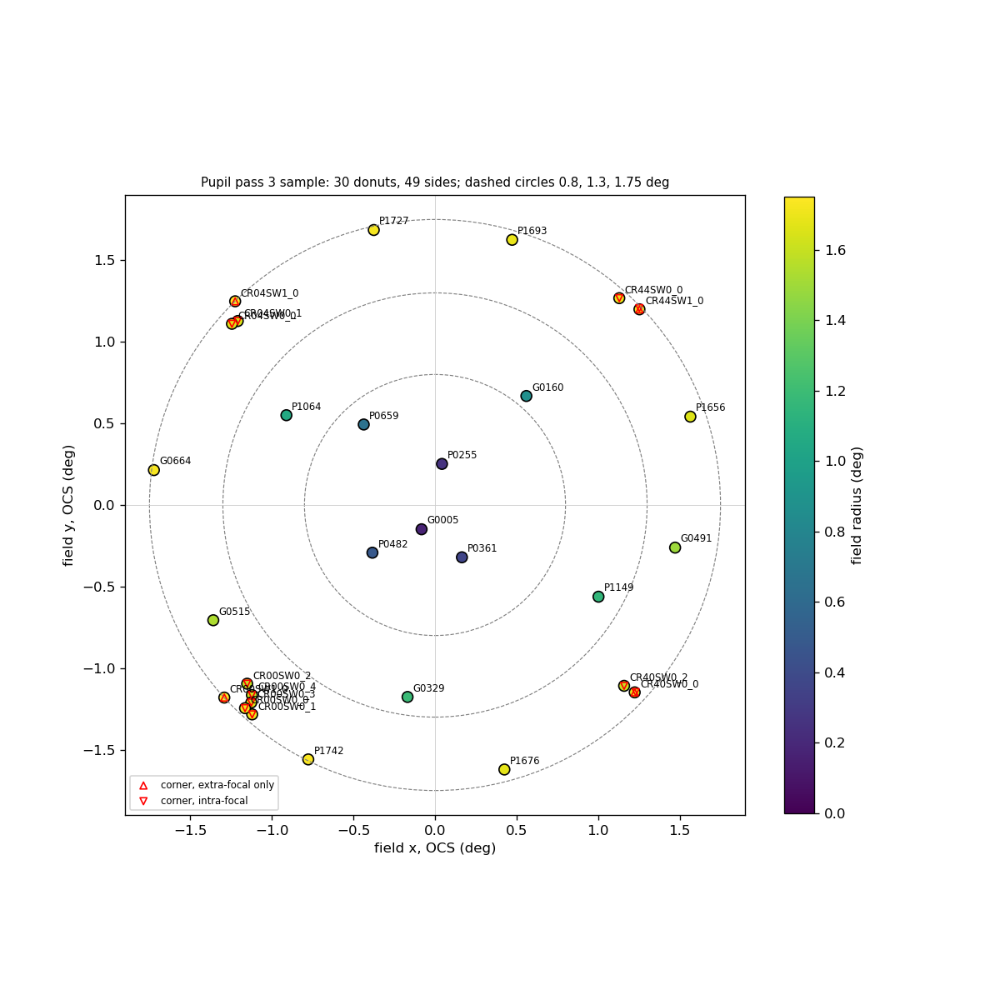

**Reference** (5). ts_wep `Instrument.getOffAxisCoeff(..., nollIndicesModel=0–66,
nollIndicesIntr=4–66)` plus `Instrument.getIntrinsicZernikes(..., defocalType=None)`,
on v4.02 with `batoidOffsetOptic = [Detector, LSSTCamera, M2]`. This is the batoid
zernikeTA at the defocused configuration (equal to 3e-17 µm). At G0515 extra-focal
(CCS field (−1.356, −0.711) deg), Z4–Z11 in µm of wavefront:
- intrinsicTA: +121.75, +0.53, +0.49, −0.82, −1.56, −0.12, −0.01, +0.14;
- in-focus intrinsic: 0.00, +0.02, +0.14, −0.01, −0.01, −0.11, −0.01, −0.03.

The difference is the defocus plus the coma and astigmatism of the ±4 mm
configuration, as expected. At CR40SW0_0 intra-focal (detector +1.5 mm), Z4 is −98.64
µm against −0.01 µm.

**Fits** (6). All 49 sides fitted, none failed to run. Four fits are left out of the
summaries because their fitted flux is about 5 times the stamp sum (dimensionless):
CR00SW0_4 intra, fits a–c (15.04 AB mag, the faintest), and CR04SW0_1 intra, fit d.

Medians over sides (extra / intra; chi2/dof on the whole donut; edges data − model,
pixels; ratio r_inner / r_outer, dimensionless):

| fit | chi2/dof | inner edge RMS | outer edge RMS | inner offset | outer offset | ratio excess |
|---|---|---|---|---|---|---|
| a: Z4 | 7.35 / 4.79 | 3.57 / 3.31 | 1.60 / 1.64 | +2.28 / +1.72 | −1.29 / −1.06 | +0.0101 / +0.0072 |
| b: Z4, Z11, Z22 | 6.88 / 4.49 | 2.31 / 2.24 | 1.29 / 1.31 | +0.68 / +0.22 | −0.56 / −0.43 | +0.0032 / +0.0019 |
| c: sparse set | 6.56 / 4.25 | 2.09 / 2.33 | 1.15 / 1.09 | +0.77 / +0.25 | −0.50 / −0.51 | +0.0032 / +0.0017 |
| d: annulus | 9.31 / 6.28 | 1.08 / 1.61 | 1.15 / 1.22 | +0.07 / +1.16 | +0.37 / −0.80 | −0.0038 / +0.0051 |

Fit d's chi2/dof on its fitted pixels is 18.2 / 11.4. Per side, chi2/dof over fit a's is
0.943 (b), 0.915 (c) and 1.358 (d, whole donut), median, dimensionless, n 48.

**8a. Ratio against field radius.** On science donuts with fit a, the data ratio is
0.0104 above the model (median, nMAD 0.0048, dimensionless). It has no trend with field
radius: Pearson r −0.15, Spearman rho −0.21 between excess and field radius (deg), n 34.
- The excess is 0.008 at 0–0.8 deg and 0.013 at 0.8–1.3 deg.
- At 1.3–1.75 deg it is 0.0035 extra-focal and 0.0112 intra-focal on science donuts,
  and about 0 on the corner sensors (−0.0014, n 14).
- The data ratio rises from 0.623 at the centre to 0.64–0.66 beyond 1.5 deg, from
  vignetting; every model follows it.

A constant excess at all field radii on the science sensors supports a pupil-geometry
cause: the M1 central obscuration about 1 % larger in radius than v4.02 has it (inner
edge +2.1 pixels, 0.6 % of r_out), and the outer clear edge about 0.4 % smaller (−1.25
pixels). A field-dependent cause would grow with field, and it does not. It cannot be
told from the edge positions alone whether it is a true radius or a slope effect at the
mirror edges (thermally driven refraction, M1's turned-down edge). Both scale with
defocus, so the fractional ratio is the same at every defocus. Three measurements would
tell them apart:
- the M1 clear-aperture inner and outer radii, as built: the inner baffle and the
  M1Baffle1 lip;
- the edge profile itself. A slope error spreads or piles light within a few pixels of
  the edge, and a radius error only moves a sharp edge;
- the same fit on another giant-donut night (20251027 BLOCK-T621). A thermal effect
  would change with the dome and mirror temperatures.

The corners show no excess, but at 1.6–1.75 deg the edges there are set by vignetting,
not M1, so they do not test it.

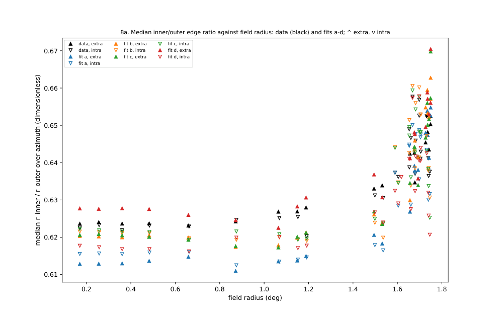

**8b. Zernikes against field radius.**
- Fit a gives Z4 +0.33 µm extra-focal and +0.85 µm intra-focal (median). Intra-focal Z4
  is above 1 µm on 37 % of intra sides, and +1.2 to +1.35 µm inside 0.8 deg. With Z11
  and Z22 free (fit b), both sides give +0.26 µm. So fit a's intra-focal Z4 is pulled by
  the pupil size.
- Z11 in fit b is −0.15 µm extra and +0.15 µm intra. Wavefront Z11 would have one sign
  on both sides of focus; a sign that flips with focus is the ratio excess being
  absorbed.
- Fit c: Z7 +0.14 / +0.24 µm and Z8 +0.02 / +0.08 µm (extra / intra). Every term except
  Z5, Z6 and Z10 stays within ±1 µm on every side. Z5 is past 1 µm on 37 % of
  intra-focal sides, at most 3.87 µm, all beyond 1.5 deg.
- Fit d: Z7 +0.76 µm on both sides, +0.66 to +0.85 µm in every band and sensor class;
  Z8 within ±0.1 µm. Z4 is −1.2 µm on extra-focal sides inside 1.3 deg.
- The 1–3 µm deviations of the earlier passes do not appear inside 1.5 deg. Beyond it
  they are in Z5 and Z6 on intra-focal sides, a pupil bias (8e).

**8c. chi2/dof** grows with brightness, not field radius. Stars of 12–13 AB mag give
1.3–5; stars of 8.7–9.8 AB mag give 40–240, in all four fits. The shot-noise-limited
residual of a bright donut is set by the pupil model.

**8d. Edge RMS.**
- Inner edge: fit a 2.3–4.4 pixels at every field radius; b and c 1.3–3.3; d 0.9–1.6
  inside 1.3 deg and 1.0–2.9 beyond.
- Outer edge: 1.0–2.0 pixels for every fit inside 1.6 deg. Beyond 1.65 deg it is 3–7
  pixels on intra-focal sides (G0664, P1742, P1727, CR44SW1_0, CR04SW0_1), where the
  filter and M3 set the edge (pass 2), whatever the Zernikes.

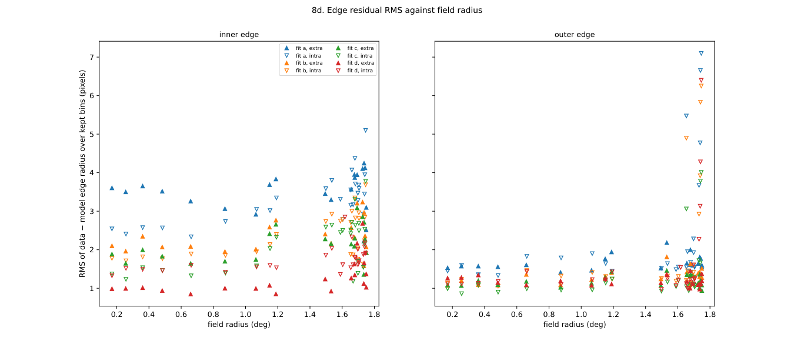

**8e. Against OCS azimuth, 1.3–1.75 deg.**
- On intra-focal sides fit c's astigmatism follows the focal-plane azimuth φ:
  - Z5 against sin 2φ: Pearson r −0.82, Spearman rho −0.87, amplitude −1.5 µm, n 18;
  - Z6 against cos 2φ: −0.73 and −0.85, amplitude −1.1 µm.
- On extra-focal sides there is no such pattern: |r| ≤ 0.50, amplitude ≤ 0.21 µm, n 12.
- A wavefront pattern would be there on both sides of focus. An intra-focal-only one
  points to the vignetting edges at the intra configuration, which the v4.02g masks
  miss.
- The ratio excess does not follow azimuth: Pearson r −0.19, Spearman rho −0.18,
  n 48.

**Answers.**
- *Do more Zernikes improve the edges, or only chi2/dof?* Both, and the edges more.
  - From a to b, the inner-edge RMS falls by a third: 3.3–3.6 to 2.2–2.3 pixels. The
    outer falls from 1.6 to 1.3 pixels, and the inner offset from +2 to +0.2–0.7 pixels.
    chi2/dof falls by 6 %.
  - From b to c adds little: inner 2.1–2.3, outer 1.1–1.2 pixels, chi2/dof −3 % more.
  - The edge gain comes from Z11 and Z22 absorbing the pupil-size mismatch, with
    signs that flip with focus. It is the pupil, not better wavefront.
- *Does the annulus fit match the edges better with plausible coma?* It matches them
  best: inner 1.1 / 1.6 pixels, outer 1.15 / 1.2 pixels. It needs Z7 +0.76 µm on every
  donut and both sides. That size is plausible, but the coma is not real wavefront:
  - the whole-donut fits find +0.14 to +0.24 µm;
  - the seq 324 state gives +0.02 µm (pass 2);
  - fit d's coma raises the whole-donut chi2/dof by 36 %.
  It is the pass 2 inner-shadow shift (+0.71 to +0.81 µm equivalent) seen again: the
  pupil has an offset, not the wavefront.
- *What in the pupil model most needs measuring:* the M1 central-obscuration radius
  and centre (inner edge +2.1 pixels out, shifted along +y CCS), and the M1 outer clear
  aperture (−1.25 pixels). Next, the filter and M3 vignetting at 1.65–1.75 deg
  intra-focal.

**Scaling** (10). `pupil_pass3.py --candidates all --pages none|sample|all` fits every
selected, not-bad donut side on 337 and 340 within 1.75 deg. That is 335 sides on 223
detectors: science 160 + 160, SW0 1 + 10, SW1 3 + 1.
- Measured on this run: 49 sides in 400 s wall at 48 workers.
- Per side, 204 s median at 48 in parallel (257 s at most), and 55 s with 3 in
  parallel. The ISR is 5 s per detector. The four fits are 3–5 s (a), 7 s (b), 21 s (c)
  and 10–14 s (d), unloaded; the edges take the rest.
- For the full set at 48 workers: about 335 × 8.2 s, 46 min wall, plus the report.

Next:
- Fit a central-obscuration radius scale and centre, and an outer-edge radius, in the
  danish mask against the science-donut edges, both sides of focus.
- Measure the edge profile width (10–90 %) against the model, to tell a slope effect
  from a radius error.
- Run `--candidates all --pages none` (about 46 min, in the background) when Aaron
  wants the full set.

### 2026-10-21 — selection v2 scored and final

Aaron's labels (`hand_labels_v2.csv`, 12 pages done) confirm his counts. Science
rafts: 83 good, 4 bad, 3 missed. Corner rafts: 2 good, 1 bad, 6 missed. All 4 bad
science donuts carry only a ^; every v and both-marker donut is good. Code:
`peak_refine.py` (run `20261020_peak_refine`), `score_selection.py` rewritten for the v2
labels (run `20261020_selection_score`), `final_candidates.py` rewritten (run
`20261020_candidates_v2`). The rule is in `method.md` section 9.

Scores (purity: kept good over kept labelled; completeness: kept good over good plus
missed; both dimensionless):

| rule | science kept good / bad / missed | science purity | science completeness | corner kept good / bad / missed | corner purity | corner completeness |
|---|---|---|---|---|---|---|
| baseline | 83 / 4 / 3 | 0.954 | 0.965 | 2 / 1 / 6 | 0.667 | 0.250 |
| fix a | 83 / 2 / 3 | 0.976 | 0.965 | 2 / 1 / 6 | 0.667 | 0.250 |
| fix b | 83 / 4 / 3 | 0.954 | 0.965 | 7 / 0 / 1 | 1.000 | 0.875 |
| final (a + b) | 83 / 2 / 3 | 0.976 | 0.965 | 7 / 0 / 1 | 1.000 | 0.875 |

By marker, science, final: ^ only 28 good / 2 bad (purity 0.933), v only 15 / 0, both
40 / 0. The final rule marks 2 corner donuts that carry no label; no new science ones.

**(a) The bad donuts.** Two kinds:
- R31_S10, refcat 5116758886649137664 (12.75 AB mag), bad on both visits. Its
  neighbour at 1.29 r_out has no ComCam r (`mag_best` 14.94), so cut 6 ignored it.
  `overlap_frac_best` (neighbours by `mag_best`) is 0.27–0.28 against 0.00. Fix a
  (`overlap_frac_best < 0.02`) removes both and no good donut: only 4 of 319 isolated
  stars on 337 and 340 change.
- R13_S11 9.23 mag (bad on 337, good on 340) and R10_S02 11.49 mag (bad on 340, good on
  337). The same star got opposite labels on the two visits, and its metrics barely
  differ between them. The flux-weighted overlap is 0.010–0.013 against a good median
  near 0.002. No cut tested removes them without losing good donuts:
  - flux-weighted overlap (`overlap_w_sep`, neighbour ring inside the target's ring,
    times the flux ratio): < 0.01 gives purity 1.000 and completeness 0.779; < 0.015
    gives 0.974 and 0.860; < 0.02 gives 0.976 and 0.942;
  - `overlap_frac_d4` < 0.1, 0.2, 0.3: completeness 0.686–0.779;
  - no brighter neighbour within 2 r_out: no change.
  None keeps completeness at or above 0.95, so none is used. Many good donuts have
  a fainter neighbour's ring on them at this level.

**(b) The corners.** Per missed donut, reason code and metrics (ann: annulus_ratio;
ovl: overlap_frac; sky ann: sky-corrected annulus ratio; w: flux-weighted overlap;
S/N: ring level over pixel noise; all dimensionless):

| visit | sensor | mag (AB) | reason | ann | ovl | sky ann | w | S/N | final |
|---|---|---|---|---|---|---|---|---|---|
| 337 | R40_SW1 | 12.92 | annulus | 0.050 | 0.00 | 0.023 | 0.000 | 55 | kept |
| 340 | R40_SW1 | 12.92 | annulus | 0.084 | 0.00 | 0.026 | 0.001 | 23 | kept |
| 340 | R04_SW0 | 14.30 | annulus | 0.073 | 0.21 | −0.015 | 0.011 | 14 | kept |
| 337 | R04_SW1 | 14.61 | blended peak | 0.156 | 0.73 | 0.044 | 0.025 | 12 | kept |
| 340 | R40_SW0 | 14.61 | blended peak | 0.121 | 0.67 | 0.003 | 0.029 | 11 | kept |
| 337 | R40_SW0 | 14.61 | blended peak | 0.265 | 0.82 | 0.057 | 0.059 | 4.6 | missed |

- **The cause is the background, not the edge, the radius or the threshold.** All six
  are detected peaks, all whole on silicon, at the right radius (SW0 404 pixels extra
  and 272 intra; SW1 268 and 400, the swap is right). The 10th-percentile background
  map sits 14–24 e per binned pixel below the sky (median 19 e). On a corner ring of
  80–800 e that offset alone gives an annulus ratio of 0.03–0.25.
- The second cause is the binary overlap: neighbours 3.0–3.4 mag fainter count as
  full overlaps (0.21–0.82). Weighted by flux, they are 0.01–0.03.
- The one corner bad donut (340 R40_SW0, ring-level magnitude 17.3 AB mag) is a noise
  peak, ring S/N 0.26. The S/N > 3 cut removes it.
- The last miss (337 R40_SW0) has a ring S/N of 4.6 and a flux-weighted overlap of
  0.059, so it fails too. It is the same star as the 340 donut that is kept.
- Fix b applies only to the corner sensors. On the science sensors the same rule
  adds 11 unlabelled donuts and gains 1 good one, so they keep `good_peak`.

**Final candidates** (run `20261020_candidates_v2`; donut counts, selected / within
1.75 deg):

| exposure | side | science | SW0 | SW1 |
|---|---|---|---|---|
| 2025102300337 | extra | 178 / 161 | 1 / 1 | 6 / 3 |
| 2025102300338 | extra | 177 / 161 | 1 / 1 | 5 / 3 |
| 2025102300340 | intra | 176 / 161 | 10 / 10 | 2 / 1 |
| 2025102300341 | intra | 178 / 164 | 10 / 10 | 2 / 1 |

The extra-focal SW0 donuts are 404 pixels in radius, so most overlap; hence 1 against
10. Outputs: `candidates_v2.parquet` and `.csv`, `tally.csv` and `.pdf`,
`score_summary.csv` and `.pdf`, and `candidates_<visit>_<side>.pdf` ×4 (mosaic, tally,
scores, one page per raft, ^ and v coloured by hand label).

### 2026-10-20 — selection plan v2

**Decision (Aaron, 2026-10-20).** The pupil analysis is paused. Pass 2 (run
`20261019_pupil2`) became too convoluted to follow or to draw conclusions from. Its
results stand as recorded, but nothing new builds on them. The next goal is a larger,
higher-fidelity sample of giant donuts. The pupil analysis will then be redesigned on
that sample.

**Plan.** This is not built yet. It waits for Aaron's review. There are three new runs:
`<date>_selection_diag` (A to C, plus `hand_labels.csv`), `<date>_isr_bin4_v2` (the
338 and 341 cache) and `<date>_candidates_v2` (D to F). Run `20261018_candidates` is
not touched.

Code changes, used by every step:
- `candidates.py`:
  - `load_refcat` keeps stars with no r flux and returns every the_monster band.
  - `blind_detect` returns the score map and takes a threshold mode, `rel` (0.3) or
    `sigma` (5 × nMAD of the score map).
  - New: `blitz_neighbours`, which reimplements blitz's rule so the rejecting
    neighbour's id and distance are known. It is checked against blitz's
    `selected`, and must give 0 mismatches.
  - New: `relevant_neighbour`, `annulus_model_residual` and `saturation_bleed`.
- `select_candidates.py`:
  - Takes several caches and up to four visits.
  - Loads the refcat to 18.5 mag.
  - Keeps one row per catalog star at 7–14.5 mag, every star on silicon, with a
    `reason` code.
  - Writes a peaks table.
- New: `selection_pages.py` (PDF pages and tally pages), `score_selection.py` (step D)
  and `find_giant_nights.py` (step E).
- New notebook: `notebooks/hand_label_giant_donuts.ipynb`, from the template.

**A. Diagnostics.**
- On the mosaic, raft and CCD pages, CCD edges drawn:
  - every the_monster star at 7–14.5 mag, one marker per bin (7–9, 9–11, 11–13,
    13–14.5) with the count per bin in the legend;
  - every peak that passed the cuts, with peaks that have no star within 0.5 r_out
    after the affine drawn differently;
  - the quality circles, as now.
- Per catalog star:
  - a `reason` code, taken as the first cut that fails, in this order: edge,
    no_r_flux, out_of_mag, blitz_neighbour (with `blitz_nbr_id` and
    `blitz_nbr_dist_rout`), annulus, overlap. A star that passes every cut is `kept`,
    with its `iso_class`.
  - the nearest relevant neighbour: a catalog star with mag_nbr < mag + 4, refcat to
    18.5 mag. Columns `nbr_dist_rout` (dimensionless), `nbr_mag` (AB mag) and
    `nbr_dmag` (mag).
- A tally page per visit and sensor class (science, SW0, SW1):
  - catalog at 7–14.5 mag → on silicon → with an r mag → matched to a peak;
  - isolated / marginal / blended / saturated;
  - unmatched peaks.
- Outputs: `diag_<visit>_<side>.pdf` (mosaic, tally, rafts, CCDs), `stars.parquet`
  and `peaks.parquet`.
- Run time: about 15 min for two visits. Run in the background.

**B. Checks on the current methods.** Written as a page in the diag PDF and as
`checks.json`, from the A tables:
- Peak threshold: counts at threshold_rel 0.3 against 5 sigma, per sensor class, and
  the peaks only one of them finds, with their magnitude and position.
- Blitz separation (818 pixels, about 2.4 r_out): the count of stars it rejects that
  have no relevant neighbour within 2.0 r_out.
- no_r_flux: how many have a flux in another the_monster band. The band order is
  chosen after looking at which bands exist.
- R31 intra (2025102300340): a zoom page per CCD with every visible good donut that
  has no circle, and its reason code.

**C. Hand scan (the truth set).**
- Rafts: R22 (centre), R31 (mid-field, required), R13 (mid-field, opposite side),
  R10 (field edge), R40 and R04 (corner WFS). Both visits: 12 pages, about 400 donuts.
- The notebook (ipympl) shows one raft from the 4×4 cache, background subtracted,
  with an asinh stretch tuned so the rings show, and the star and peak markers.
- Clicking near a marker cycles its label: good / marginal / blended / not a donut.
  Clicking elsewhere adds a missed donut (`added=True`).
- Each click writes to `hand_labels.csv` in the diag run. The columns are visit,
  detector, x_pix, y_pix, refcat_id, peak_id, label and added.
- Aaron's time: about 1–2 hours.
- Run time to build: none.
- **STOP** here for the labelling.

**D. Improve and score.**
- `score_selection.py` matches the labels to the table rows by refcat_id or peak_id,
  or by position for added donuts.
- It reports completeness, purity and the 4×4 confusion matrix per sensor class.
- Six changes, each tested alone against the baseline:
  - the Δmag 4 neighbour rule;
  - the 5-sigma peak threshold;
  - a separation cut in r_out;
  - other-band magnitudes;
  - the annulus-model residual (residual RMS over ring level, dimensionless);
  - the saturation and bleed check, which looks for column streaks in the binned
    image.
- The changes that raise completeness without losing purity are kept, and combined.
- Most variants only reclassify. The 5-sigma variant reruns detection.
- Outputs: `score_summary.csv` and `score_summary.pdf`, with the before and after
  numbers.
- Run time: about 10 min, in the foreground.

**E. Larger sample.**
- `isr_cache.py` on 2025102300338 (extra) and 2025102300341 (intra): done, run
  `20261020_isr_bin4`. Stars are paired across the four visits by refcat_id.
- Giant donuts are made by a Trim change, not the LUT. On 20251023 the Trim moves
  exactly ±4000.0 µm on both hexapods from the in-focus Trim at seq 336 (M2 z
  −1288.6 µm, camera z −1168.9 µm). The LUT drifts by 17–18 µm over seq 336–341.
  Seq 335 is a FAM image (camera Trim +1500 µm from 336).
- **Seq 336 is the in-focus reference for the optical state** (Aaron, 2026-10-20),
  not seq 324, which pass 2 used.
- `find_giant_nights.py` reads the DuckDB `visit_telemetry` Trim (`dof0`, `dof5`),
  finds exposures with both hexapod z Trims ±4000 µm from the bracketing in-focus
  Trim, and joins ConsDB for band, exposure time and block. Output
  `giant_nights.csv`, under 1 min. A list only: the sample stays on 20251023, and
  20250520 (BLOCK-T389, 8 exposures) is left for later.
- The field (RA 34.03 deg, Dec −28.37 deg, b = −71.3 deg) is already near the south
  galactic pole. A lower-density field won't gain much, because most of the crowding
  comes from the 68 arcsec donut radius.

**F. Output.** In `<date>_candidates_v2`:
- `candidates_v2.parquet` and `candidates_v2.csv` for all four exposures, with the
  reason codes, isolation metrics, fit quality and hand labels;
- `candidates_<visit>_<side>.pdf` ×4;
- `tally.pdf`;
- `score_summary.pdf`.
- Run time: about 25 min, in the background.

### 2026-10-20 — hand review v2: confirm and add; waiting on labels

Aaron's review of the v1 labeller: labelling every donut is too much work. The tool now
shows only what the algorithm calls good, and Aaron clicks the bad and the missed ones.
- `code/peak_quality.py` (run `20261020_peak_metrics`, about 15 min): ring metrics at
  every peak, against every other peak and every Δmag 4 catalog star. Good peaks per
  visit: 103–112 on the science CCDs, 0–4 per CWFS class.
- `code/hand_label.py` rewritten; notebook `notebooks/hand_label_giant_donuts_v2.ipynb`.
  ^ marks a star classed isolated, v a good peak. 90 marked donuts over the 12 pages.
- Labels go to `hand_labels_v2.csv` and `hand_labels_v2_pages.json` in
  `20261020_selection_diag`. The v1 `hand_labels.csv` is kept as it is.
- `code/test_hand_label.py`: headless test of drawing, toggle, add, page button,
  legend placement and the CSV round trip; it passes.
- 2026-10-21 fix: changing page lost the legend and every later click. `ax.clear()`
  had already removed the overlay, and removing it again raised. The test now changes page.
- `method.md`: how the selection works, step by step.

**Next:** Aaron reviews the 12 pages and says go. Then step D against
`hand_labels_v2.csv`.

### 2026-10-20 — selection v2: diagnostics (A, B), night search (E); waiting on hand labels

Aaron approved the plan, with three answers: the six rafts as proposed; label every
donut on a page, not only the marked ones; for stars with no r flux, use another band,
including Gaia G.

Code: `candidates.py` (new functions), `selection_v2.py`, `selection_pages.py`,
`hand_label.py`, `score_selection.py`, `final_candidates.py`, `find_giant_nights.py`.

**A. Run `20261020_selection_diag`**, all four exposures, about 12 min.
- Outputs: `stars.parquet`, `peaks.parquet`, `tally.csv`, `checks.json`, and
  `diag_2025102300337_extra.pdf` and `diag_2025102300340_intra.pdf` (mosaic, tally,
  checks, 21 raft pages, 197 CCD pages).
- The baseline matches `20261018_candidates`: the same radii, and the same affine
  (273 matches, 0.076 mm scatter on 337).
- Every 20261018 class is reproduced except about 10 stars per visit, which move from
  marginal to blended or from isolated to marginal. Those stars are now overlap-tested
  against neighbours on adjacent detectors as well.
- Tally for 337 science CCDs, in star counts:
  - catalog stars at 7–14.5 mag (best r): 1402;
  - centre on a CCD: 1224;
  - whole donut on the CCD: 797;
  - with ComCam r: 733;
  - matched to a peak: 580;
  - classes: isolated 158, marginal 81, blended 493, saturated 1.
- The corners are thin. Each SW sensor has 5–13 whole donuts and 1–5 isolated ones
  per visit.
- No r flux: 255 star rows over the four visits (about 64 per visit), 8.1–14.4 mag.
  DES r covers 116 of them and Gaia G with a colour term covers 127.
  - The colour term: r − G = 0.298 c² − 0.493 c + 0.045, with c = BP − RP. It is fitted
    on 6518 stars, residual nMAD 0.011 mag. The 12 stars without BP/RP get the median,
    r − G = −0.130 mag.

**B. Checks** (`checks.json`; a page in each diag PDF).
- **Peak threshold.** On a science CCD, 5 sigma of the score map keeps only 237–261
  peaks per visit, against 1701–1731 at threshold_rel 0.3. On the corner sensors it
  keeps 0–1, against 14–27.
  - Every 5-sigma peak also passes 0.3. The peaks found only at 0.3 number 6029 over
    the four visits; 629 of them have no star within 0.5 r_out.
  - The score map after histogram equalisation is not Gaussian: crowded donuts raise
    its nMAD. As defined, 5 sigma is not a usable threshold. Step D still tests it, as
    the overlap neighbour list.
- **Blitz separation** (818 pixels, 2.4 r_out, on science CCDs).
  - It rejects 1910 star rows over the four visits.
  - 90 of them have no relevant neighbour (Δmag < 4) within 2.0 r_out. 336 have no
    neighbour within Δmag 2 inside 2.0 r_out.
  - 47 rejected rows are image-clean (annulus_ratio < 0.05, overlap_frac < 0.02). 24 of
    those also have no relevant neighbour within 2.0 r_out. Those are the clearest
    losses.
  - My neighbour reimplementation matches blitz on all 3006 eligible star rows. One
    star differs at the edge cut, 0.1 pixel inside blitz's eroded box.
- **R31 intra (2025102300340).** 59 star rows: 21 blitz_neighbour, 19 edge, 7 kept,
  4 no_r_flux, 4 annulus, 2 overlap.
  - One image-clean donut is dropped: R31_S00, refcat 5116686181442752256, 12.55 mag.
    Blitz's rejecting neighbour sits at 2.23 r_out. The nearest relevant neighbour is
    3.3 mag fainter, at 1.05 r_out.
  - The other visibly good donuts with no circle are mostly edge cuts and no_r_flux
    stars. The hand labels in step C will count them.

**C. Hand scan, ready for Aaron.**
- Notebook: `notebooks/hand_label_giant_donuts_v1.ipynb` (since removed; v2 replaces it). The code is in
  `code/hand_label.py`.
- The labels go to `output/20261020_selection_diag/hand_labels.csv`, and the done
  pages to `hand_labels_pages.json`.
- Tested headless: drawing, cycling a marker's label, adding a missed donut.

**E. Night search** (`find_giant_nights.py`, DuckDB Trim; run `20261020_giant_nights`).
- It finds 20251023 seq 337–341 and a second set, seq 349–352. That set was taken
  after M1M3 bending mode 4 was stepped by +1.0 at seq 344, so it is not a clean
  repeat.
- Other nights with both hexapod z Trims stepped by ±4000 µm, in r or i, 60 s:
  - BLOCK-T621: 20250920 (z band), 20250921, 20251027 and 20251119; 7–8 exposures
    each;
  - BLOCK-T666: 20251216–20260119, 2–8 exposures per band per night, at Dec 0 or
    −25 deg;
  - BLOCK-T680 (20260127, r band, 11 exposures) and BLOCK-T708 (20260327).
  - The full list is in `giant_nights.csv`.
- BLOCK-T389 (20250520, seq 384–391) is not a giant-donut set. It moves the camera
  hexapod alone, by ±6000 µm, and M2 not at all: a CWFS sequence. It is left for
  later anyway.
- Nothing is processed: the sample stays on 20251023.

**Next:** Aaron labels the 12 pages, then says go. Then `score_selection.py --diag
20261020_selection_diag` (D), then `final_candidates.py --diag
20261020_selection_diag` (F, about 15 min in the background).

### 2026-10-20 — pupil pass 2

Run `20261019_pupil2`. Already there at the start of the day (code committed with this
line): `state336` (json, `_dof`, `_zk`), `trim_check`, `hexapod_actual`,
`hexapod_demand` (`giant_state.py`); `masks/` (6 v4.02g files), `v402g_validation`,
`v402g_edge_shift`, `v402g_silhouette`, `camaperture_cuts` (`obscuration_v402g.py`);
`batoid_images_v1000` and its G0515 extra test (`batoid_images.py --model v1000`);
`fits_v402g`, Z4 and Z4 + Z7 + Z8, 76 fits (`fits_pass2.py`); `coma_sensitivity`, 8
sides (`coma_sensitivity.py`); `element_tolerance` and `geom_coma_check.json`
(`geom_edges.py`); `images/` (38 each of `v4.02g_z4`, `v4.02g_z478`, `batoid_v1000`).
`robust_edges.py` is written but not yet run.

Found before today, against seq 336: Trim at 337 and 340 minus Trim at 336 is exactly
±4000 µm in M2 z and camera z and 0 elsewhere. EFD actual minus demand during 337 and
340 is at most 1.40 µm and 0.12 arcsec.

**Step 1, the state: seq 324.** value_added `optical_state`, variant
`v22_12__batoid__consdb_v1`, snapshot 20261016, has seq 324 (resid RMS 0.148 µm of
wavefront), so 324 replaces 336. `giant_state.py --seq 324` writes `state324*`,
`trim_check_324`, `hexapod_*_324`.
- Corner deviation from the batoid intrinsic (µm of wavefront, OCS):

  | corner | Z5 | Z6 | Z7 | Z8 |
  |---|---|---|---|---|
  | R00_SW0 | −0.57 | +0.24 | −0.09 | −0.10 |
  | R04_SW0 | +0.49 | +0.19 | +0.27 | −0.26 |
  | R40_SW0 | +0.24 | −0.07 | −0.26 | −0.12 |
  | R44_SW0 | −0.25 | −0.04 | +0.17 | −0.15 |
- DOF (optical_state; µm, arcsec): M2 dz +175.7, dx −22.7, dy −7.8, rx −0.05, ry
  −1.56; camera dz −172.4, dx +578.0, dy −160.7, rx 0.00, ry −3.63; bending modes
  within ±0.03 µm.
- Trim at 324 (µm, arcsec): M2 z −1230.19, rx +10.45, ry −86.58; camera z −1250.63,
  rx −27.44, ry +4.89; x, y within 0.07 µm. **The Trim at 324 does not equal that at
  337 and 340**: 337 and 340 carry the Trim of seq 328 (M2 rx +10.10, ry −84.97;
  camera rx −26.55, ry +6.89 arcsec), after a Tweak at 326 and one at 328 (M2 dz −53.5
  µm, camera dz +74.5 µm). Trim(337) − Trim(324): M2 z +3941.57 µm, rx −0.34, ry
  +1.61 arcsec; camera z +4081.76 µm, rx +0.89, ry +2.00 arcsec; x, y within 0.002
  µm. 340 is the same with z −4058.43 and −3918.24 µm. The EFD demand change from 324,
  less the elevation LUT change, matches these to 0.4 µm and 0.01 arcsec.
- EFD actual minus demand at 324: at most 1.73 µm and 0.05 arcsec.
- Batoid DOF for step 3b: the 324 optical_state plus the 337/340 Trim tilts (M2 rx
  +10.10, ry −84.97; camera rx −26.55, ry +6.89 arcsec), applied with batoid_rubin in
  the sensitivity-matrix convention (`giant_state.apply_dof`). In Batoid v4.02 the
  Trim tilts alone give Z8 −1.71 µm and Z7 −0.23 µm of wavefront on axis, nearly all
  from M2 ry; the 324 optical_state alone gives under 0.15 µm. The v4.02 file already
  holds an as-built alignment, so adding the Trim may count it twice; 3b runs both
  (`v4.02s` with the Trim tilts, `v4.02s0` without).

**Step 2, coma.** `pass2_report.py --steps coma` writes `coma_conversion` (per side) and
`coma_summary.csv`. Sensitivity (`coma_sensitivity`, 8 sides): +1 µm Z7 gives +4.45
pixels of inner-minus-outer centre shift along +y CCS, +1 µm Z8 gives +4.45 pixels
along +x CCS, the same sign intra and extra. Each side's pass-1 data − Batoid edges
are fitted with a circle per edge; the inner-minus-outer centre shift is solved for
Z7, Z8 with that side's sensitivity (or the 8-side median). Clean sides, median (nMAD),
µm of wavefront:

| side | n | Z7 from edges | Z8 from edges | Z7, danish Z4+Z7+Z8 fit | Z8, fit | Z7, 324 state | Z8, 324 state | Z7, 324 state + Trim tilts | Z8, same |
|---|---|---|---|---|---|---|---|---|---|
| extra | 7 | +0.71 (0.12) | −0.01 (0.07) | +0.02 (0.20) | +0.14 (0.22) | +0.02 (0.03) | −0.15 (0.03) | −0.21 (0.02) | −1.84 (0.03) |
| intra | 9 | +0.81 (0.17) | +0.05 (0.26) | +0.19 (0.08) | +0.07 (0.28) | +0.02 (0.03) | −0.15 (0.04) | −0.20 (0.03) | −1.83 (0.03) |

- The edges give one common coma, Z7 +0.7 to +0.8 µm, Z8 ≈ 0, on both sides of focus
  and at all field radii 0.17–1.70 deg (side range +0.63 to +1.03 µm; one exception,
  G0618 extra, −0.20 µm). That is what coma does and what a decentred obscuration does
  not, so the geometry supports the coma hypothesis.
- But the danish fits with Z7 and Z8 free do not find it: median Z7 +0.02 µm extra
  and +0.19 µm intra. Per side, edge-Z7 against fit-Z7: Pearson r +0.71 extra and
  −0.43 intra, Spearman rho +0.32 and −0.50 (n 7 and 9). The fit is driven by the
  whole flat-top pattern, not the edges, so a real 0.75 µm Z7 would show up there.
- The 324 state has no such coma: its Batoid Z7 at the donut fields is +0.02 µm. With
  the Trim tilts added it is −0.21 µm of Z7 and −1.84 µm of Z8, which the edges rule
  out (they give Z8 ≈ 0).
- So the inner-edge shift has the signature of coma but is not wavefront coma that
  danish or the state can see. Step 5's element tolerance and step 3b test what else
  could do it.

**Element tolerance** (`geom_edges.py`, `element_tolerance`). Geometric edges (no blur)
from a dense Batoid trace of v4.02 at both giant configurations and 4 fields (0, 0),
(0, 1.5), (1.2, 1.2), (1.5, 0) deg. Each non-optical group is moved 10 mm in x, y and
z (editing its yaml coordinates, optics untouched); the M2 and camera hexapods 100 µm.
Recorded: the edge change and the inner-minus-outer centre shift (pixels), and for the
hexapods the Batoid coma. To give the measured +3.3 pixels of shift along +y CCS, the
same sign on both sides of focus:
- the M1 inner hole, M1Baffle1, M2 and M3 apertures and the camera silhouette give
  0.3–0.9 pixels per 10 mm, but **their sign flips between intra and extra**, as any
  pupil-plane obscuration's does, so none of them can give the measured shift;
- the filter gives −0.35 pixels and L3 −5.7 to −6.3 pixels per 10 mm of dy, the same
  sign on both sides. L3 would need about 5 mm in −y, and that would move the outer
  edge by about 15 pixels RMS, which is not seen. The filter would need about 100 mm;
- the hexapods' 100 µm decentres give under 0.2 pixels and under 0.07 µm of coma;
- the M2 baffle, M2 cell and mid-level baffle never set an edge (0.00 pixels at 10
  mm): their lips sit inside the M1 hole on the incoming beam.

So no single plausible element shift produces the inner-edge offset. Of everything
tested, only something in the converging beam near focus (L3, the filter) has a
same-sign signature, and they would need implausible moves.

**Step 3b, the state applied** (`state_pass.py`: `z4_fits_state`, `batoid_images_state`;
edges in `edges_bins_pass2`, `sector_offsets`). Z4-only danish fits (v4.02g mask,
intrinsic from the perturbed optic) and Batoid images for both variants, 76 of 76.
- Z4-only fit residual RMS, variant over nominal v4.02g (dimensionless, median):
  `v4.02s` (state + Trim tilts) 1.19 all, 1.24 clean, worse on 38 of 38 sides;
  `v4.02s0` (state only) 1.001 all, 0.990 clean, lower on 18 of 38. Batoid residual
  RMS, state over nominal: 1.21 (`v4.02s`), 1.004 (`v4.02s0`).
- Median inner-edge data − model per 45 deg OCS sector, clean sides, robust edges
  (pixels), sectors 0, 45, ..., 315 deg:

  | model | side | 0 | 45 | 90 | 135 | 180 | 225 | 270 | 315 |
  |---|---|---|---|---|---|---|---|---|---|
  | Batoid v4.02 (before) | extra | +3.2 | +5.8 | +5.8 | +3.1 | +1.8 | +0.5 | +0.2 | +1.4 |
  | | intra | +2.9 | +4.2 | +4.3 | +2.7 | +1.4 | −0.8 | −0.8 | +1.6 |
  | state + Trim tilts | extra | +5.9 | +6.6 | +5.4 | +0.9 | −0.6 | −0.1 | +0.4 | +3.7 |
  | | intra | +5.6 | +4.1 | +2.8 | −2.0 | −3.5 | −2.8 | −0.4 | +4.7 |
  | state, no Trim | extra | +3.9 | +6.5 | +6.4 | +3.4 | +2.0 | +1.0 | +0.7 | +2.1 |
  | | intra | +2.8 | +3.7 | +3.6 | +1.9 | +0.6 | −1.3 | −1.1 | +1.3 |

- With the Trim tilts the outer edge goes from −0.1 to −1.8 pixels to −8.1 to +3.2
  pixels: the M2 ry of −85 arcsec decentres the beam on M1Baffle1 and M3. With them
  the inner offset rotates rather than shrinks. So the Trim is already in v4.02's
  as-built alignment, and adding it counts it twice. Without the Trim, the state
  changes the sector offsets by under 1 pixel. **The seq 324 state does not explain
  the inner-edge offset.**

**Step 4, radius ratio** (`radius_ratio`): r_inner / r_outer (dimensionless) per bin
from the robust edges, bins usable on both edges. Per side: the median and the spread
over azimuth (nMAD, and 95th minus 5th percentile). Medians over the clean sides:

| image | extra: median | nMAD | p95 − p5 | intra: median | nMAD | p95 − p5 |
|---|---|---|---|---|---|---|
| data | 0.6279 | 0.0175 | 0.043 | 0.6306 | 0.0296 | 0.088 |
| Batoid v4.02 | 0.6159 | 0.0135 | 0.053 | 0.6173 | 0.0164 | 0.077 |
| danish v4.02 | 0.6158 | 0.0124 | 0.050 | 0.6156 | 0.0153 | 0.071 |
| danish v4.02g | 0.6160 | 0.0126 | 0.051 | 0.6163 | 0.0162 | 0.070 |
| danish v1000 | 0.6156 | 0.0128 | 0.050 | 0.6168 | 0.0163 | 0.079 |
| Batoid v1000 | 0.6158 | 0.0139 | 0.051 | 0.6176 | 0.0165 | 0.078 |

All five models agree to 0.002. The data ratio is 0.012–0.013 higher (2 %), on both
sides of focus: the inner shadow is larger relative to the outer edge than any model
has it. At r_outer ≈ 340 pixels, 0.012 is 4 pixels of inner radius. So the inner
shadow is both larger and shifted. Coma barely changes the radii (Z7 changes r_inner
by under 0.1 pixel per µm in `coma_sensitivity`), so coma cannot give the ratio
excess; a central obscuration about 1 % larger in radius than v4.02's could. The outer-edge
offset of pass 1 (−0.4 to −1.7 pixels) is a fraction −0.0033 extra and −0.0017 intra
of r_outer (median, clean sides). The spread over azimuth is set by field vignetting
and is the same in data and models.

**Step 5, Batoid against danish** (`pass2_report.py --steps cases`: `cases`,
`pattern_bins`, `pattern_table`). G0429 and G0492 are not among the 38 fitted sides:
both are `blended` candidates, never fitted. The table uses G0249 and G0592, the
fitted sides with the same digits; Aaron should confirm that is what he meant. Per case,
the surface is the Batoid v4.02 first blocker of the traced rays within 3 pixels
outside the Batoid edge; the offsets are medians over the range of raw 50 % crossings,
model minus Batoid v4.02 (pixels):

| case | surface | danish v4.02 | danish v4.02g | danish v1000 | Batoid v1000 | verdict |
|---|---|---|---|---|---|---|
| G0429→G0249 extra, outer 80–200 | M1Baffle1 | +0.25 | +0.22 | +0.24 | +0.22 | agree within 0.3 |
| G0249 intra | M1Baffle1 | +1.06 | +1.06 | +1.17 | +0.28 | danish +1 pixel: the outer circle is a polynomial fit; v4.02g no change |
| G0492→G0592 extra, inner 330–350 | M1 hole | +2.01 | +1.89 | +1.34 | +0.24 | danish 2 pixels off at 1.65 deg; v4.02g no fix |
| G0592 intra | M2 inner | −3.07 | −3.42 | −2.31 | −0.26 | as above |
| G0491 extra, inner 150–280 | M1 hole | +0.32 | +0.22 | +0.23 | +0.42 | agree; the "cut" is the M2 baffle CAD lip and spider |
| G0491 intra | M2 inner (0.51), M1 | +0.05 | +0.09 | +0.20 | +0.14 | agree |
| G0515 extra, inner 30–50 | M1 hole | +0.31 | +0.17 | +0.58 | — | agree |
| G0515 intra | M2 inner | −1.83 | −2.07 | +0.57 | — | danish v4.02 2 pixels inside; v4.02g no fix |
| G0618 extra, inner 125–145 | TopEndCentre plane | −0.42 | −0.64 | +0.24 | — | a top-end plane danish lacks; small |
| G0618 intra | inclined spider top | −3.48 | −3.88 | +0.70 | — | spider vane near the inner edge; danish's vane projection differs |
| G0663 extra, outer 220–240 | M3 outer | −0.14 | +0.18 | −10.43 | +0.65 | v1000 lacks the v4.02 M3; v4.02 and v4.02g fine |
| G0663 intra, outer 35–50 | Filter entrance | +24.4 | +3.8 | +5.3 | — | **v4.02g fixes it**: the filter circle's thetaMin moved |
| G0664 intra, outer 170–190 | Filter entrance | +8.0 | −8.4 | −7.2 | −14.4 | v4.02g overshoots |
| G0676 extra, outer 40–60 | M3 outer | −8.3 | −0.5 | −20.2 | +2.3 | **v4.02g fixes it**: M3 outer circle refitted at +4 mm |
| G0678 intra, outer 310–330 | Filter entrance | +17.4 | −2.5 | −1.9 | −18.9 | **v4.02g fixes it** |

- **Hypothesis (i), the mask fitted at nominal, holds** for the outer edges at
  1.73–1.75 deg set by M3 and the filter: v4.02g moves danish onto Batoid. But Batoid
  itself then misses the data there by 7–21 pixels: the data edge lies outside the
  filter cut Batoid applies (G0663, G0664, G0678 intra), as pass 1 found.
- **Hypothesis (ii), the dropped in-camera openings, is ruled out**: over the full
  field and all azimuths at the giant configurations, `CamAperture` is the unique
  blocker of no ray (fraction 0.000), so dropping it costs nothing. The camera
  silhouette uniquely blocks 0.2–2.5 % of rays at 1.5–1.95 deg and the filter 2–6 % at
  1.75–1.85 deg.
- The remaining danish v4.02 differences of 2–4 pixels (G0592, G0515 intra, G0618
  intra) are inner edges near 1.5–1.7 deg where the M2 inner circle, the spider and
  the top-end planes meet. That is the limit of a one-circle-per-edge fit, and v4.02g
  does not change it.

**Pattern over all bins** (8373 usable bins with all three models): Batoid v4.02 is
closest to the data in 37 % of bins, danish v1000 in 34 %, danish v4.02g in 29 %.
Median |model − data|: Batoid v4.02 1.63, danish v1000 1.70, danish v4.02g 1.75 pixels.
Batoid v4.02 wins on outer edges (50 % of bins), on intra-focal sides (47 %), and where
the camera silhouette (61 %), the filter (77 %) or M1Baffle1 (51 %) sets the edge.
danish v1000 and v4.02g win on inner edges set by the M1 hole (41–43 % each against
16 %). The inner edge is offset the same way in all three (median −2.3 pixels,
model − data, clean sides), so on inner edges the choice of model hardly matters.
No dependence on field radius or on azimuth from the radial direction stands out
(Batoid v4.02 closest in 31–44 % of bins in every band).

**Step 6, robust edges** (`robust_edges.py` through `pass2_report.py --steps edges`:
`edges_bins_pass2`, `robust_kept`, `edge_stats_robust`, `unmodelled_surfaces_robust`).
Every image type gets both the pass 1 50 % crossing and the robust edge; model images
use the data's noise for the thresholds.
- Kept fraction of usable bins (not spider, vignetted or masked), data, median over
  sides (dimensionless): clean 0.90 inner, 0.89 outer; flagged 0.89 inner, 0.85
  outer. Range 0.84–0.91 on clean sides. Lowest: G0592 extra outer 0.60, G0606 extra
  outer 0.60, G0635 extra outer 0.65 (neighbour-crowded corner sides). Model images:
  0.81–0.85 inner, 0.83–0.86 outer, lower than the data because their flat top has
  structure near the spider.
- The pass 1 crossing exists in 100 % of usable bins on most sides, so robust edges
  do not add bins; they remove wrong ones. The gain is in the RMS against Batoid v4.02
  (pixels, pass 1 → robust): G0592 extra inner 82.1 → 2.8 and outer 29.4 → 3.7;
  G0592 intra inner 26.1 → 1.5; G0606 extra inner 24.1 → 2.9; G0732 extra outer
  6.3 → 3.4; G0737 intra outer 4.1 → 2.6. Clean sides change by under 0.2.
- Unmodelled surfaces with robust edges: 188 runs (71 on clean sides), against 234
  (79) in pass 1. By surface: M1 hole, inner, 84 runs, 841 bins, median +3.9 pixels;
  M2 inner, 33 runs, 503 bins, +4.2; M1Baffle1, outer, 41 runs, 269 bins, −4.2;
  Filter entrance, outer, 9 runs, 82 bins, +11.0; M3, outer, 8 runs, 58 bins, −4.3.
  Same ranking as pass 1. The M1 and M2 inner runs are the inner-edge offset, now
  free of the bad crossings.

Code `f41ca31`, `21c7cc8`, `e41f1b2`, `a0340c4`, `842a5a2`, `d177ce5`, `294fa36`,
`4d904e5` (`giant_state.py --seq`, `state_pass.py`, `pass2_report.py`). The PDF is
`20261019_pupil2/giant_donut_pupil_pass2.pdf`, 53 pages: summary, sections 1–6, then
one robust-edge page per side; the summary text is `summary.txt`.

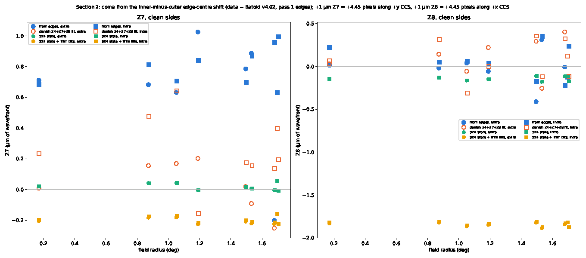
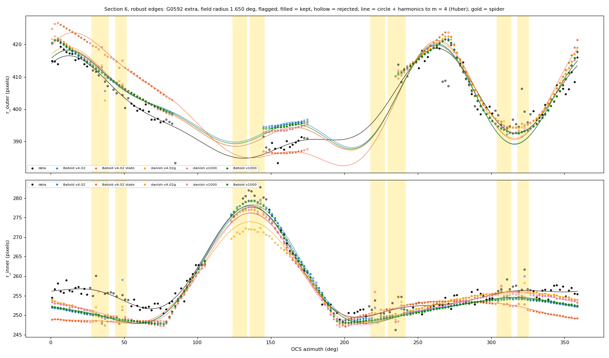

Next:
- Aaron to confirm G0249 and G0592 for the listed G0429 and G0492.
- Fit a central-obscuration scale and decentre in Batoid against the clean inner edges:
  the ratio excess and the +y shift together, both sides of focus.
- Check the filter clear aperture at 1.74–1.86 deg against the CAD: the data edge lies
  7–21 pixels outside Batoid's there.

### 2026-10-19 — pupil model: Z4-only fits, Batoid images and edges

Code `93994b8`: `code/z4_fits.py`, `code/batoid_images.py`, `code/pupil_edges.py`.
Run `20261018_pupil`: tables `z4_fits`, `batoid_images`, `edges_bins`, `edge_stats`,
`unmodelled_surfaces` (parquet and csv). The PDF is `giant_donut_pupil_model.pdf`, 119
pages: three per donut side (step 1, 2, 3), then 5 summary pages.

**Aaron's read of the fits PDF.** v4.02 places the spider correctly; v1000's vanes are
one vane width (50 mm) off. On the intra-focal side, v4.02's vane widths fit the data.
The free fits push the blur FWHM to the 1.5 arcsec bound on 20 of 38 donut sides,
because the model has no thermal effects. Beyond 1.9 deg the fitted wavefront (20–44 µm)
is unphysical and is very likely pupil-model mismatch. The goal now is the pupil model.

Same 38 donut sides, flags, neighbour masks and full-resolution ISR stamps as
`20261018_fits` (read from its `images/`).

**Step 1, Z4-only danish fits.** Z4, flux and centre float. Noll 5–28 are fixed at each
pupil's own batoid intrinsic, at the donut field with the side's offsets. Blur is fixed
at 1.0 arcsec FWHM, with no background term. 76 of 76 fits converged.
- v4.02 has the lower residual RMS (inside 1.1 r_out, unmasked pixels) on 35 of 38 sides
  and 15 of 16 clean. Median v4.02/v1000 residual RMS (dimensionless): 0.944 all, 0.942
  clean.
- Z4 − intrinsic, v4.02 (µm of wavefront): +0.17 to +1.26 clean, −1.48 to +1.39 all.
  v1000: +0.19 to +1.23 clean.
- chi2/dof spans 1.16–199 (v4.02). It scales with brightness, as before.

**Step 2, Batoid images, v4.02.**
- Reduced model per side: the optical surfaces plus the 24–231 obscurations that
  vignette first at least one ray of a 500 × 500 traceFull grid. Agreement with the full
  model (dimensionless fraction of rays): 0.99996–1.00000. The reduced model passed on
  all 38 sides; the full model was not needed.
- Spider: the telescope (not the camera) is rotated by −rtp. Checked against the danish
  mask at a 10 deg test angle: agreement 0.99997 with that sign, 0.972 with the other.
- Camera piston that matches Batoid Z4 to the step 1 fit: −3 to +75 µm extra-focal
  (median +25 µm), −95 to +89 µm intra-focal (median +58 µm).
- 25–30 million rays per side at 620 nm; 103–116 rays per illuminated pixel (median per
  side). Kolmogorov blur, 1.0 arcsec FWHM, drawn as danish does.
- Cross-correlation shift after centring on the step 1 model (pixels): magnitude
  0.0–2.4 on clean sides, up to 18 on flagged sides (G0732 extra, G0714 extra).
- Batoid/danish residual RMS (dimensionless): median 0.977 all, 0.982 clean. Batoid is
  lower on 30 of 38 sides.

**Step 3, edges against azimuth.** 50 % of the flat top, 2 deg bins. Spider bins,
Batoid-vignetted bins and neighbour-masked crossings are marked and excluded.
Per-side RMS of the edge differences (pixels):

| field radius (deg) | subset | data − Batoid, outer | data − Batoid, inner | v4.02 model − Batoid, outer | v4.02 model − Batoid, inner |
|---|---|---|---|---|---|
| 0–1.0 | clean (4) | 1.2–1.5 | 2.6–4.8 | 0.19–0.65 | 0.17–0.29 |
| 1.0–1.6 | clean (8) | 1.2–2.2 | 2.8–4.3 | 0.19–0.81 | 0.22–1.09 |
| 1.6–1.725 | clean (4) | 1.3–2.1 | 2.6–12.4 | 0.66–0.79 | 0.83–1.57 |
| 1.6–1.725 | flagged (5) | 3.2–29 | 2.8–82 | 0.41–2.3 | 0.89–3.0 |
| 1.725–1.9 | flagged (13) | 1.2–8.8 | 2.1–41 | 0.47–7.2 | 1.2–4.1 |
| 1.9–2.0 | flagged (4) | 1.4–6.3 | 2.2–3.5 | 1.3–12.1 | 2.7–5.8 |

The danish v4.02 model tracks the full Batoid model to about 1 pixel inside 1.725 deg.
It departs beyond that, up to 12 pixels RMS at 1.9–2.0 deg. The data depart from both.
On clean sides, the median data − Batoid inner-edge offset per 45 deg OCS sector is
+3.5 to +5.7 pixels over 0–135 deg and −0.9 to +1.3 pixels over 225–315 deg (extra and
intra alike). The outer-edge offset is −0.4 to −1.7 pixels. Read plainly, the inner
shadow is decentred by about 2.5 pixels (25 µm in the focal plane) relative to the
model, the same way on both sides of focus. The cause is not established.

Unmodelled surfaces: 234 runs of 3 or more bins with |data − Batoid| > 3 pixels, 79 of
them on clean sides. By the first clipping surface just outside the Batoid edge:

| surface | edge | runs | bins | median offset (pixels) |
|---|---|---|---|---|
| M1 (inner hole) | inner | 101 | 964 | +3.7 |
| M2 | inner | 39 | 505 | +4.0 |
| M1Baffle1 | outer | 53 | 300 | −3.9 |
| M3 | outer | 13 | 109 | −3.5 |
| Filter entrance | outer | 11 | 108 | +12.5 |
| CameraSilhouette | inner | 8 | 53 | +3.7 |

The largest single runs are inner-edge runs at OCS 54–126 deg on clean donuts (G0005
extra, G0329, G0491, G0515 extra, G0160), each 30–37 bins at +4 to +6 pixels. Those are
the decentre above, not a missing surface. The Filter-entrance runs are all on corner or
edge-of-field sides at 1.74–1.86 deg (G0663, G0664, G0678, G0681, G0684 intra). There
the data edge lies 7–19 pixels outside Batoid's, so v4.02 clips at the filter where the
sky does not.

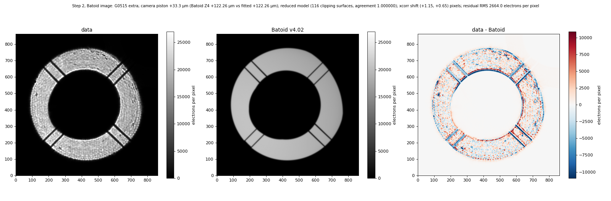
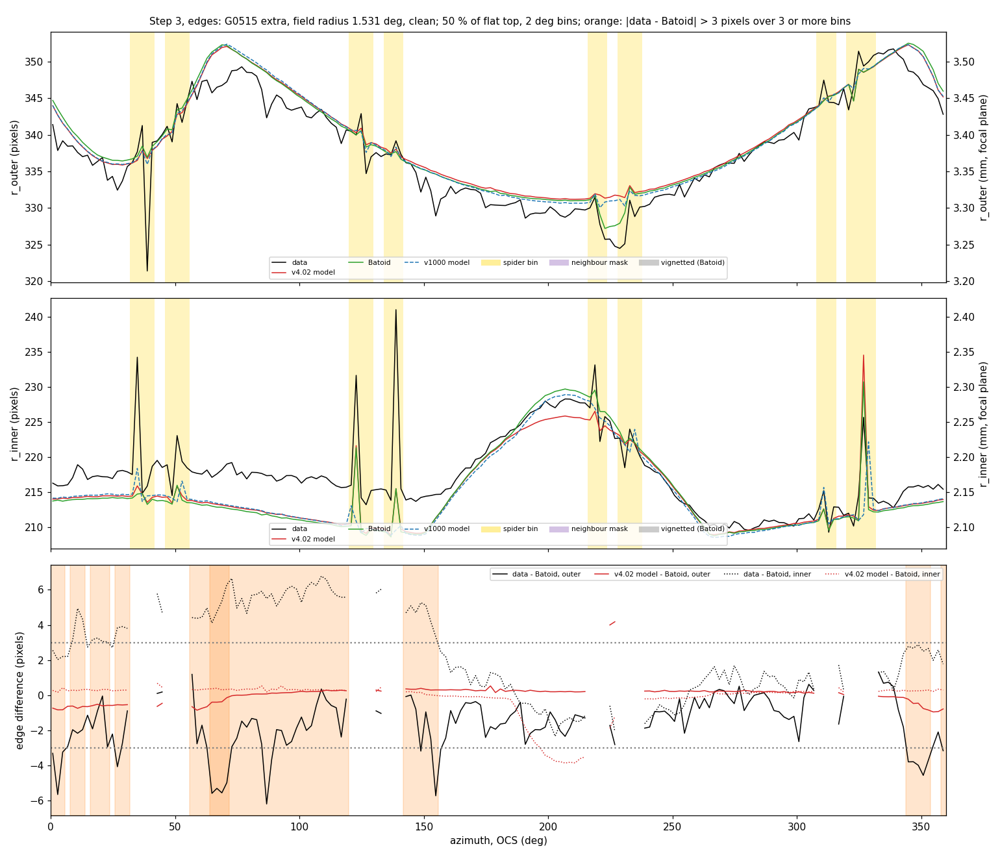

Next:
- Fit the inner-obscuration decentre (M2 or M1 inner-hole shift) in Batoid against the
  clean inner edges.
- Check the filter aperture at 1.74–1.86 deg against the CAD.

### 2026-10-18 — spider check and fits: v4.02 against v1000

Code `1f09446`: `code/spider_validation.py`, `code/fit_donuts.py`, `code/plot_results.py`.
Runs: `20261018_spider_validation`, `20261018_fits`. The results PDF is
`output/20261018_fits/giant_donut_pupil_results.pdf`, 46 pages.

**Spider check** (`20261018_spider_validation`). Each file's `Spider_3D` shadow on the stop
plane is compared with the batoid-traced v4.02 CAD spider planes, rotator 0 deg, offsets
(0, 0), (+4, +4) and (−4, −4) mm. The plan called for each file against its own model,
but `Rubin_v1000_r.yaml` has no spider, so v1000 is checked against the CAD too. The
offset is the vane-shadow position, danish minus batoid, perpendicular to the arm. Strip
agreement is the fraction of rays within one vane width of the batoid shadow on which
the two agree (dimensionless).

| field radius (deg) | v4.02 max offset (mm) | v4.02 strip agreement | v1000 max offset (mm; vane widths) | v1000 strip agreement |
|---|---|---|---|---|
| 0 | 0.0 | 1.0000 | 50.0; 1.00 | 0.25 |
| 1.0 | 0.0 | 1.0000 | 55.6; 1.11 | 0.30 |
| 1.75 | 0.0 | 0.9995 | 59.9; 1.20 | 0.34 |

The defocus offsets change no number. v1000 places its vanes 0.40 m from the axis, the
CAD places them at 0.35 m, so every v1000 shadow sits about one vane width (50 mm) off.
The v4.02 stop rule (offset > 0.050 m) did not trip.

**Fits** (`20261018_fits`, table `fits.parquet`/`fits.csv`):
- 20 donuts on 38 donut sides: 18 on both visits, G0643 intra only, G0676 extra only.
- 4 fits per side, 152 fits in all. 152 of 152 converged, with no failures.
- Settings: full-resolution ISR on the 18 picked detectors; binning 1; spider on, with
  `spider_angle` = rtp (−0.199 deg and −0.046 deg); blur FWHM bounded to 0.1–1.5 arcsec;
  tolerance 1e-3.
- Coefficients are stored in CCS and in OCS (rotated by rtp).
- The neighbour mask (variance 1e20 electrons² within 1.05 r_out of a neighbour) was
  applied on 9 donut sides. It masked part of the target's ring on 4 of them. Fraction
  of the target's ring masked (dimensionless): G0592 extra 0.230, G0606 extra 0.487,
  G0606 intra 0.119, G0635 extra 0.344.
- Blur FWHM at the 1.5 arcsec bound on 20 of 38 donut sides in the blitz set, for both
  pupils, mostly intra-focal.

**Residuals.** Residual RMS is taken inside 1.1 r_out, over unmasked pixels, in
electrons per pixel. "v4.02 better" means lower residual RMS.

| Zernike set | v4.02 better, all | v4.02 better, clean | median v4.02/v1000 residual RMS, all | clean |
|---|---|---|---|---|
| Z4 + Z11 + Z22 | 35 of 38 | 16 of 16 | 0.939 | 0.938 |
| blitz (Noll 4–19, 22–26) | 28 of 38 | 12 of 16 | 0.948 | 0.948 |

The ratios are dimensionless. The per-donut residual images show the v1000 vane shadows
offset from the data, and the v4.02 shadows on it.

Residual RMS scales with brightness. The r = 8.9–10.3 mag donuts reach 540–2900
electrons per pixel, but as a fraction of the ring level (residual RMS over mean ring
level, dimensionless) they sit at 0.10–0.17, like the rest. The one fit that failed in
substance is G0592 intra (marginal, flagged): 1.92 of the ring level.

**Z5–Z8.** For the clean subset with the blitz set:
- The fitted deviations from the batoid reference are within ±3 µm of wavefront.
- No trend with field radius: |Pearson r| ≤ 0.29 and |Spearman rho| ≤ 0.35, against
  field radius (deg), n = 16 per pupil and term.
- Median |v4.02 − v1000| (µm of wavefront): Z5 0.61, Z6 0.19, Z7 0.20, Z8 0.10.
- Median |intra − extra| on the 7 clean donuts seen on both visits (µm of wavefront):
  0.30–0.70 for v1000 and 0.33–1.38 for v4.02.

Beyond 1.9 deg (G0732, G0737) the deviations reach 20–44 µm, with opposite signs intra
and extra. The model does not describe those donuts.

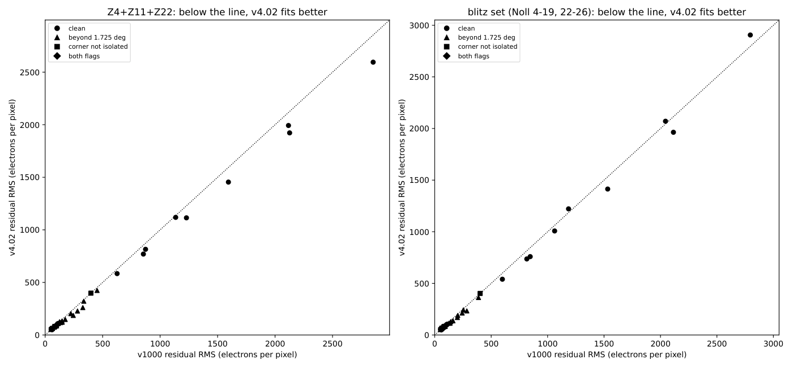
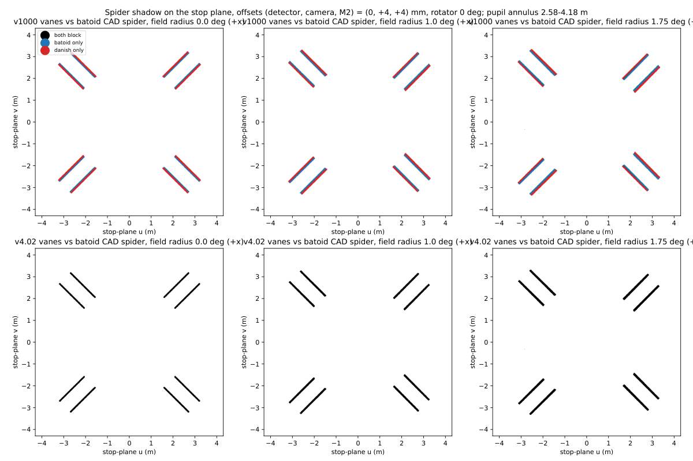

Next:
- A fixed-blur pass. The intra-focal blur sits at the 1.5 arcsec bound on most donuts.
- The TMA sections and the silhouette-circle error at > 1.75 deg are the known gaps of
  the v4.02 file.

### 2026-10-18 — plan

**Step 2, selection and display (done, below).**

**Step 3, Danish fits on the donuts Aaron picks.**
- Single-sided, one fit per donut, spider on (`spider_angle` from the rotator angle),
  through `wfs/code/giant_donuts/fit_giant_donut.py` (`fit_stamp`, `pupil_override`),
  with offsets (detector, camera, M2) = (0, ±4, ±4) mm. Corner sensors add their
  ±1.5 mm detector offset. Full-resolution ISR on the chosen detectors only.
- Two Zernike sets: Z4 + Z11 + Z22 only; the full blitz set (Noll 4–19, 22–26).
- Two pupils, so 4 fits per donut:
  - v1000: danish `RubinObsc_v1000_r_rtpp0_azp45_pp0d0.yaml` and the v1000 batoid model.
  - v4.02: a RubinObsc-format obscuration file built from `LSST_r_v4.02.yaml`, with the
    batoid model swapped to match.
- Building the v4.02 file. ts_wep `utils/maskUtils.fitMaskModel` / `_fitEdges` exists:
  it fits a circle (cubic in field angle, centre and radius) per batoid obscuration.
  danish 1.3 ships only the v1000 and v3.14 files and no generator. v4.02 carries
  106 `ClearPolygon` camera openings, 688 `ObscPolygon` and 440 baffle planes, so a
  per-item fit is not usable as is. Plan:
  1. Fit M1, M2, M3, L1, L2, filter and L3 edges with `_fitEdges`, as v1000 was
     (`wfs/code/giant_donuts/gen_mask_params.py` handles the per-element frame).
  2. Replace `CameraBody` with one circle fitted to the union of the
     `CameraSilhouette_z*` planes, and drop the in-camera openings: they clip no ray at
     any field (`LSST_r_v4.02_changes.md`, validation). Check that.
  3. `Spider_3D` from the CAD: vanes at 0.350 m from the axis, 0.050 m wide, 2.77 m
     long, at the CAD heights (`spider_z.py`).
  4. Validate against batoid as the archived `wfs_batoid_pupil_compare` notebook did:
     agreement fraction of the danish mask against traced vignetting at 0, 1.0, 1.5,
     1.75 deg, with the 4 + 4 mm offsets applied, in the stop-plane frame.
  - Caveat: v4.02's camera openings come from the z-band CAD; these visits are r band.
- Output: one table, one row per (donut, pupil, Zernike set): coefficients (µm of
  wavefront), blur FWHM (arcsec), chi2/dof, residual image.

**Step 4, results.**
- Coma (Z7, Z8) and astigmatism (Z5, Z6) against field position for both pupils:
  focal-plane maps (OCS, deg) and against field radius (deg).
- Intra against extra for the same stars.
- Fit residual maps per donut, and v1000 minus v4.02 residual comparison: residual RMS
  per donut (electrons per pixel) and its difference.

### 2026-10-18 — candidate selection

ISR: overscan, assembly and gains (`donut_images.minimal_isr_config`) on all 197 detectors
of both visits, no failures; cached 4×4 binned. Run `output/20261018_candidates/`.

Measured donut radii, outer / inner half-maximum, full-resolution pixels:

| visit | science | SW0 | SW1 |
|---|---|---|---|
| 337 extra | 340 / 212 | 404 / 248 | 268 / 176 |
| 340 intra | 336 / 208 | 272 / 172 | 400 / 248 |

The corner sensors add their ±1.5 mm detector offset, so SW0 and SW1 swap sizes between
the visits. Raw-WCS refcat positions sit about 4.6 mm (x) and 1.7 mm (y) off the donut
centres in focal-plane coordinates. An affine fit per visit corrects them, with 0.08 mm
scatter (nMAD of the residual radius) over 271–273 matched stars.

Selection: the_monster stars at r = 7.0–14.5 AB mag, whole donut on silicon.
- (a) blitz `DonutSourceSelectorTask`: `unblendedSeparation` and `minBlendedSeparation`
  scaled from the FAM radius (66.5 px) to the giant one; `isolatedMagDiff` 2 mag.
- (b) Image check: mean flux in 1.05–1.5 r_out over the ring's mean (annulus_ratio,
  dimensionless), and the fraction of the ring under another donut (overlap_frac,
  dimensionless).
- Classes: **isolated** = (a) and (b) clean (annulus_ratio < 0.05, overlap_frac < 0.02);
  **marginal** = one of them; **blended** = neither; **saturated** = binned ring
  99th percentile > 1.2e5 electrons per pixel.

Candidate counts:

| region | visit | isolated | marginal | blended | saturated |
|---|---|---|---|---|---|
| science | 337 extra | 148 | 89 | 470 | 1 |
| science | 340 intra | 145 | 92 | 476 | 1 |
| corner WFS | 337 extra | 3 | 1 | 11 | 0 |
| corner WFS | 340 intra | 5 | 4 | 7 | 0 |

738 stars, 715 of them on both visits. 20 proposed (`proposed` column):
- 12 science donuts, isolated on both visits, field radius 0.17–1.98 deg.
- 8 corner WFS donuts, 2 per raft. Only G0618 (R40_SW0) and G0663 (R44_SW1) are isolated
  on both visits. G0643 and G0676 are on silicon in one visit only. G0592, G0606 and
  G0678 are marginal, and G0635 is isolated on intra only. The corner fields are crowded.

### 2026-10-18 — Aaron's picks; the v4.02 obscuration file

**Picks.** Aaron took all 20 proposed donuts (12 science, 8 corner WFS). The selection is
good enough for a first pass and is not re-tuned. Each donut is fitted on every visit
where it is on silicon. Two flags go on every table and plot:
- `beyond_fov`: field radius > 1.725 deg.
- `corner_not_isolated`: a corner donut with iso_class != isolated, overlap_frac > 0.02 or
  annulus_ratio > 0.05 on that visit.

The clean subset is the rows with neither flag.

**v4.02 file** (`code/obscuration_v402.py`, run `output/20261018_obscuration_v402/`,
`RubinObsc_v4.02_r_rtpp0_pp0d0.yaml`; not committed to rubin-optical-model).
- Circles from ts_wep `fitMaskModel` on a copy of v4.02 cut to M1 and its baffles, M2,
  M3, the lenses, the filter and the detector. ts_wep's `_fitCircle` fails under numpy 2
  (a 1-element array goes to `np.arange`). The study carries a fixed copy; ts_wep is
  not edited.
- In-camera openings dropped. Rays they alone block, over transmitted rays
  (dimensionless): 0 at 1.5–1.98 deg for every offset tried.
- Camera silhouette: one circle per field angle on the stop plane, then a cubic. It is
  centred at 0 m with radius 2.078 m at 0 deg, and at −0.795 m with radius 2.130 m at
  1.75 deg. Outside the M1 inner edge the shadow departs from the circle by up to 0.062 m
  (1.75 deg) and 0.081 m (2.0 deg).
- Not represented: the TMA sections. Rays they alone block, over transmitted rays
  (dimensionless): 0.0010 at 1.75 deg and 0.0046 at 1.98 deg.
- `Spider_3D`: the 48 CAD member edges (rubin-optical-model `spider_tilted`) as 50 mm
  vanes, heights from the stop plane. Against the batoid spider planes, the rays they
  classify differently, over transmitted rays (dimensionless), are below 0.0001 at 0 and
  1.75 deg.

**Validation against batoid.** Rays are traced on the stop plane out to 4.3 m. Each
file is compared with its own batoid model (v1000 with `Rubin_v1000_r.yaml`, v4.02 with
`LSST_r_v4.02.yaml`), both without the spider. The table gives the agreement fraction
(dimensionless): rays where danish and batoid agree on transmission, over all rays.
Offsets are (camera, M2) in mm, detector 0. The corner configurations add ±1.5 mm on the
detector, which changes no number in the table. At 1.65 deg the agreement fraction is
0.9988 for v1000 and 0.9963 for v4.02, with any corner offset.

| field radius (deg) | offsets (mm) | v1000 | v4.02 | v4.02 with spider |
|---|---|---|---|---|
| 0 | 0, 0 | 1.0000 | 1.0000 | 1.0000 |
| 0 | ±4, ±4 | 1.0000 | 1.0000 | 1.0000 |
| 1.0 | 0, 0 | 1.0000 | 1.0000 | 1.0000 |
| 1.0 | ±4, ±4 | 0.9998 | 0.9998 | 0.9998 |
| 1.5 | 0, 0 | 0.9999 | 0.9990 | 0.9990 |
| 1.5 | +4, +4 | 0.9990 | 0.9981 | 0.9981 |
| 1.5 | −4, −4 | 0.9992 | 0.9984 | 0.9984 |
| 1.75 | 0, 0 | 0.9990 | 0.9966 | 0.9967 |
| 1.75 | +4, +4 | 0.9848 | 0.9909 | 0.9911 |
| 1.75 | −4, −4 | 0.9838 | 0.9835 | 0.9837 |

The plan's stop rule was "stop if v4.02 agrees with its batoid model worse than v1000
does with its own". That rule tripped. Aaron's call: **continue**. The rule was too
strict. v4.02 is within 0.0025 (agreement fraction, dimensionless) of v1000 everywhere,
and better at 1.75 deg with +4/+4 mm. Both lose about 1.6% at 1.75 deg with −4/−4 mm.
That is the limit of the circle model, and it is the same for both files.
