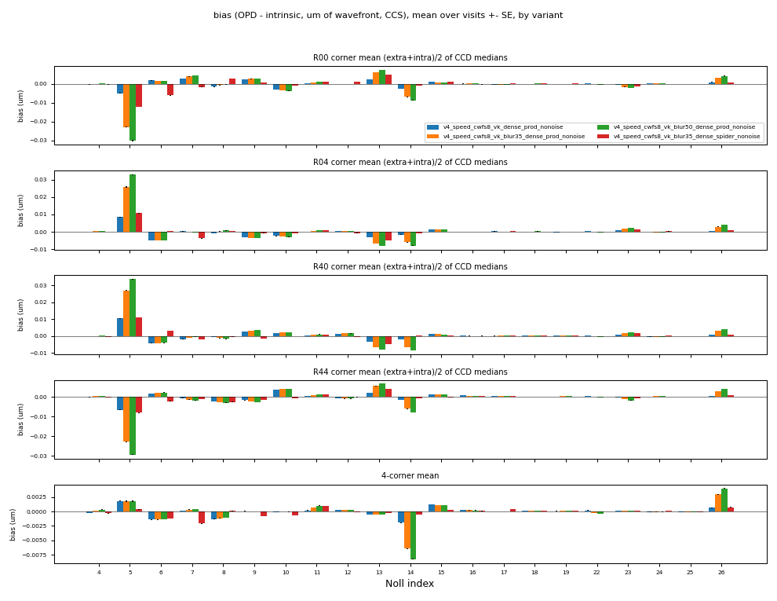

# `v4speed_cwfs_visit_bias`

## Question

Do shot noise and an elliptical von Karman seeing kernel give the production Danish CWFS fits (dense 21 terms, no spider) a bias in astigmatism and coma that survives the extra/intra corner average, with 1st and 2nd aberrations anticorrelated?

## Current answer

With perfect alignment, shot noise and a 3% elliptical von Karman kernel leave the CWFS corner (extra+intra) mean within 0.011 um of the intrinsic, and noise adds no bias. A fixed intra - extra blur difference breaks the cancellation: at the measured Danish difference (0.35 arcsec fitted, blur50) the corner Z5 bias is +-0.030-0.034 um (RMS 0.032 um), anticorrelated with Z13 (slope -0.24, dimensionless), alternating sign by corner so the 4-corner mean stays at +0.002 um; Z14 shifts -0.008 um on every corner. Modelling the spider halves it.

## Log

### 2026-11-23 — pass 1: noise, seeing ellipticity and intra - extra blur

Simulated 100 CWFS visits, perfectly aligned: 8 donuts per corner half-chip inside
1.725 deg (`batoid_intrinsic v4_speed_cwfs8`), r band, 30 s, stars 10.5-15.42 mag AB
(dN/dm ∝ 10^(0.25 m)), sky 19.5-21.2 mag/arcsec² (about 900-4300 e- per pixel), read
noise 6 e-, von Kármán 1.0 arcsec FWHM, L0 20 m, distortion e 0.03 with the major-axis
angle drawn per visit and corner, ±0.5 px offsets (`sim_donut_visits`). Fits as
production: dense 21 terms, no spider, binning 2, production tolerances
(`sim_donut_visit_fits`), on the noisy stamps and on their noise-free expectation.
Products `5e49e54`, `fdd913e`; script `code/visit_bias.py`; runs `20261123_visit_bias`,
`20261123_visit_bias_blur`. Bias = per-CCD median OPD minus median intrinsic (µm of
wavefront, CCS), corner = mean of SW0 (extra) and SW1 (intra), averaged over visits.

| variant | fitted FWHM extra / intra (arcsec) | corner Z5 RMS | corner Z13 RMS | 4-corner Z14 |
|---|---|---|---|---|
| no blur difference, noisy | 1.058 / 1.057 | 0.0067 | 0.0025 | -0.0020 |
| no blur difference, noise-free | 1.054 / 1.053 | 0.0080 | 0.0029 | -0.0020 |
| intra +0.35 arcsec injected, noisy | 1.058 / 1.293 | 0.0232 | 0.0058 | -0.0066 |
| intra +0.35, noise-free | 1.054 / 1.293 | 0.0247 | 0.0063 | -0.0064 |
| intra +0.50 (Danish difference 0.350), noise-free | 1.054 / 1.404 | 0.0315 | 0.0076 | -0.0083 |
| intra +0.35, noise-free, spider modelled | 1.045 / 1.286 | 0.0106 | 0.0046 | -0.0006 |

(corner RMS over the 4 corners, µm; 4-corner mean of Z14, µm.)

- Per CCD the bias is large and odd in defocus (Z5 RMS over CCDs 0.25 µm, Z14 0.18 µm,
  Z7/Z8 0.037 µm), the missing-spider bias of `v4speed_spiderbias`.
- Shot noise adds no bias: noisy minus noise-free per donut has mean at most 0.0002 µm,
  standard deviation 0.020 µm in Z5 (0.032 µm fainter than 15 mag).
- The e 0.03 kernel moves Z5 and Z6 by under 0.001 µm (cos 2β, sin 2β of the angle).
- An intra - extra blur difference stops the odd bias cancelling: corner Z5 grows to
  ±0.030-0.034 µm at the measured Danish difference, with Z13 anticorrelated (slope
  -0.24, dimensionless, over corners), the weak Z5/Z13/Z23 direction of the dense fit.
  Its sign alternates by corner (R04, R40 positive; R00, R44 negative), so the 4-corner
  mean stays at +0.002 µm; Danish's fitted FWHM difference is 0.69 of the injected.
- Modelling the spider halves the corner residual (0.0247 to 0.0106 µm) and removes the
  Z14 shift; the rest is the field offset between SW0 and SW1 points.

Next, if wanted: blur drawn per visit (time variation), phase screens, and the corner
Z5 pattern expressed as a double-Zernike field term to compare with the MIW.

### 2026-11-23 — started

Study created.
