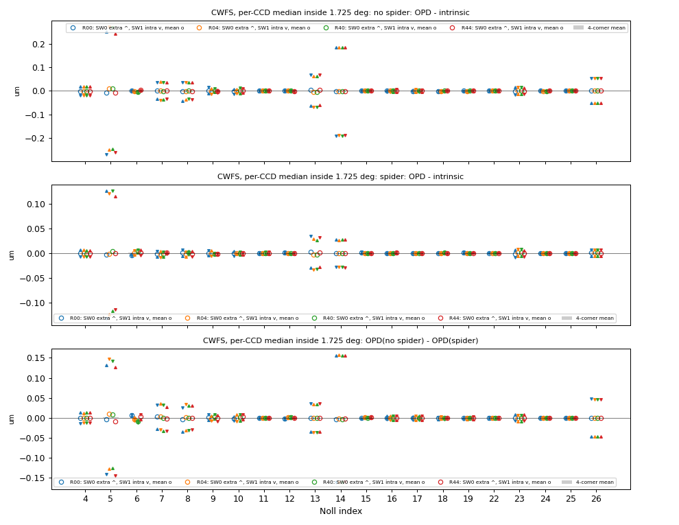

# `v4speed_spiderbias`

## Question

How does omitting the spider from the Danish model (the production default) bias the recovered wavefront, per Noll term, per side and averaged over extra and intra?

## Current answer

Omitting the spider (production) biases each side but the bias is odd in defocus: CWFS per CCD Z5 +-0.13-0.15 um and Z14 +-0.16 um, sign flipping with side, corner extra/intra mean <= 0.010 um; FAM even part <= 0.006 um RMS. Giant donuts keep an even Z6 part, 0.088 um RMS.

## Log

### 2026-11-23 — pass 1: no-spider against spider dense fits

Compared `sim_donut_fits` `v4_speed_dense_prod` (no spider, production tolerances) with
`v4_speed_dense` (spider at 0 deg, tight tolerances) on the same noise-free stamps
(1e6 e- per donut, Noll 4-19, 22-26, binning 2): delta = OPD(no spider) - OPD(spider),
µm of wavefront, CCS, field r <= 1.725 deg. Script `code/spider_bias.py` (`20809ae`), run
`20261123_spider_bias`.

- Per side the bias is large: CWFS per-CCD median δZ5 ±0.13-0.15 µm, δZ14 ±0.16 µm,
  δZ7/δZ8 ±0.03 µm, sign flipping between SW0 (extra) and SW1 (intra). FAM RMS over field
  per side: Z14 0.168, Z5 0.067, Z6 0.030 µm.
- It is odd in defocus: CWFS corner means (extra+intra)/2 are at most 0.010 µm and the
  4-corner mean at most 0.002 µm; FAM even part at most 0.006 µm RMS in every term.
- Giant donuts keep an even part: Z6 0.088 µm RMS, Z12 0.021 µm RMS.
- The variants also differ in tolerance; the linearised bias from truth matches the
  production fit (`v4speed_danish_closure` check), so the tolerance contributes little.

So in noise-free sims the missing spider does not explain an astigmatism or coma offset
in an extra/intra-averaged MIW. 

### 2026-11-23 — started

Study created.
