# BLOCK-T720 elevation bounce: A–B–A optical-state change and the 22/12 recovery

> **Status:** draft · **Last updated:** 2026-11-22 · **Kind:** outward-facing note (method and results)

**Summary.** The BLOCK-T720 bounce test alternates Full Array Mode (FAM) wavefront visits
between a reference elevation of 70 deg and a comparison elevation, on six nights in April
to July 2026. That gives seven (night, leg) points at 30, 40 (three nights), 50, 60 and
75 deg. For each leg we measure the change in the Double-Zernike (DZ) wavefront by
**A–B–A** differencing: each B visit minus the two neighbouring A visits interpolated in
time. This removes the slow wavefront drift that biased the earlier paired difference. A
Monte Carlo (MC) noise model fitted from the same visits gives the errors. We recover the
change into optical degrees of freedom (DOF) with three schemes:
- the default 50-DOF, 34-mode truncated inversion (50/34);
- Range-Bounded Recovery over 50 DOF and 50 modes (RBR 50/50);
- the 22-DOF, 12-mode reduced set (22/12).

Under 50/34, 86 of 350 (leg, DOF) values exceed their allowed range, against 6 under
RBR 50/50 and 0 of 154 under 22/12. In every scheme, M2 dz and camera dz are anticorrelated
at MC r ≈ −0.99, so only their sum is measured. The 22/12 ΔDOF follow elevation in
the camera decentres and tilts, M2 dy and tilt, and the low M1M3 bending modes. The three
40 deg nights disagree beyond their errors: median chi2/dof = 5.1/2 over the 22 DOF.

**Acronyms.**
- AOS: Active Optics System.
- FAM: Full Array Mode, intra- and extra-focal images over the full focal plane.
- DZ: Double Zernike.
- DOF: degree of freedom.
- MIW: measured intrinsic wavefront.
- RBR: Range-Bounded Recovery.
- MC: Monte Carlo.
- SVD: singular value decomposition.
- OCS: Optical Coordinate System.
- LUT: look-up table.
- FWHM: full width at half maximum.

---

## 1. Input visits

BLOCK-T720 slews between the reference A (elevation 70 deg) and one comparison
elevation B, alternating one FAM visit at each. The rotator stays near 0 deg
(−1.2 to +0.2 deg measured). The visit cadence is 2.7–2.8 min (median gap between
consecutive visits), so a B visit follows its A by 2.6–3.1 min.

A leg is the set of visits within a window about its nominal elevation:
- 67–73 deg for A;
- ±3 deg for each B, except 73–78 deg for the 75 deg leg.

On 20260713 the first 31 min alternate 70 and 75 deg and the rest alternate 70 and 30 deg.
That night therefore gives two legs, which share the A visits.

Visits pass a quality cut, the bounce's own and looser than the default 170-detector cut:
- at least 500 donuts;
- at least 160 detectors with donuts;
- median donut blur ≤ 1.2 arcsec.

95 of the 104 BLOCK-T720 visits pass.

| night | B elev (deg) | band | A visits | B visits | A–B–A diffs | span (min) | median blur (arcsec) | seq_num | A/B pattern |
|---|---|---|---|---|---|---|---|---|---|
| 20260418 | 40 | i | 6 | 6 | 5 | 31 | 0.94 | 356–389 | `ABABABABABAB` |
| 20260419 | 40 | i | 12 | 10 | 9 | 81 | 0.88 | 273–356 | `AABABAABABABABABABABAB` |
| 20260513 | 40 | i | 8 | 8 | 7 | 54 | 0.79 | 176–222 | `ABABABABABABABAB` |
| 20260709 | 60 | i | 6 | 4 | 3 | 30 | 1.03 | 50–83 | `ABABABAAAB` |
| 20260711 | 50 | r | 6 | 6 | 5 | 30 | 1.03 | 15–48 | `ABABABABABAB` |
| 20260713 | 30 | r | 12 | 5 | 5 | 62 | 0.63 | 15–81 | `A.A.A.A.A.A.ABABABABABA` |
| 20260713 | 75 | r | 12 | 6 | 6 | 62 | 0.61 | 15–81 | `ABABABABABABA.A.A.A.A.A` |

In the pattern, `.` is a visit of the night's other leg. A B visit with no A after it,
such as the last one on 20260418, gives no A–B–A difference.

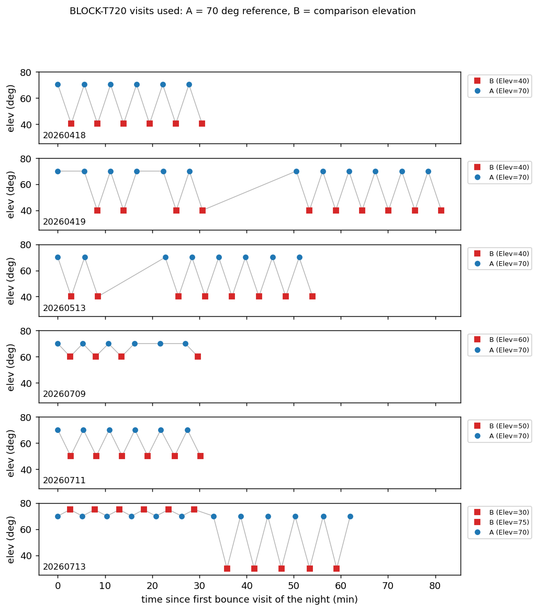

*Figure 1. Elevation of every visit used, against time since the night's first bounce
visit. Blue circles are A (70 deg); red squares are B.*

## 2. Processing

**Donut fits.** The donuts are fit with Danish 1.3 on the `/repo/main` collection
`u/jmeyers3/bounce_fam_unpaired_v3.14`:
- binned ×2;
- unpaired, so each intra- and extra-focal donut is fit on its own;
- v3.14 pupil model.

This is the `fam_tables` variant `danish_1_3`. Each donut gives annular Zernike coefficients
$Z_j$, Noll $j$ = 4–19 and 22–26 (21 terms), in µm of wavefront at its field position
$\vec\theta$ in OCS. There are about 3300 donuts per visit.

**Double-Zernike fit.** Per visit, each pupil coefficient is fit across the field with
focal-plane Zernikes $\mathcal{Z}_k$, $k$ = 1–6, by a Huber M-estimator:

$$
Z_j(\vec\theta) - Z_j^{\mathrm{intrinsic}}(\vec\theta) \;=\; \sum_{k=1}^{6} w_{kj}\,\mathcal{Z}_k(\vec\theta/1.75^\circ).
$$

That gives 126 DZ terms $w_{kj}$ per visit, written DZ(k,j), in µm of wavefront.

**Intrinsic.** $Z_j^{\mathrm{intrinsic}}$ is the batoid design wavefront for the 22/12 results,
and the 50/50 RBR MIW `d13-A_50_50_i_rbr_5rot` for the RBR results. The choice hardly
matters here:
- Per visit, the two DZ tables differ by a near-constant offset (nMAD of the per-visit
  difference 0.0002–0.0005 µm).
- At a fixed rotator that offset cancels in the A–B–A difference.
- The 22/12 results from the two intrinsics differ by at most 0.18 of the MC error for any
  DOF and 0.13 for any v-mode (dimensionless; |batoid − MIW| over the MC error).

**Recovery.** Every scheme uses the ts_ofc sensitivity matrix $S$ (µm of wavefront per DOF
unit) over the same 126 DZ terms, with the shipped normalization (section 4).

## 3. The A–B–A difference

**Why not a paired difference.** The wavefront drifts during a night. For example, DZ(1,4)
of the A visits drifts by −0.8 to +0.5 µm per hour of wavefront (Figure 2a). The earlier
analysis paired each B with the A just before it. That pairing always lags by about 2.8 min,
so it adds drift × lag, which is up to 0.04 µm and changes sign from night to night. At
40 deg the three nights' paired values had chi2/dof = 262/2 about their mean.

**Method.** For each B visit $b$ at time $t_b$, take the A visits immediately before and
after it, $a_0$ and $a_1$, and interpolate them linearly to $t_b$:

$$
d_b \;=\; w_b - \Big[(1-f)\,w_{a_0} + f\,w_{a_1}\Big],\qquad f = \frac{t_b - t_{a_0}}{t_{a_1}-t_{a_0}}.
$$

$w$ here is the full 126-term DZ vector. The leg's ΔDZ is the median of $d_b$ over its B
visits, term by term. A linear drift cancels exactly, and the median limits the effect of a
single bad visit. ΔDZ is then recovered into ΔDOF and v-modes (section 4).

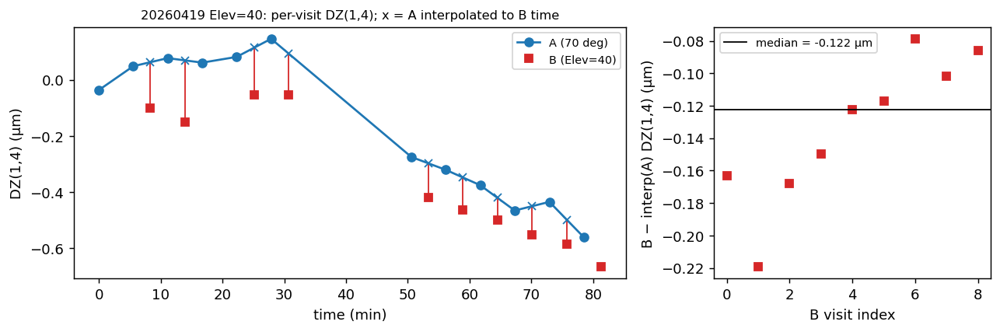

*Figure 2a. 20260419, 40 deg. Left: per-visit DZ(1,4). Blue is A, red is B, and × marks
the A visits interpolated to each B time; the red lines are the $d_b$. Right: $d_b$ by
B visit and their median. A spans 0.7 µm over the night's 80 min; the A–B–A differences
scatter by about 0.04 µm about −0.12 µm.*

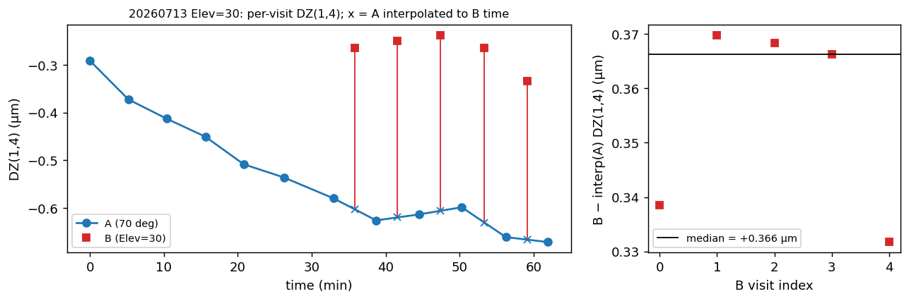

*Figure 2b. The same for 20260713, 30 deg: ΔDZ(1,4) = +0.366 µm.*

**Noise model and errors.** The errors are the standard deviation over 1000 MC draws per leg.
Each draw adds simulated noise to every visit of the leg and goes through the same A–B–A
median and the same recovery. The noise is fitted from the same visits:

- **White noise, all 126 terms.** The per-visit σ is
  $\sqrt{\sum d^2 / (2(N-G))}$, where $d$ is a B − A pair difference with its leg's median
  removed. There are $N$ = 45 pairs in $G$ = 7 legs, at lags of 2.6–3.1 min.
  - DZ(1,4) has σ = 0.044 µm per visit, about the atmospheric focus floor.
  - The largest is DZ(1,5) at 0.129 µm. Every $k \ge 2$ term is below 0.024 µm, and the
    median over terms is 0.0024 µm.
  - The correlations between terms are the Ledoit–Wolf estimate from the same pairs
    (shrinkage 0.66, dimensionless).
- **Red noise, DZ(1,4) only.** Same-setting differences grow with lag much faster than white
  noise allows. They follow $D(\tau) = 2\sigma_W^2 + \sigma_R^2(\tau/10\,{\rm min})^\alpha$
  with $\sigma_R$ = 0.088 ± 0.007 µm and $\alpha$ = 1.92 ± 0.14 (dimensionless);
  chi2/dof = 0.61/3. At 30–60 min lag, $D/(2\sigma_W^2)$ is 39 (dimensionless) for DZ(1,4),
  but 1.3 for the median term, so the other terms are treated as white.

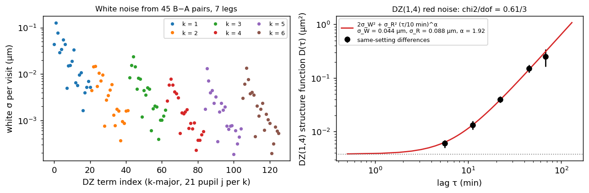

*Figure 3. Left: white σ per visit for the 126 DZ terms. Right: DZ(1,4) structure function
of same-setting visit pairs, and the fit; the dotted line is the white floor $2\sigma_W^2$.*

For a nonlinear scheme (RBR) the recovery is solved for each draw, so its errors need no
linearisation. Within one night, the A–B–A differences of DZ(1,4) about their weighted
mean, with the full model covariance, give chi2/dof from 0.12/2 to 5.74/6 per leg. So the
model describes the scatter within a night.

**ΔDZ.** Figure 4 shows the 16 terms with the largest RMS over legs. The largest are DZ(1,7),
DZ(1,5), DZ(1,4) and DZ(1,6), with RMS over the 7 legs of 0.15–0.20 µm. Most change
monotonically with elevation, cross zero at the 70 deg reference and change sign at 75 deg.
DZ(1,7), for example, goes from +0.26 µm at 30 deg to −0.09 µm at 75 deg.

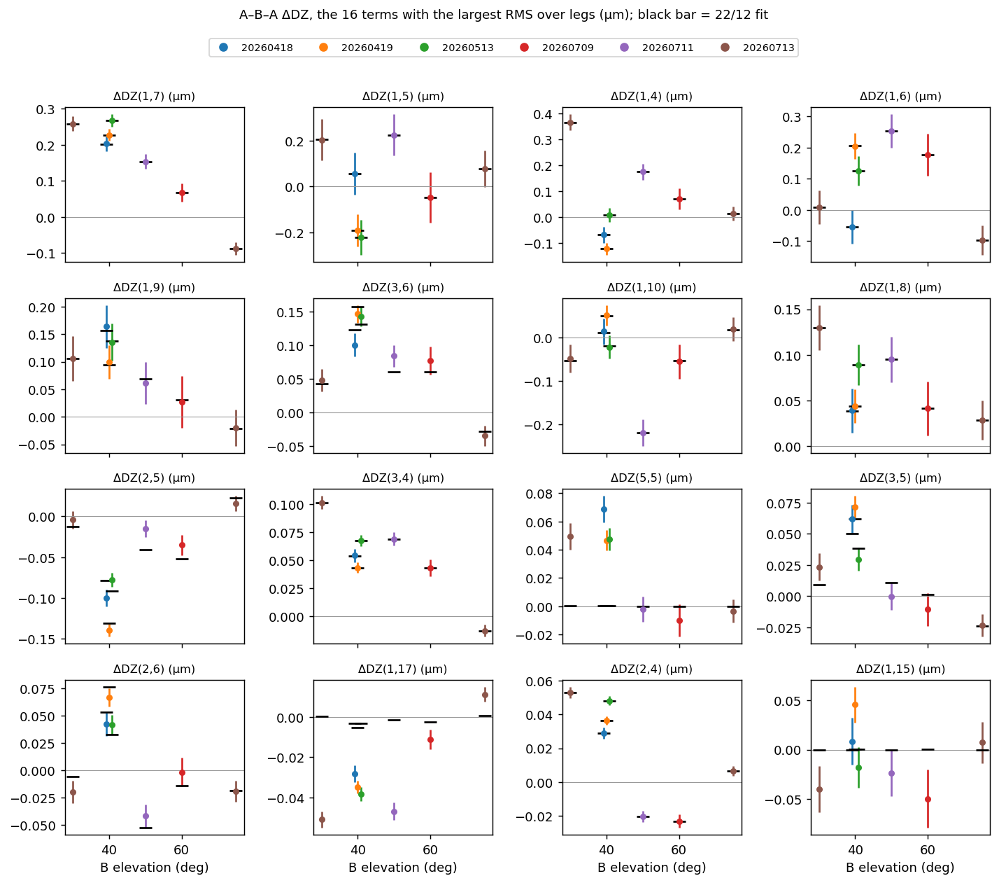

*Figure 4. A–B–A ΔDZ against B elevation, one point per (night, leg), coloured by night.
The three 40 deg nights are offset by ±0.8 deg for clarity. The black bar is the 22/12
fit, $S\,\Delta\mathrm{DOF}$.*

## 4. Recovery schemes

All three schemes start from the normalized sensitivity matrix $\hat S = S N$, where $N$
weights each DOF by its effect on image quality and its allowed range $r_j$. Its SVD is
$\hat S = U \Sigma V^\top$.

| scheme | DOF | modes kept | solve | v-modes |
|---|---|---|---|---|
| 50/34 | all 50 | 34 | truncated pseudo-inverse | 34 of the `all_50` state estimator |
| RBR 50/50 | all 50 | 50 | least squares plus a range penalty $\sum_j (\lvert d_j\rvert/(\kappa r_j))^{2p}$, $\kappa$ = 4, $p$ = 3, weight 1.0 µm² of wavefront (ts_ofc `dof_range_bounded`) | 50 of `all_50` |
| 22/12 | 22: M2 and camera hexapods (10), M1M3 bending B1_1–B1_7, M2 bending B2_1–B2_5 | 12 | truncated pseudo-inverse on the 22-DOF $\hat S$ | 12 of `standard_22` |

The 50/34 scheme is what the AOS feedback uses today. RBR 50/50 is the recovery the MIW is
built with. 22/12 is the reduced set the AOS is expected to run in.

### 4.1 Problems with 50/34

**Amplitudes beyond range.** Under 50/34, 86 of 350 (leg, DOF) values exceed their allowed
range. The largest is B1_20 at 13.4 times its range (Figure 5). The over-range DOF are
B1_3, then the higher bending modes B1_8–B1_20 and B2_8–B2_20. These amplitudes are not real
mirror-figure changes but ill-conditioning:
- RBR 50/50 holds them inside their ranges, with 6 values over range and the largest at 1.12
  times its range.
- RBR leaves only slightly more ΔDZ power: 0.022 against 0.015 for 50/34 (Figure 7;
  dimensionless, residual² over ΔDZ², all legs).
- The earlier Danish 1.2 analysis found the same: the bounded solution cost a median of
  +0.0027 arcsec FWHM (`notes/aos-bounce-test-summary/`).

Under 22/12 every value is inside its range; the largest is 0.51 times its range.

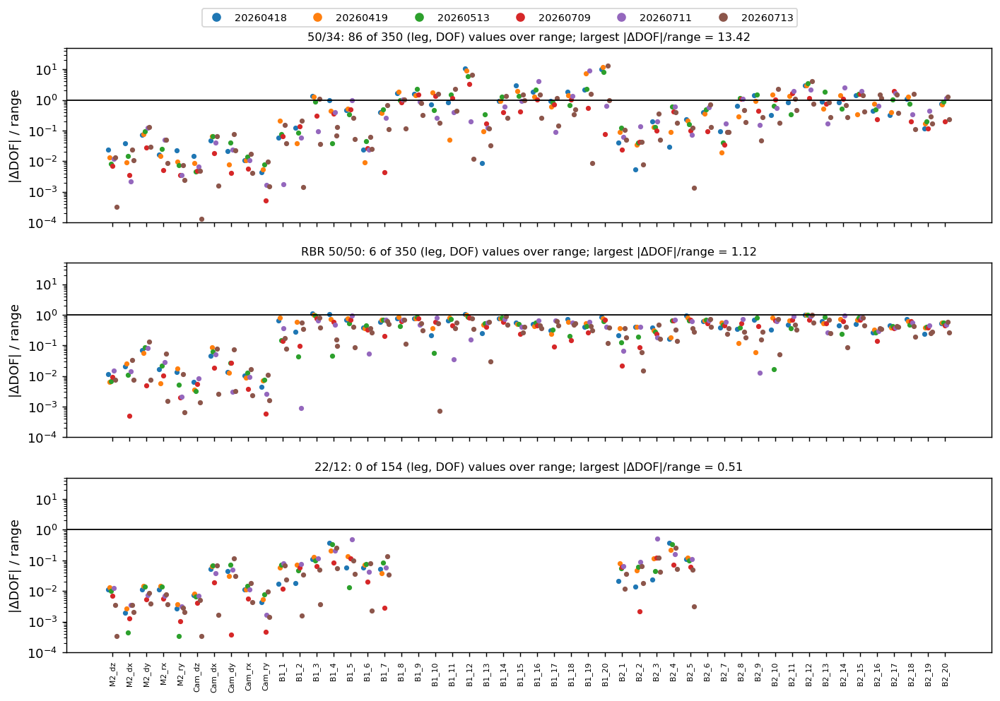

*Figure 5. |ΔDOF| / allowed range per DOF, one point per (night, leg), for 50/34, RBR 50/50
and 22/12. Ranges are those of the shipped normalization.*

**M2 dz against camera dz.** In every scheme, the M2 and camera hexapod dz are anticorrelated
over the MC draws, with r = −0.99 to −1.00 on every leg (Figure 6). The data fix their sum to
within 1.5–5.7 µm, but not their difference, which carries most of the amplitude: up to
141 µm each, opposite in sign. Moving both hexapods together in dz is a near-null direction. The
scheme then sets the difference through whatever else it fits:
- 50/34 and RBR 50/50 give M2_dz from −141 to −38 µm at 40 deg;
- 22/12 gives +59 to +78 µm there.
- The schemes agree in sign only at 50 deg (−70, −87 and −73 µm). At 75 deg all three are
  within 2 µm of zero.
- Under 22/12 the difference follows B1_3 and B2_5, whose DZ(1,11) and field coma it
  cancels.

No single hexapod dz therefore shows the elevation trend of focus, DZ(1,4). A focus LUT must
fit the combined focus mode (v1), not M2_dz or Cam_dz alone.

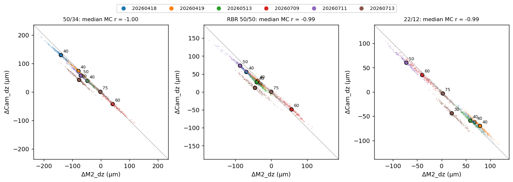

*Figure 6. ΔM2_dz against ΔCam_dz per leg (large points, labelled by B elevation in deg),
with 200 MC draws each (small points), for the three schemes. The grey line is
ΔM2_dz + ΔCam_dz = 0.*

**Per-DOF LUT.** An LUT fitted DOF by DOF to the RBR 50/50 results did worse than no
correction at 5 of 7 points (study Log, 2026-10-28). The fitted DOF are strongly correlated,
so their separate medians are not a consistent state.

### 4.2 What 22/12 leaves

22/12 leaves 0.056 of the ΔDZ power over all legs, against 0.022 for RBR 50/50
(dimensionless, residual² over ΔDZ²). Per leg it leaves 0.029–0.106, and 20260418 at 40 deg
and 20260709 at 60 deg are worst (Figure 7).
- What remains is in terms that 12 modes do not reach. One example is DZ(5,5): 0.05–0.07 µm
  at 40 and 30 deg, with a 22/12 fit of 0 (Figure 4).
- The diagonal chi2 of the residual is 157–2132 for 114 dof (126 terms − 12 modes),
  against 114–1514 for 76 dof under RBR.
- So neither scheme fits ΔDZ to its noise. The 22/12 residual is a real wavefront change
  that 22/12 does not correct.

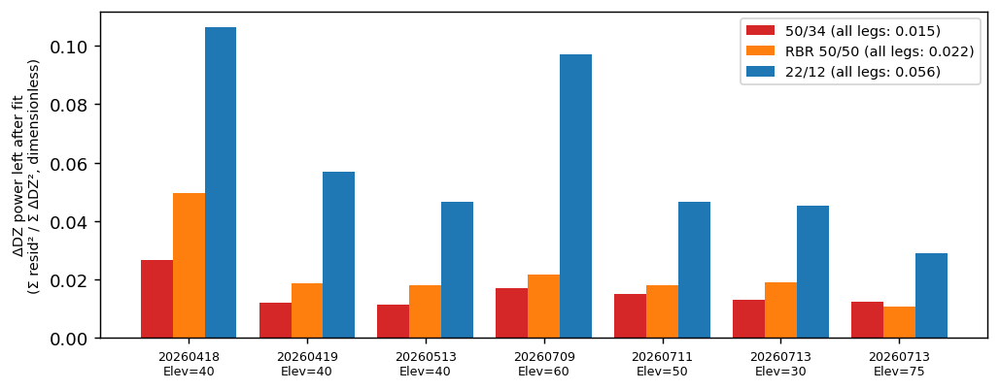

*Figure 7. Fraction of ΔDZ power left after the fit, per leg, for the three schemes
(dimensionless, Σ residual² / Σ ΔDZ² over the 126 terms).*

## 5. 22/12 results

The 22/12 ΔDOF (Figures 8, 9) and v-modes (Figure 10) are read from the `bounce_aba`
product, variant `d13-batoid-22_12`, build 20261121. Translations and bending amplitudes
are in µm and hexapod tilts in deg. Errors are the MC standard deviation.

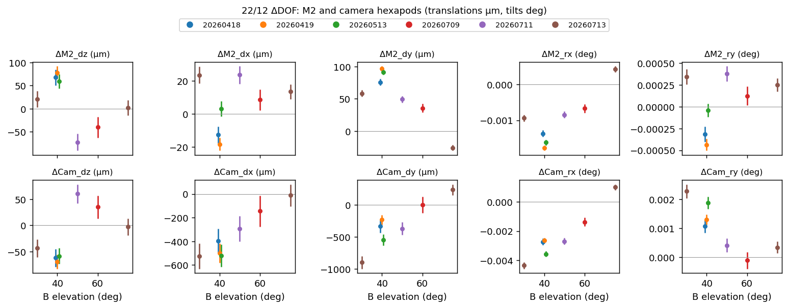

*Figure 8. 22/12 ΔDOF of the M2 and camera hexapods against B elevation.*

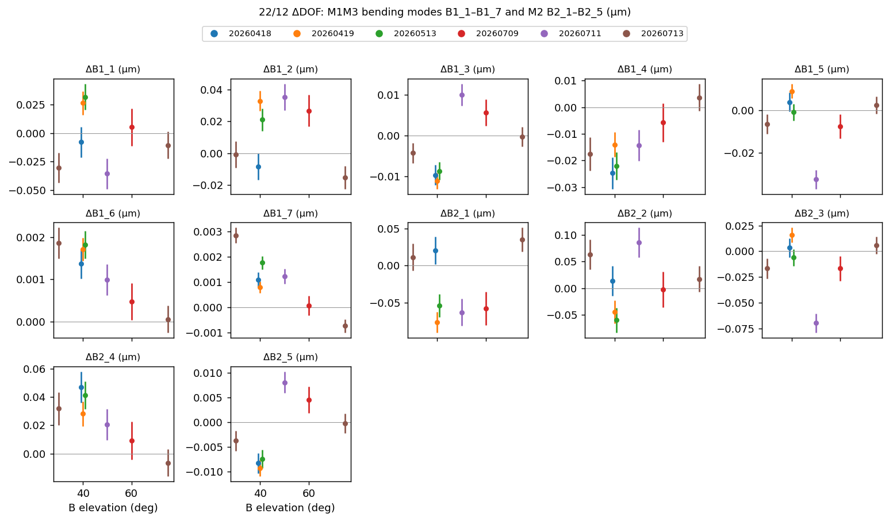

*Figure 9. 22/12 ΔDOF of the M1M3 (B1_1–B1_7) and M2 (B2_1–B2_5) bending modes, µm.*

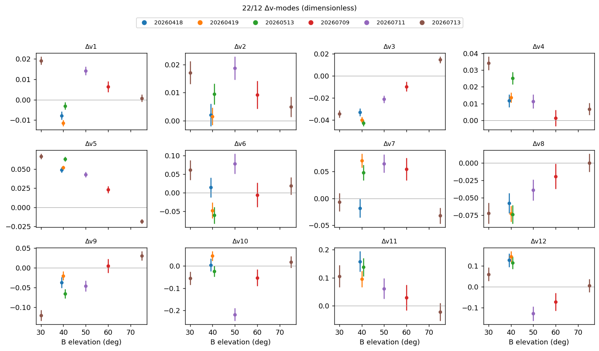

*Figure 10. 22/12 Δv-modes (dimensionless).*

**Trends with elevation.** Several DOF have one sign at every B elevation below the 70 deg
reference, and the opposite sign or about zero at 75 deg. The camera terms grow towards
30 deg; M2_dy and M2_rx are largest at 40 deg.

| DOF | 30 deg | 40 deg (3 nights) | 50 deg | 60 deg | 75 deg | typical error |
|---|---|---|---|---|---|---|
| Cam_dx (µm) | −525 | −398, −498, −521 | −293 | −145 | −12 | 80–130 |
| Cam_dy (µm) | −900 | −337, −232, −548 | −369 | +3 | +236 | 77–126 |
| Cam_rx (deg) | −0.0044 | −0.0027, −0.0026, −0.0036 | −0.0027 | −0.0014 | +0.0010 | 0.0002–0.0003 |
| M2_dy (µm) | +58 | +76, +97, +91 | +49 | +36 | −26 | 4–6 |
| M2_rx (deg) | −0.0009 | −0.0014, −0.0018, −0.0016 | −0.0008 | −0.0007 | +0.0004 | 0.0001 |
| B1_6 (µm) | +0.0019 | +0.0014, +0.0017, +0.0018 | +0.0010 | +0.0005 | +0.0001 | 0.0003–0.0004 |
| B1_7 (µm) | +0.0028 | +0.0011, +0.0008, +0.0018 | +0.0012 | +0.0001 | −0.0007 | 0.0002–0.0004 |

The v-modes v3, v5 and v8 follow the same smooth pattern (Figure 10).

Some quantities are not monotonic in elevation:
- M2_dz and Cam_dz, the near-null pair of section 4.1;
- B1_1, B1_2, B2_1 and B2_2.

The 50 deg night (20260711) departs from the trend in DZ(1,10), B1_5, B2_3, v10 and v12. It
is one of two r-band nights; the other, 20260713, does not depart, so the band does not
explain it.

**Agreement of the three 40 deg nights.** Repeat measurements at 40 deg disagree beyond
their errors. The test is chi2 about the weighted mean of the three nights (dof = 2). The
p = 0.01 threshold is 9.21.

| quantity | median chi2/dof | fraction above 9.21/2 | largest |
|---|---|---|---|
| 22 DOF | 5.1/2 | 0.32 | B2_1 17.9/2, B1_2 15.8/2, M2_ry 15.7/2 |
| 12 v-modes | 5.0/2 | 0.25 | v7 17.3/2, v1 12.7/2, v5 10.8/2 |
| 126 DZ terms | 3.9/2 | 0.17 | DZ(2,5) 28.8/2, DZ(3,10) 27.9/2, DZ(2,4) 21.1/2 |

DZ(1,4) has 13.3/2. The noise model describes the scatter within a night (section 3), so the
night-to-night difference is real. Its cause might be a different starting state, the
temperature, or a hysteresis that depends on the slew history; these data cannot tell which.
In DZ(1,4) it would take an extra 0.060 µm per night, in quadrature, to bring chi2/dof
to 1.

## 6. Conclusions

1. **The A–B–A difference removes the in-night drift.** At 40 deg, the paired difference
   gave chi2/dof = 262/2 between nights in DZ(1,4); with A–B–A and its noise model this falls
   to 13.3/2. Within one night the model fits the scatter (DZ(1,4) chi2/dof from 0.12/2 to
   5.74/6 per leg).
2. **50/34 recovers amplitudes beyond range.** It puts 86 of 350 (leg, DOF) values over
   range, up to 13.4 times the range in B1_20. RBR 50/50 removes nearly all of them (6 over,
   at most 1.12 times), and 22/12 none, while RBR leaves only 0.022 against 0.015 of the ΔDZ
   power.
3. **M2 dz against camera dz is not measured.** In every scheme the pair is anticorrelated at
   r ≈ −0.99. The data fix the sum to a few µm, but the split of 40–140 µm each depends on
   the scheme and flips sign between 22/12 and the 50-DOF schemes at 30, 40 and 60 deg.
   Focus LUTs must be built on the combined mode, not per hexapod.
4. **The 22/12 state follows elevation.** Most of the change has one sign below the 70 deg
   reference and the opposite sign, or about zero, at 75 deg. The largest parts:
   - the camera decentres, Cam_dy −900 ± 99 µm and Cam_dx −525 ± 107 µm at 30 deg;
   - the tilts about x, Cam_rx −0.0044 ± 0.0002 deg at 30 deg and M2_rx −0.0014 to
     −0.0018 deg at 40 deg;
   - M2_dy, +76 to +97 µm at 40 deg.
5. **22/12 leaves 0.056 of the ΔDZ power over all legs**, against 0.022 under RBR 50/50
   (dimensionless). The residual is above the noise on every leg (diagonal chi2 157–2132 for
   114 dof).
6. **The 40 deg nights disagree beyond their errors** (median chi2/dof = 5.1/2 over the
   22 DOF; 32% of the DOF above p = 0.01). A per-elevation LUT built from one night is
   therefore uncertain by about the night-to-night spread, which is about 0.06 µm for
   DZ(1,4).

**Open:**
- the cause of the 40 deg disagreement between nights;
- an LUT fitted in v-mode or wavefront space rather than DOF by DOF;
- a repeat with updated processing of the bounce runs.

## Provenance and data

See [`provenance.md`](provenance.md). Every figure is made by `make_figures.py` from the
`bounce_aba` and `fam_tables` products; `figures/numbers.json` holds every number quoted
here.
