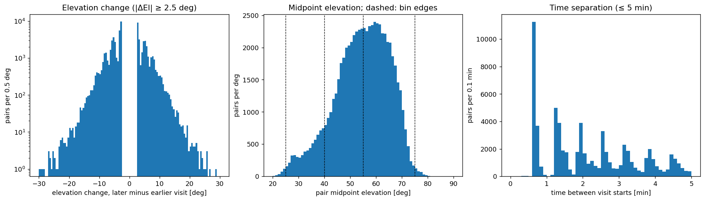
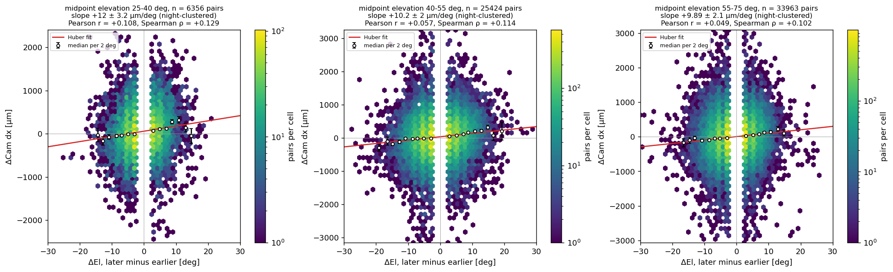
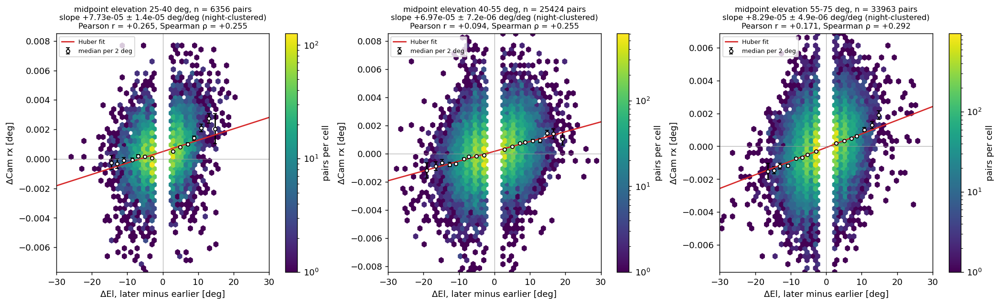
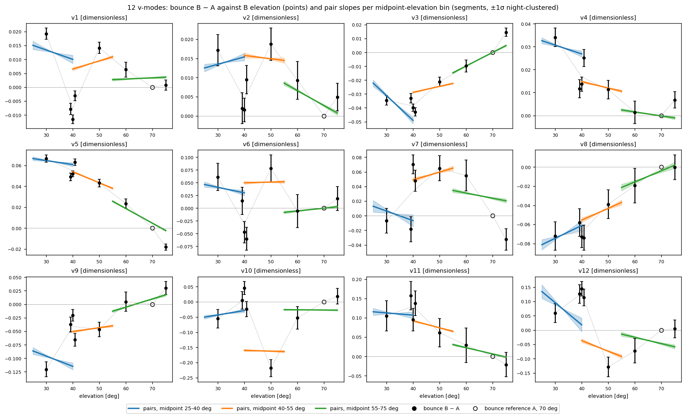
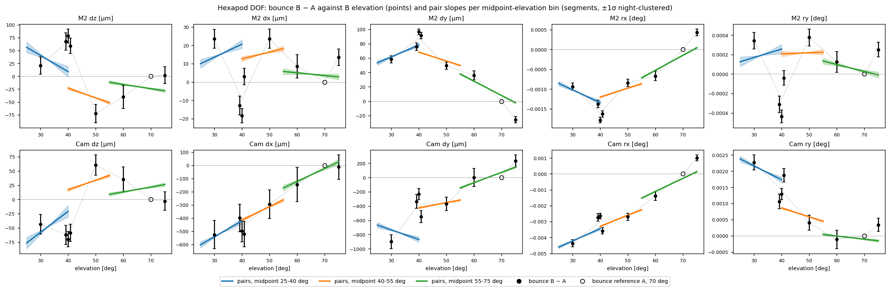
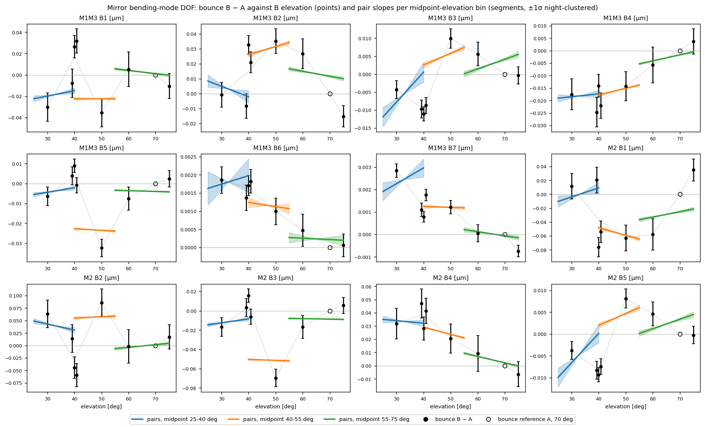

# Elevation dependence of the open-loop optical state from science visit pairs

> **Status:** draft · **Last updated:** 2026-11-22 · **Kind:** note (Slack post / tech-note draft)

## Summary

The Rubin Active Optics System (AOS) applies a hexapod look-up table (LUT) in elevation
and closes the loop on the corner wavefront sensors (CWFS). This note measures what the
LUT leaves uncorrected. It uses pairs of science visits taken minutes apart that differ
mainly in elevation. The quantity measured is the open-loop optical state, Deviation −
Trim, in the 22-DOF, 12-mode (22/12) basis. It is compared with the BLOCK-T720 A–B–A
elevation bounce test, recovered in the same basis.

- 66,306 visit pairs on 107 nights, 20251209 to 20260713, all after the last LUT change.
- Camera dx and camera rx give the largest and steadiest slopes: +10 to +12 µm per deg of
  elevation and +7 to +8 × 10⁻⁵ deg per deg, in all three elevation bins.
- Integrated from 70 deg down to 30 deg, the pairs give camera dx −421 ± 54 µm and
  camera rx −0.0031 ± 0.0002 deg. The bounce test gives −525 ± 107 µm and
  −0.0044 ± 0.0002 deg.
- Over the 12 v-modes and 22 DOF, 31 of the 38 bounce slopes that are above 3σ have the
  same sign as the pair slope. The pair slopes are smaller, with a median pair/bounce slope
  ratio of 0.14 (dimensionless).
- v-mode 1 (v1) and the defocus term DZ(1,4) disagree. The pairs give almost no net v1
  change from 70 deg to 30 deg, while the bounce gives +0.019 (dimensionless).

## 1. Method: paired science visits

Two science visits on the same night form a pair when:

| cut | value |
|---|---|
| time between visit starts | ≤ 5 min (the visits need not be consecutive) |
| azimuth change, wrapped to ±180 deg | \|ΔAz\| < 5 deg |
| camera rotator angle change | \|ΔRot\| < 5 deg |
| band | unchanged |
| elevation change | \|ΔEl\| ≥ 2.5 deg |
| nights | day_obs ≥ 20251209, the last hexapod LUT change |
| excluded nights | 20251210, 20251211, 20251212, 20251214, 20251216, 20251218, 20251219, 20260115, 20260116 (a different LUT setting) |
| wavefront | Danish 1.3 corner Zernikes on all four corner rafts at both visits |

Pointing, band and image type come from the Consolidated Database (ConsDB). Holding
azimuth, rotator angle and band fixed leaves elevation as the main change across a
pair. The short time separation limits thermal drift.

The sample:

- 72,669 science visits on 138 nights pass the night selection.
- 75,248 pairs pass the cuts, and 66,306 of them have a wavefront state at both visits.
  They span 107 nights and 42,321 distinct visits.
- A visit is in 3.1 pairs on average, so pairs are not independent. There are 633 pairs
  per night (median).
- Bands: i 17,815, z 16,091, y 12,839, r 11,410, g 5,545, u 2,606 pairs.
- Most pairs come from survey blocks: BLOCK-407 has 50,294 pairs, BLOCK-421 6,588 and
  BLOCK-419 6,528.
- The median time between visit starts is 1.9 min, and the median \|ΔEl\| is 4.7 deg.
- \|ΔEl\| distribution: 37,123 pairs at 2.5–5 deg, 25,259 at 5–10 deg, 3,826 at
  10–20 deg and 98 above 20 deg.

The fits are done in three bins of the pair's midpoint elevation, (El₁ + El₂)/2. The
bins are 25–40 deg (6,356 pairs), 40–55 deg (25,424 pairs) and 55–75 deg (33,963 pairs).
563 pairs fall outside 25–75 deg and are in no bin.

## 2. Optical state: Deviation − Trim

For each visit, two sets of degrees of freedom (DOF) are combined:

- **Trim**: the DOF correction commanded by the AOS. It is read from the Engineering
  Facilities Database (EFD) topic `MTAOS.logevent_degreeOfFreedom` as of the visit start,
  through the `value_added` DuckDB database of per-exposure telemetry. Its units are µm,
  and deg for hexapod tilts.
- **Deviation**: the DOF recovered from the wavefront measured on the corner sensors in
  the same visit.

The open-loop state is **Deviation − Trim**: the wavefront the telescope would have had
with the loop open. It does not include the hexapod LUT, which is applied in both visits.
Its change across a pair is therefore the part of the elevation dependence that the LUT
leaves uncorrected. The A–B–A bounce test measures the same quantity with the same sign.

The deviation comes from this processing:

| step | setting |
|---|---|
| wavefront estimation | Danish 1.3 (`danish_1_3_0`) |
| corner task | blitz (`donutBlitzCornerResults`), unpaired: each corner half-chip fitted on its own |
| binning, pupil model | 2 × 2 binned images, v3.14 pupil model |
| processing run | RSO-1071 science reprocessing, collection `LSSTCam/runs/aos/cwfs/danish_1_3_0/wep_blitz_rso1071/dv_blitz_rso1071/bin_x2/unpaired/donutBlitz` |
| product | `cwfs_science` variant `d13-blitz_rso1071`, build 20261026 |
| donut selection | the product's quality cut: a pipeline candidate with a successful (`ok`) fit and finite SNR, blur and Zernikes |
| per half-chip | median Zernike over the selected donuts, minus the intrinsic (batoid model) wavefront, in the Optical Coordinate System (OCS) |
| per raft | mean of the extra-focal (SW0) and intra-focal (SW1) half-chips; a raft needs both |
| state recovery | `aos_state.recover_optical_state`, ts_ofc v13 sensitivity matrix, DOF set `standard_22`, 12 v-modes kept (22/12) |

The 22 DOF are:
- the 10 hexapod DOF: M2 and camera dz, dx, dy (µm) and rx, ry (deg);
- M1M3 (primary/tertiary mirror) bending modes B1–B7 (µm);
- M2 (secondary mirror) bending modes B1–B5 (µm).

The v-modes are the 12 singular vectors of the normalized sensitivity matrix in that
DOF set (dimensionless).

**Fit.** For each quantity X (a v-mode or a DOF), the change ΔX = X(later visit) −
X(earlier visit) is fitted against ΔEl with a Huber robust line,
ΔX = a + b ΔEl, using statsmodels `RLM` with `HuberT`. The slope b, in units of X per deg,
is the elevation derivative at the bin's midpoint elevation.

**Errors.** Pairs share visits and nights, so the formal Huber errors are too small. The
errors quoted are night-clustered sandwich errors, which treat each night as one
independent unit. A 200-resample night bootstrap of v1 and DZ(1,4) agrees with them to
within 10%. The clustered errors are 2.3 to 7.3 times the formal ones (dimensionless
ratio, over all quantities and bins).

## 3. Examples: camera dx and camera rx

Camera dx and camera rx show the clearest elevation dependence. Their slopes are about the
same in all three bins, so the LUT residual in these two DOF is close to linear in
elevation.

| midpoint elevation [deg] | camera dx slope [µm/deg] | camera rx slope [10⁻⁵ deg/deg] |
|---|---|---|
| 25–40 | +12.0 ± 3.2 | +7.7 ± 1.4 |
| 40–55 | +10.2 ± 2.0 | +7.0 ± 0.7 |
| 55–75 | +9.9 ± 2.1 | +8.3 ± 0.5 |

Single-pair scatter is large: the camera dx change has a spread of about ±1000 µm at fixed
ΔEl. The slope is still well measured, because there are tens of thousands of pairs. The
correlations are weak: for camera dx, Pearson r is +0.05 to +0.11 and Spearman ρ is
+0.10 to +0.13 (n as in each panel).

## 4. Comparison with the A–B–A bounce test

The bounce test is BLOCK-T720, an elevation sweep with the loop frozen. Its reference
visits (A) are at 70 deg, and between them are test visits (B) at 30, 40, 50, 60 and 75 deg.

- Each leg is B − A, with A interpolated in time to the B visit. It is measured from Full
  Array Mode (FAM) double Zernikes (DZ) with the batoid intrinsic subtracted.
- The leg is recovered in the same 22/12 basis, from the `bounce_aba` product, variant
  `d13-batoid-22_12`, build 20261121.
- The errors come from a Monte Carlo noise model fitted to the same visits.
- The legs were taken on six nights: 40 deg on 20260418, 20260419 and 20260513, 60 deg on
  20260709, 50 deg on 20260711, and 30 and 75 deg on 20260713.

In each panel below, the black points are the bounce B − A values, and the open circle is
the 70 deg reference, zero by definition. Each coloured segment is a pair slope. It spans
its midpoint-elevation bin and is anchored on the bounce curve, interpolated at the bin
centre, so only its slope is compared. The bands are ±1σ.

Bounce slopes between legs were computed at 30–40, 40–50 and 60–70 deg, with the three
40 deg nights averaged. They were compared with the pair slopes in the 25–40, 40–55 and
55–75 deg bins. Of the 38 bounce slopes above 3σ, 31 have the pair slope's sign. The
median pair/bounce slope ratio is 0.14 (dimensionless).

Pair slopes summed from 0 at 70 deg down to 30 deg, against the 30 deg bounce leg:

| DOF or mode | unit | pairs | bounce, 20260713 |
|---|---|---|---|
| camera dx | µm | −421 ± 54 | −525 ± 107 |
| camera rx | deg | −0.0031 ± 0.0002 | −0.0044 ± 0.0002 |
| camera ry | deg | +0.0010 ± 0.0002 | +0.0023 ± 0.0002 |
| M2 dy | µm | +32 ± 5 | +58 ± 5 |
| camera dy | µm | −194 ± 64 | −900 ± 99 |
| M2 dz | µm | +73 ± 16 | +21 ± 17 |
| camera dz | µm | −75 ± 16 | −44 ± 17 |
| v1 | dimensionless | −0.002 ± 0.002 | +0.019 ± 0.002 |

Camera dx agrees within errors. Camera rx, camera ry and M2 dy have the right sign at 50%
to 70% of the bounce value. Camera dy and v1 disagree. In the 22/12 basis, M2 dz and
camera dz each change by many tens of µm in opposite directions, and their sum sets v1;
the pairs and the bounce split that sum differently.

## 5. Caveats

- **The bounce legs come from different nights.** Only 20260713 has two legs, 30 and
  75 deg. A bounce slope between legs mixes elevation with night-to-night changes. The
  zigzag at 40 deg in v1 and several DOF suggests this effect.
- **The wavefront sensors differ.** The pairs use the four corner sensors in science
  visits, and the bounce uses FAM on the science sensors. Both are fitted in the same
  22/12 basis, but the corner sensors constrain the field dependence less well.
- **At 55–75 deg the small-ΔEl pairs depart from the line.** The DZ(1,4) slope there is
  −0.0020 ± 0.0007 µm of wavefront per deg at \|ΔEl\| 2.5–5 deg, against
  +0.0004 ± 0.0007 at 5–10 deg. This bin holds half the pairs, so its slopes for v1 and
  the dz DOF should be read with that in mind.
- **DZ in the pairs is a projection.** It is S(k,j) times the 22 recovered DOF, where S is
  the sensitivity matrix, so it holds only the 12-mode part of the measured wavefront.

## Provenance

Products, builds, code versions and how to regenerate the figures are in
[provenance.md](provenance.md). The analysis is the `aos/elevation_pairs` study.
