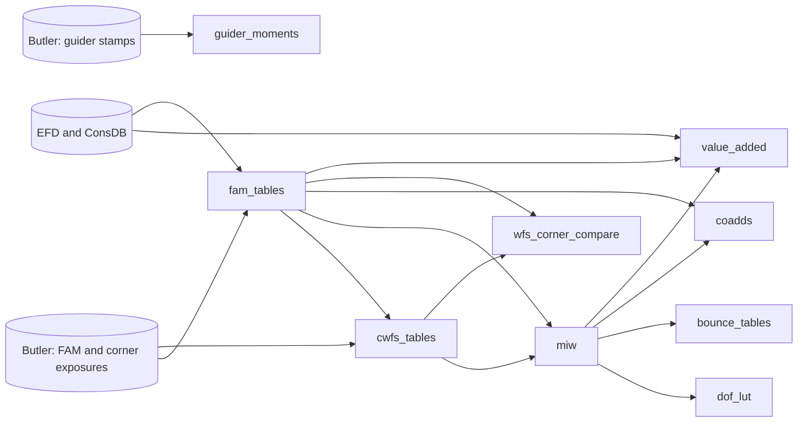

# Product catalog

> **Status:** current · **Last updated:** 2026-10-25 · **Kind:** reference (catalog)

What each product is, what builds it and how to read it. The detail is in each product's
package docstring (`rubinwork/products/<name>/__init__.py`). Generated companions:

- [`PRODUCTS.md`](../../PRODUCTS.md): every variant and build, with current build and size.
- [`PRODUCT_MAP.md`](../../PRODUCT_MAP.md): the product graph, each variant's recorded
  inputs, and every study and piece of code that reads each product.

A **product** writes data in variants and dated builds, each closed by a `manifest.json`.
Read one only through `rubinwork.products.catalog` or the product's own reader, never by
building a path. A configuration change is a new variant in the product's
`variants.yaml`. No build moves `current`; that is
`python -m rubinwork.products.catalog set-current <product> <variant> <build>`.

Data root: `/sdf/group/rubin/u/roodman/LSST/rubin-work/products/` (`$RUBINWORK_DATA`).

## How they connect

`miw` reads `cwfs_tables` only to write its corner sidecar
(`wfs/<cwfs variant>/zk_intrinsic.parquet`). `value_added` reads `fam_tables` and `miw`
for its `fam_dz` and `optical_state` tables, and `fam_tables` reads `value_added` back for
the M1M3 gradients it attaches to `visits.parquet`.

## The products

| product | what it is | built by | variants (current) | read with |
|---|---|---|---|---|
| `fam_tables` | Full Array Mode (FAM) per-donut, per-visit and Double Zernike (DZ) fit tables: `donuts`, `visits`, `fits.parquet` | `fam_tables/Snakefile` (Butler mktable, fit, attach telemetry); `builders/refit_build.py` for a cut-only rebuild | one per processing: `danish_1_2`, `danish_1_3`, `danish_1_3_test`, `danish_1_3_v1000` | `fam_tables.load(variant)` |
| `cwfs_tables` | Corner wavefront sensor (CWFS) donuts from each FAM triplet's in-focus exposure, tagged with the paired FAM visit | `cwfs_tables/Snakefile` (`run_wfs_mktable`) | one per CWFS processing: `d12-refitWcs`, `d12-ai_donut`, `d12-paired_3mm`, `d12-tarts`, `d13-blitz_unpaired` | `cwfs_tables.load(variant)` |
| `miw` | Measured Intrinsic Wavefront: per-rotator-bin grids, OCS/CCS split, per-donut sidecars (FAM and CWFS) and the MIW-subtracted DZ refit | `miw/Snakefile`, running `ts_intrinsic_wavefront`'s `bin/` runners | `<fam short code>-<scheme>`: `d12-A_50_34_i`, `d12-A_50_34_i_5rot`, `d13-A_50_34_i(_5rot)`, and the old-tree `d13t-*`, `d13v1000-*` arms; external `official-*`, `staged-v1` | `miw.load(variant)`, `miw.load_maps(...)` |
| `dof_lut` | The averaged degree-of-freedom look-up table, from the MIW refit DZ through the sensitivity-matrix SVD | `dof_lut/Snakefile` (`run_build_lut`) | one per MIW variant: `d12-A_50_34_i`, `d12-A_50_34_i_5rot` | `dof_lut.load(variant)`; mode counts with `dof_lut.build_metadata` |
| `bounce_tables` | Paired optical-state change across the T720 and T724 bounces, per DZ term, v-mode and DOF, under five recovery schemes | `bounce_tables/Snakefile` (`rubinwork.bounce.analysis`) | one per MIW variant: `d12-A_50_34_i`, `d12-A_50_34_i_5rot` (`_july` old tree) | `bounce_tables.load(variant)` |
| `coadds` | Per-FAM-block MIW remnant maps and metrics against the MIW | `coadds/Snakefile` (`run_coadd_blocks_miw`) | one per MIW variant and block selection: `d12-A_50_34_i_5rot`, `d13-A_50_34_i_5rot` (`_v2` old tree) | `coadds.load(variant)` |
| `wfs_corner_compare` | CWFS against FAM wavefront at each corner, with per-corner Huber fits and correlations | `wfs_corner_compare/Snakefile` (`rubinwork.corner_compare`) | one per CWFS variant: `d12-refitWcs`, `d13-blitz_unpaired` current | `wfs_corner_compare.load(variant)` |
| `value_added` | DuckDB database of per-visit EFD telemetry, recovered optical state and FAM DZ projections (`visit_telemetry`, `optical_state`, `fam_dz`, `m1m3_thermal_r2`) | builders in `value_added/builders/` write `v1/live`; a snapshot is copied to `v1/snapshots/<date>` and set current | `v1` | `rubinwork.products.value_added.reader` (`load`, `visits`, `fam_dz`, `optical_state`) |
| `guider_moments` | Per-night guider-sensor second and third moments, star tables and metrics | `guider_moments/Snakefile`, one night at a time | schema versions: `v6` (built), `v4` (copied, 20260512–20260712); nights are partitions, no `current` | `guider_moments.load_night(night)`, `guider_moments.nights()` |

## Where to start

- Rebuilding after a change upstream: [`PRODUCT_MAP.md`](../../PRODUCT_MAP.md), "Readers
  by product", lists what reads the product you changed.
- Which studies a product change affects: the same file's last table, which also marks a
  study whose code reads a product its `uses:` does not declare.
- A product's schema and build steps: its package docstring.
