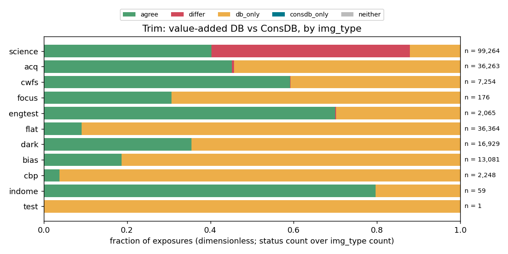
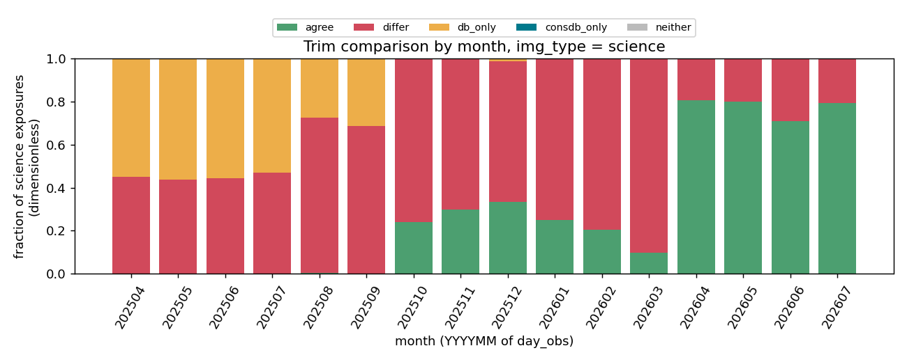

# `compare_trim_consdb`

> **Status:** active · **Last updated:** 2026-10-20 · **Kind:** study

## Question

Where and why does the ConsDB transformed-EFD Trim (mt_logevent_aggregated_dof) differ from the value-added database Trim, now that ConsDB is backfilled for all nights?

## Current answer

The two databases apply different rules to the same EFD events,
`lsst.sal.MTAOS.logevent_degreeOfFreedom` `aggregatedDoF0..49`:

| source | rule |
|---|---|
| value-added DB `visit_telemetry.dof0..49` | last event at or before `obs_start` |
| ConsDB `efd_lsstcam.exposure_efd_unpivoted`, property `mt_logevent_aggregated_dof` | `most_recent_value` over `[obs_start - 1 h, obs_end]` (`start_offset: -1`, `config_lsstcam.yaml`) |

Rebuilding both rules from the raw events reproduces **213,680 of 213,680** DB rows and
**121,515 of 121,515** ConsDB rows exactly (counts; agreement to rtol 1e-6). There are no
unexplained differences.

Outcomes over 213,704 exposures, `day_obs` 20250415 to 20260714 (counts):

| outcome | cause | count |
|---|---|---|
| agree | no event during the exposure | 74,000 |
| differ | an event during the exposure; ConsDB takes it | 47,514 |
| DB only | no event in `[start - 1 h, end]`, so ConsDB has none by design | 53,321 |
| DB only | an event in the window but no ConsDB row: backfill gap | 38,845 |
| ConsDB only | DB row has no Trim | 1 |
| neither | — | 23 |

- **Differences are a science-exposure effect.** 47,322 of the 47,514 `differ` exposures
  are `science`; `acq` has 178, the others 14 together. The AOS publishes a new Trim during
  the exposure. The event falls either in the first 10 s or near the end of a 30 s exposure
  (report page 6). Only 4 exposures had more than one event.
- **It changed in 2026-04.** Of science exposures with a value in both, 85.4% differ before
  2026-04 (37,990 of 44,465) and 21.8% from 2026-04 (9,332 of 42,800); the AOS event moved
  to before most exposures.

  

- **The difference is a full AOS step**, not noise: the median |ConsDB − DB| on camera
  hexapod dz (`dof5`) is about 10 µm (log10 |Δ| [log10 µm] peaks near 1).
- **The 1 h window drops calibrations by design.** Most `flat`, `dark`, `bias` and `cbp`
  exposures have no AOS event within 1 h, so ConsDB is NULL there; the DB carries the last
  Trim, however old.
- **ConsDB is still incomplete.** 67 of 366 nights have no ConsDB Trim at all, and 91 more
  are partial, mostly 2025-04 to 2025-09. These 38,845 exposures cover every img_type,
  including 2,961 `cwfs` and 18,404 `acq`. The science-only gate from the 2026-09
  20260513 notebook is gone: `cwfs` and `acq` now have rows.

**The DB value is the one that was physically applied.** MTAOS publishes the new Trim
during the exposure, but the hexapods are not commanded until after the shutter closes.
`MTHexapod.logevent_uncompensatedPosition` follows 0.09 to 1.82 s after `obs_end`, and
the measured `MTHexapod.application.position` follows 0.5 to 0.8 s after that. This held
on all 12 hexapod DOF checked, over 4 science exposures (see the 2026-10-19 hexapod log
entry). The ConsDB value is therefore the Trim for the *next* exposure whenever the event
came mid-exposure.

The time history on report page 9 is science exposure 2026042100703 (30 s): one event 28 s into the
exposure moves camera hexapod dx by about −65 µm and dy by about −67 µm. The DB keeps the
pre-exposure value and ConsDB the new one.

**Time-frame note.** The EFD influx index is already UTC. It equals `private_sndStamp`
(TAI → UTC) and `private_efdStamp`, checked on 2025-04-19. `select_time_series(...,
convert_influx_index=True)` shifts it 37 s early. With that shift neither database could
be reproduced (143,767 and 61,630 rows matched); without it both match exactly.
`rubinwork.common.dof_telemetry._asof_rows_by_night` (the hexapod LUT) and
`ess_telemetry` use `convert_influx_index=True`, which needs checking.

## Log

### 2026-10-19 — first full comparison

`code/fetch_inputs.py` (run `20261019_inputs`) reads the DB Trim from
`value_added=v1@snapshots/20261016`, the ConsDB exposure table and unpivoted Trim month by
month, and all 100,289 `degreeOfFreedom` events. `code/compare.py` (run `20261019_compare`)
classifies each exposure and explains it from the rebuilt rules. It writes
`comparison.parquet` and the CSV tables. Since the rerun below, it writes every figure
into one 10-page report, `20261019_report/compare_trim_consdb.pdf`:

| page | content |
|---|---|
| 1 | rules, reproduction counts, status and cause tables by img_type |
| 2 | status fraction by img_type |
| 3 | mismatch causes by img_type |
| 4 | science status fraction by month |
| 5 | DB vs ConsDB scatter and log10 abs(ConsDB − DB) for dof5, dof0, dof8, dof10 |
| 6 | when the ConsDB-chosen event fell within the exposure |
| 7–10 | EFD time histories: two science mismatches before 2026-04, two after | Both ran on sdfiana from a copy of `code/`
at commit `c00870c`.

The first pass used `convert_influx_index=True` and left 47k "unexplained" mismatches. A
−37 s shift made both rules match 100%, which traced to the index conversion (see the
time-frame note).

Rerun with the label `report`: one PDF in place of the scattered PNGs, per the
one-PDF-per-study rule. `20261019_compare` holds the earlier PNG output.

### 2026-10-19 — units, time scales, and when the in-exposure events land

**Hexapod tilt units are deg.** `aggregatedDoF3,4,8,9` equal
`MTAOS.{m2,camera}HexapodCorrection.u/v` and `MTHexapod.uncompensatedPosition.u/v`, both
documented in deg. The median ratio is 1 (dimensionless) on 2025-04-19, 2025-11-20,
2026-04-22 and 2026-07-11, which settles the conflicting documents. Recorded with the
sources in `aos/docs/telemetry.md` §7; `value_added/docs/schema.md` and the
`dof_telemetry` docstrings are corrected.

**Time scales.** ConsDB `obs_start`/`obs_end` are TAI (sdm_schemas). The EFD influx index
is UTC. Both databases compare `obs_start` → UTC with the raw index, which is correct.

**When the events land, science exposures by month.** The fraction of science exposures
with a `degreeOfFreedom` event between `obs_start` and `obs_end` (dimensionless) is 0.44
to 0.53 in 2025-04 to 2025-07, 0.66 to 0.90 in 2025-08 to 2026-03, and 0.19 to 0.30 from
2026-04. The median time from `obs_end` to the next event is 10 to 34 s in 2025-06 to
2026-03 and 42 to 45 s from 2026-04. It is 38 s in 2025-04 and 2025-05.

There is no break at 2025-11/12. These are MTAOS Trim events, not hexapod LUT updates. A
LUT update during an exposure would appear in `MTHexapod.compensationOffset`, which this
study does not read. The event's own `visitId` (the visit the correction was derived from)
would give the latency directly; not yet used.

### 2026-10-19 — does the hexapod move when the Trim changes mid-exposure?

`code/hexapod_response.py` (run `20261019_hexapod`, `hexapod_response.pdf`, 13 pages)
takes the four science mismatches of the report and the three hexapod DOFs per exposure
with the largest Trim step at the in-exposure event. Steps under 1 µm or 5e-5 deg are
skipped. Each DOF gets one page, with two panels:

- **top:** `MTAOS.logevent_degreeOfFreedom.aggregatedDoF<i>` with
  `MTHexapod.logevent_uncompensatedPosition.<axis>`;
- **bottom:** measured `MTHexapod.application.position<k>`, commanded `demand<k>`,
  `MTHexapod.logevent_compensatedPosition.<axis>`, and `inPosition` state changes.

Times in s; "moves" is the first sample half way to the new value:

| exposure | Trim event after obs_start | hexapod commanded after obs_end | position moves after Trim event |
|---|---|---|---|
| 2025092100134 | 0.65 | 0.26 | 31.04 to 31.31 |
| 2026022700235 | 8.64 | 0.09 | 22.89 to 23.04 |
| 2026042100703 | 28.52 | 0.09 | 3.07 to 3.20 |
| 2026071100146 | 7.20 | 1.82 | 26.31 to 26.38 |

In every case the hexapod holds its pre-exposure position through the exposure. It moves
only after `obs_end`, however early in the exposure MTAOS published the new Trim. The AOS
update is recorded at once but applied later, so the value-added DB Trim (as of
`obs_start`) describes the exposure, and the ConsDB Trim does not when the two differ.

On 2025092100134 (2025-09) `compensatedPosition` also publishes repeatedly during the
exposure, while the measured position stays flat. Those are LUT re-evaluations at an
unchanged value, not moves. Four exposures are a sample, not a census; a census would
use every `differ` exposure.

### 2026-10-20 — census mode, tested on one night

`hexapod_response.py --census` covers every `differ` exposure of `comparison.parquet`, one
EFD query per night and hexapod. It records the delay from `obs_end` to the first
`MTHexapod.logevent_uncompensatedPosition` after the in-exposure Trim event, and the
change in measured `application.position` (1 s server-side means, last minus first full
bin inside the exposure). An axis "moved" if that change exceeds 5 × its census nMAD and
1 µm or 5e-5 deg. The EFD allows at most 20,000 buckets per query, so `application` is
read in 5 h chunks.

Test, `day_obs` 20260421 (run `20261020_hexapod_census_test`): 133 `differ` exposures.
Both hexapods were commanded 0.05 to 0.32 s after `obs_end` (median 0.08 s). On all 266
exposure-hexapod pairs `uncompensatedPosition` equals the in-exposure Trim exactly. No
hexapod moved during an exposure (0 of 133). Run time 35 s per night.

The full census (about 300 nights, 2 to 3 h) is on hold until the intended
MTAOS–MTHexapod interaction is confirmed with Tiago or Sandrine.

Next: confirm the 37 s index issue on the LUT and ESS readers; rerun once ConsDB reports
the backfill is done.
